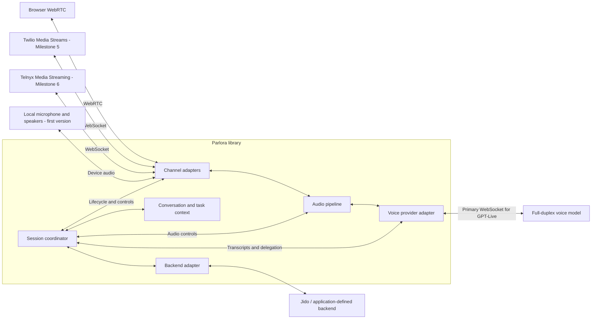

# Parlora — Initial Project Brief

**Status:** Initial design, before implementation  
**Date:** September 15, 2026  
**Language and runtime:** Elixir / Erlang OTP  
**Development toolchain:** Elixir `1.20.4-otp-29` / Erlang `29.1.2`

**Intended Hex package:** `parlora`  
**Elixir namespace:** `Parlora`

> The conversation flows. Your agents get things done.

## 1. The idea

Parlora is an Elixir library for building live voice applications with full-duplex models and independently chosen backend agents.

The voice model manages the spoken conversation: listening, speaking, responding to interruptions, and deciding when to request backend help. The backend agent handles reasoning, tools, workflows, and business logic. Parlora connects these responsibilities while keeping the conversation active during backend work.

The application developer chooses three adapters:

1. A **channel** for connecting the participant.
2. A **voice provider** for the full-duplex model.
3. A **backend** for delegated agent or application work.

**Every incoming and outgoing audio stream must pass through Parlora.** This includes browser audio. The library owns the audio bridge between the participant and the voice provider.

GPT-Live-1 is the first model and the focus of the initial implementation. Future providers, including NVIDIA PersonaPlex, should be possible through explicit capabilities and separate adapters.

The first version implements one participant channel: direct local microphone capture and speaker playback through CPAL and Rustler, with Rubato for PCM resampling. Pair it with GPT-Live-1 and Jido. Keep `Parlora.Channel` independent of local devices so applications and the subsequent browser adapter and the Twilio/Telnyx adapters can use the same session, provider, and backend contracts.

### GPT-Live reference baseline

The following references were read in full for this brief on September 15, 2026. Use them when resolving implementation questions, designing the first provider, and reviewing tests. GPT-Live-1 is the first voice model: validate its concrete path before generalizing for other providers.

| Reference | Use in Parlora |
| --- | --- |
| [GPT-Live-1 API launch post](https://openai.com/index/introducing-gpt-live-1-in-the-api/) | Full-duplex conversation, independent backend selection, interruption behavior, and voice customization. |
| [Getting started](docs/gpt-live-1/live.md) | Voice/backend responsibilities, client delegation choice, and connection topology. |
| [Managing sessions](docs/gpt-live-1/live-conversations.md) | Startup configuration, transcripts, context updates, microphone controls, storage, recovery, and final usage. |
| [Delegation and tools](docs/gpt-live-1/live-delegation.md) | Context ownership, delegation identifiers, verified results, corrections, typed input, and backend concurrency. |
| [Prompting](docs/gpt-live-1/live-prompting.md) | Short voice prompts, backchannels, interruptions, and explicit delegation conditions. |
| [Migration](docs/gpt-live-1/live-migration.md) | Adapting existing agents, separating Live from Realtime events, action reconciliation, and playback validation. |
| [Partner integrations](docs/gpt-live-1/live-partner-integrations.md) | Integration candidates and the need to verify each partner's actual Live support and media path. |

These local files are the supplied documentation snapshots. Follow their official links for missing protocol details and verify the current Live API contract before implementing wire messages. The additional [Live WebSocket guide](https://developers.openai.com/api/docs/guides/voice-websockets?api=live) establishes the primary connection and audio format contract used below. Shared guides also contain Realtime material; select the Live sections explicitly. Preserve project decisions such as routing all audio through Parlora when adapting upstream examples.

### Name and identity

Parlora is a coined name inspired by Italian *parlare*, “to speak,” and *ora*, “now.” The intended story is “conversation in the moment.” This is naming wordplay, rather than a literal Italian translation.

The exact package name `parlora` was unregistered in [Hex's public API](https://hex.pm/api/packages/parlora) when checked during project planning on September 15, 2026. This check does not reserve the name. An [unrelated voice product](https://parlora.ai/) also uses the name Parlora; the project name was selected with that existing use known.

## 2. Decisions already made

| Area | Decision |
| --- | --- |
| Audio ownership | All audio passes through the library in both directions. |
| Initial channel | Local audio is the only built-in participant channel for the first version. Expose a device- and transport-independent `Parlora.Channel` behaviour for application-defined and future adapters. |
| Browser connection (Milestone 4) | The browser connects to a WebRTC endpoint operated by Parlora. Parlora terminates that connection; the separate consumer demonstrates this channel. See [browser evidence](docs/browser-channel.md). |
| Twilio integration (Milestone 5) | Bidirectional Media Streams over WebSocket with μ-law/8 kHz passthrough; implementation and validation are tracked in [the Twilio report](docs/twilio-channel.md). |
| Telnyx integration (Milestone 6) | Incoming Voice API calls with authenticated bidirectional Media Streaming, PCMU/8 kHz and the existing OrderDesk application. Implemented with automated macOS/Linux and live-network evidence; see [the Telnyx report](docs/telnyx-channel.md). |
| Telephony scope | SIP integration is outside the initial scope. |
| Local audio | Support direct microphone capture and speaker playback on a machine. |
| First voice model | OpenAI `gpt-live-1`. |
| Delegation mode | GPT-Live client delegation, with backend execution owned by the application. |
| Credentials | The host application retrieves credentials and passes an explicit `api_key:` in the OpenAI provider options for each session. Runtime environment configuration is the default documented setup. On the development Mac, use the Keychain item labeled `keel-openai-development`; GPT-Live access was verified on September 15, 2026. |
| Token-limit handling | Keep text concise, validate structure and message counts locally, and treat provider acceptance/rejection as authoritative for token limits. Exact local counting is deferred until a GPT-Live-compatible tokenizer/counting contract is verified; no tokenizer dependency is required for the first version. |
| Backend integrations | Jido is the only built-in agent-framework integration for the initial version. Expose an agent-independent `Parlora.Backend` behaviour that applications and future adapters can implement. |
| Extensibility | Public behaviours for channels, voice providers, and backends. |
| Public interface baseline | Use the [initial public interface contract](docs/public-interfaces.md), derived from GPT-Live-1, Jido, and the local CPAL/Rubato bindings. Keep shared types independent of vendors and validate them with simulated adapters and the first real integration. |
| Initial packaging | One Mix project and one Hex package, `parlora`, with adapters organized as internal modules. Revisit package splitting only when concrete implementation or distribution needs justify it. |
| Runtime | Supervised OTP processes, with audio processing independent of backend execution. |
| Initial persistence scope | Keep sessions in memory. Expose lifecycle events and accept application-supplied history/context; defer a built-in durable store, serialization format, schema migration, and restoration API beyond the first version. |
| Runtime limits | Use finite, configurable job/queue bounds and cancellation/shutdown deadlines. Choose initial numeric defaults during implementation, test behavior at the limits, and tune from measurements; final values do not block development. |
| HTTP client | Use Mint (`mint`, `Mint.HTTP`) for Parlora's outbound HTTP requests. |
| WebSocket client | Use Mint.WebSocket (`mint_web_socket`) for Parlora's outbound WebSocket connections, including the primary GPT-Live connection. |
| Inbound HTTP/WebSocket | Use Bandit with Plug, WebSockAdapter, and WebSock for browser signaling and future telephony endpoints. The host application owns server configuration and routing; Parlora supplies reusable endpoint handlers. |
| Browser media (Milestone 4) | Use `ex_webrtc` for browser WebRTC and RTP, and a standalone Rustler NIF binding to `libopus` for Opus encoding/decoding and the browser Opus ↔ mono PCM16/24 kHz conversion. |
| PCM resampling | Use Rubato through Rustler when an adapter needs PCM sample-rate conversion, including local microphone capture and speaker playback. Channel mixing and sample-format conversion belong to Parlora's wrapper. |
| Local device I/O | Use CPAL through Rustler for microphone capture and speaker playback on macOS and Linux. |
| Audio orchestration | Parlora's supervised processes own buffering, pacing, and audio lifecycle. |
| Development versions | Use Elixir `1.20.4-otp-29` and Erlang `29.1.2` throughout development, pinned in `.tool-versions`. Consumer support starts at Elixir 1.18 / OTP 27; CI covers 1.18/27, 1.19/28 and 1.20/29 on macOS and Linux. |
| Development environment | The primary development machine is a macOS laptop. A Linux machine is available through `ssh linux` for Linux-specific validation when needed. |
| Initial operating systems | Target macOS and Linux, including the local microphone/speaker adapter. Initially use macOS for physical-device tests and Linux for virtual-loopback tests; physical Linux audio remains unverified. |
| Code quality tooling | Include Credo, ExSlop (`ex_slop`), ExDNA (`ex_dna`), Credence (`credence`), and Dialyzer through Dialyxir from the initial project setup. Run them locally and in CI. |

The initial callback signatures and types are defined in the linked interface contract and remain subject to implementation validation. Remaining dependency choices and native build/distribution details below still require implementation work. The decisions in this section, including the single-package structure, are requirements.

Development and code-quality checks target this exact toolchain. Consumer
compatibility also covers Elixir 1.18 / OTP 27 and Elixir 1.19 / OTP 28; see the
[compatibility policy](docs/beam-compatibility.md) for the matrix and validation scope.

Use the macOS laptop for routine development and local checks. Use `ssh linux` when validation requires Linux, confirming the remote toolchain matches the pinned versions before running project checks. Record the operating system used for platform-specific results. macOS and Linux are the initial target operating systems, including for the local microphone/speaker adapter. Use macOS hardware for physical microphone/speaker validation and Linux virtual loopback for initial Linux audio integration checks. Physical Linux audio remains unverified; macOS hardware tests do not establish Linux driver or device behavior.

## 3. A representative conversation

An application uses Parlora for customer support:

1. The caller asks, “Can you check delivery for order 123?”
2. The voice model acknowledges the request and delegates work.
3. Parlora assembles the relevant conversation and application context and invokes the backend.
4. While the lookup runs, the caller says, “Actually, order 124.”
5. Parlora records the correction and updates or supersedes the affected work.
6. The backend returns verified delivery information for order 124.
7. Parlora supplies a concise result to the voice model.
8. Generated audio travels back through Parlora to the caller.

The result for order 123 must not be presented as the answer to the corrected request. If a business action has already completed, the backend must reconcile that outcome with the correction; hiding an outdated result does not undo an action.

This example exercises the core problem: audio, conversation context, and business work advance concurrently.

## 4. Architecture



The diagram shows the initial local channel and future alternatives. Only local audio is implemented for the first version. Each session has one participant channel and one voice-provider session. A backend adapter may internally coordinate several agents or services.

There are two cooperating paths:

- **Audio:** channel adapter ↔ audio pipeline ↔ voice provider adapter.
- **Coordination:** session lifecycle, transcript context, delegated jobs, results, and playback controls.

Audio frames must not wait for a backend task to complete or pass through a blocking agent callback.

### Initial local audio topology

```text
Local microphone → CPAL capture → Parlora PCM conversion with Rubato
  → mono PCM16/24 kHz → GPT-Live provider WebSocket

GPT-Live generated mono PCM16/24 kHz → Parlora PCM conversion with Rubato
  → CPAL playback → local speakers
```

Parlora owns bounded buffering, pacing, and lifecycle in both directions. The local channel manages device formats and converts them to and from the agreed pipeline format. It runs on the machine with the audio devices; a remote Linux instance needs accessible hardware or virtual devices to use this channel. This path requires CPAL, Rubato, and Rustler, with Mint.WebSocket for the provider connection.

### Mandatory browser topology

```text
Browser microphone
  → WebRTC connection terminated by Parlora
  → Parlora audio pipeline
  → GPT-Live provider WebSocket

GPT-Live generated audio
  → Parlora audio pipeline
  → browser WebRTC connection
  → browser speakers
```

The browser negotiates with Parlora's media endpoint. Its SDP is not forwarded to OpenAI to establish a direct browser-to-provider media connection. A browser helper can handle microphone permissions, WebRTC signaling, playback, and captions.

For both the initial local channel and subsequent browser channel, Parlora owns the primary GPT-Live WebSocket, which carries both audio and model events. A separate provider sideband is not required for these topologies.

The [getting-started browser quickstart](docs/gpt-live-1/live.md#connect-your-first-session) describes direct browser-to-OpenAI WebRTC. Parlora's browser adapter instead terminates media at Parlora and uses the server-side primary WebSocket to OpenAI. Likewise, the [partner overview](docs/gpt-live-1/live-partner-integrations.md) is a compatibility reference: selecting a partner SDK must preserve this audio ownership and the chosen Twilio/Telnyx Media Streams paths.

### HTTP and WebSocket client implementation

Use [Mint](https://hex.pm/packages/mint) for outbound HTTP and [Mint.WebSocket](https://hex.pm/packages/mint_web_socket) for outbound WebSocket connections. The Hex dependency name for Mint.WebSocket is `mint_web_socket`.

Supervised connection processes own the client connection state and handle incoming socket messages, timeouts, WebSocket ping/pong, closing, and transport failures. Keep connection handling independent of backend execution and preserve the bounded-buffer requirements of the audio pipeline. Use `mint 1.11.0` and `mint_web_socket 1.0.6`. Resolve and lock the selected clients alongside the CPAL/Rubato/Rustler stack during project setup.

### Inbound HTTP and WebSocket implementation (later channels)

Use Bandit, Plug, WebSockAdapter, and WebSock for inbound browser signaling and Twilio/Telnyx Media Streams connections when those channels are implemented. Browser signaling is implemented in Milestone 4; Milestone 5 adds signed Twilio endpoints. Telnyx follows in the authorized Milestone 6.

| Component | Responsibility |
| --- | --- |
| Bandit (`bandit`) | Accept HTTP/HTTPS and WebSocket connections. |
| Plug (`plug`) | Compose endpoint routing, authentication, and request validation. |
| WebSockAdapter (`websock_adapter`) | Upgrade an accepted Plug connection to WebSocket. |
| WebSock (`websock`) | Define the callbacks implemented by Parlora's signaling and telephony handlers. |

The host application owns server startup, listener/TLS configuration, routes, and access policy. Parlora supplies Plug-compatible endpoint helpers and WebSock handlers that the application mounts in those routes. Authenticate and validate requests before upgrading, then associate the connection with its supervised Parlora session. Keep each channel's message protocol and lifecycle in its adapter. [Bandit](https://github.com/mtrudel/bandit), [WebSockAdapter](https://websock-adapter.hexdocs.pm/WebSockAdapter.html), [WebSock](https://websock.hexdocs.pm/)

Browser signaling exchanges SDP and ICE information with Parlora; `ex_webrtc` owns the resulting browser media connection. Telephony WebSockets carry each provider's audio and control envelopes. Mint and Mint.WebSocket continue to own outbound client transport, including the primary GPT-Live connection.

When implementing the first network channel, resolve and lock the latest stable compatible releases of the selected inbound packages and validate them on the pinned Elixir/OTP toolchain on macOS and Linux. The server stack is selected; its build and endpoint integration checks remain to be run.

## 5. Channels and audio handling

Local audio is the only built-in channel in the original Milestones 1–3. Milestone 4 adds the browser channel behind the same interface. Milestone 5 adds Twilio; Telnyx is authorized for Milestone 6.

### Browser (Milestone 4)

Parlora terminates browser WebRTC with `ex_webrtc` and processes Opus through a standalone Rustler NIF binding to `libopus`, owned by its supervised processes. Rustler provides the Elixir/native boundary and resource handling; the Rust wrapper uses `opusic-c` to call libopus. Implement signaling, connection establishment, codec handling, and network traversal around this stack.

| Responsibility | Selected component |
| --- | --- |
| Browser WebRTC and RTP | `ex_webrtc` |
| Opus encoding/decoding and conversion between browser Opus and mono PCM16/24 kHz | `libopus`, called through `opusic-c` in a Rustler NIF |
| Buffering, pacing, and audio lifecycle | Parlora processes |
| Primary GPT-Live WebSocket | `mint_web_socket`, using `mint` |

Use `ex_webrtc` for peer connections and libopus's direct codec APIs for the browser audio bridge. Configure the decoder to produce mono PCM16 at 24 kHz, including from stereo Opus input, and configure the encoder to consume mono PCM16 at 24 kHz. Libopus performs this conversion within the codec. Arbitrary PCM resampling, device audio, mixing, and conversion for other codecs belong to their respective adapters. [WebRTC implementation](https://github.com/elixir-webrtc/ex_webrtc), [libopus decoder API](https://opus-codec.org/docs/opus_api-1.6/group__opus__decoder.html), [encoder API](https://opus-codec.org/docs/opus_api-1.6/group__opus__encoder.html)

On input, order and deduplicate received RTP packets, apply the packet-loss policy, and decode their Opus payloads into mono PCM16 at 24 kHz for GPT-Live. On output, assemble provider PCM into valid codec frames, encode Opus, and send paced RTP through `ex_webrtc`. Parlora owns bounded queues, RTP sequence/timestamp progression, interruption controls, and shutdown; a codec library does not supply those policies. Opus RTP timestamps use a 48 kHz clock even when the PCM sample rate is 24 kHz. [Opus RTP format](https://www.rfc-editor.org/rfc/rfc7587.html#section-4)

Parlora owns the binding's integration, native resource lifecycle, packaging, and validation. Keep encoder and decoder state separate and serialize access through the owning audio process. Expose the codec controls needed for voice and explicit packet-loss concealment and forward error correction; Parlora decides when to wait for recovery data and when to conceal a missing packet. Use the validated Rustler NIF as the implementation starting point, with a reviewed public API, bounded inputs, safe cleanup, and dirty CPU scheduling for codec work. Preserve unwind-based panic handling and discard poisoned codec state after cleanup. [Binding design and remaining implementation work](validation/rustler/README.md#implementation-and-recommendation)

### Selected media dependency versions

Use the following versions, selected and validated on 2026-09-15:

| Dependency | Version | Responsibility |
| --- | --- | --- |
| `ex_webrtc` | `0.17.0` | Browser WebRTC and RTP |
| libopus | `1.6.1` | Direct Opus encoding/decoding and browser audio conversion |
| Rustler (Hex package and Rust crate) | `0.38.0` | Elixir NIF boundary and native resource handling |
| `opusic-c` (Rust crate) | `1.6.1` | Rust calls to system libopus; bundled builds disabled |
| Bandit / Plug | `1.12.5` / `1.20.3` | Host-owned HTTP/WebSocket server integration, selected September 16 |
| WebSockAdapter / WebSock | `0.6.0` / `0.5.3` | Mountable browser signaling, selected September 16 |
| Rubato (Rust crate) | `5.0.0` | PCM resampling through Rustler, using the validated asynchronous sinc configuration |
| `audioadapter-buffers` (Rust crate) | `5.2.0` | Audio buffer adapters for the Rubato binding |
| CPAL (Rust crate) | `0.18.2` | Native microphone capture and speaker playback through Rustler |
| `mint` | `1.11.0` | HTTP transport; upgraded October 3, 2026 |
| `mint_web_socket` | `1.0.6` | GPT-Live WebSocket transport |

The Elixir packages are the stable Hex releases checked on the recorded selection dates. The Rustler bindings for libopus, Rubato, and CPAL are implementation components, with their dependencies pinned above. Use Rust `1.92.0`, matching the validated native build toolchain. For the first version, preserve the selected Rustler and HTTP/WebSocket client versions in the main project's `mix.lock`, and the native versions from the [Rubato binding's Cargo lockfile](validation/rubato/native/rubato_probe/Cargo.lock) and [CPAL binding's Cargo lockfile](validation/cpal/native/cpal_probe/Cargo.lock). The browser milestone adds `ex_webrtc`, libopus, and `opusic-c`, using the [Rustler fixture's Mix lockfile](validation/rustler/mix.lock) and [libopus binding's Cargo lockfile](validation/rustler/native/opus_rustler_probe/Cargo.lock) as validated references; integrated checks confirm compatibility on both platforms. [Native codec setup and reproduction](validation/rustler/README.md), [resampler setup and reproduction](validation/rubato/README.md)

Native builds and all 16 Rustler codec/WebRTC/boundary tests pass on macOS 26.6.2 arm64 and Pop!_OS 24.04 x86_64 with Elixir `1.20.4-otp-29` / Erlang `29.0.6`. Checks cover stereo Opus input to mono PCM16/24 kHz, mono and stereo encoding, supported sample rates and standard encoder frame durations, bidirectional encrypted RTP between local ExWebRTC peers, codec controls, packet-loss concealment, confirmed in-band FEC recovery, malformed input, resource handling, and concurrent streams. The same suite passes on Linux with AddressSanitizer and UndefinedBehaviorSanitizer instrumenting libopus; the Rust NIF and BEAM were not instrumented. [Validation results and limits](validation/rustler/README.md)

Rustler is the selected implementation because its argument and resource handling reduce the manual native-boundary code Parlora must maintain. Three isolated fault probes pass on both platforms: ordinary Rust panics are caught, poisoned codec state is rejected and remains releasable, and an intentional native abort terminates the disposable BEAM. Rustler reduces wrapper risk but does not provide native crash isolation. [Failure behavior](validation/rustler/README.md#what-happens-on-failure)

Milestone 4 integrates the production binding, packaging, browser channel and live provider path. See [browser validation](docs/browser-channel.md) for actual Chrome/macOS and Linux-server evidence and bounded test limitations. Preserve codec passthrough for compatible telephony so it does not incur unnecessary transcoding.

The browser integration should expose connection state and playback information to the session. Echo cancellation and microphone behavior must be exercised on actual browsers and devices.

### Twilio (Milestone 5)

The authorized Twilio milestone is implemented and validated. See the
[implementation and validation tracker](docs/twilio-channel.md). Earlier
first-version scope statements retain their historical meaning; Telnyx and the
other deferred features remain outside this milestone. The channel must not be
described as complete until its standalone application and live acceptance
requirements have supporting evidence.

Use bidirectional Media Streams started through `<Connect><Stream>`. The adapter receives the caller's inbound audio and sends generated audio for playback on the call. Twilio media uses base64-encoded raw μ-law at 8 kHz. [Twilio overview](https://www.twilio.com/docs/voice/media-streams), [WebSocket messages](https://www.twilio.com/docs/voice/media-streams/websocket-messages)

The adapter owns Twilio message translation, stream and call identifiers, and playback controls. Twilio's `mark` and `clear` behavior must be represented accurately: a returned mark can follow buffer clearing, so it cannot always be interpreted as successful playback.

#### Development credentials and tunnel

The user authorized the existing macOS Keychain service `cadence.twilio.development`
for Twilio development and ngrok for exposing the development endpoint. Use the
following application-owned runtime environment mapping in the development launch tooling:

| Keychain account | Environment variable |
| --- | --- |
| `account_sid` | `TWILIO_ACCOUNT_SID` |
| `auth_token` | `TWILIO_AUTH_TOKEN` |
| `voice_sdk_api_key_sid` | `TWILIO_API_KEY_SID` |
| `voice_sdk_api_key_secret` | `TWILIO_API_KEY_SECRET` |
| `phone_number_sid` | `TWILIO_PHONE_NUMBER_SID` |
| `phone_number_e164` | `TWILIO_PHONE_NUMBER` |

Development tooling retrieves these values with `security find-generic-password`
and injects them into the child application's environment. The host application
passes explicit configuration to Parlora; the library does not discover Keychain
items or environment credentials itself. Never print secrets, include them in
command-line arguments, or write them to repository files or logs.

On September 18, 2026, all six items were readable. Authenticated, read-only phone
resource requests succeeded using both the API key and the account auth token;
the saved number matched the resource and was voice-capable. Existing voice
routing was present and was not changed by verification. Preserve that routing
when arranging development tests. Subsequent bounded ngrok/Twilio tests exercised
temporary routing, verified restoration, and a complete order lookup. See the
[Twilio evidence](docs/twilio-channel.md) for current acceptance results and limitations.

### Telnyx (Milestone 6)

Use bidirectional Media Streaming over WebSocket. The intended streaming configuration uses `stream_bidirectional_mode: "rtp"`, with input and output codec settings selected explicitly. The adapter must handle Telnyx's payload framing and lifecycle contract. [Telnyx media streaming](https://developers.telnyx.com/docs/voice/programmable-voice/media-streaming)

Twilio and Telnyx need separate adapters even when the audio codec matches. Their control messages and call lifecycle are vendor-specific.

### Local microphone and speakers (first version)

The local channel connects native device capture and playback to the same audio pipeline, initially on macOS and Linux. Device selection, sample-rate conversion, output buffering, and acoustic echo handling belong in this integration. Native audio dependencies should remain optional for applications that only use network channels. A Linux server serving browser or telephony audio does not need local microphone/speaker devices; the local-device adapter requires an accessible hardware or virtual audio device.

Use CPAL `0.18.2` through Rustler `0.38.0` for native device capture/playback on the pinned toolchain, using CoreAudio on macOS and the validated PulseAudio backend against PipeWire on Linux. Parlora owns device selection, supported-format and buffer-size negotiation, bounded capture/playback queues, interruption behavior, and stream lifecycle. Keep device callbacks limited to moving buffered audio and updating counters; an owning native thread manages stream creation and destruction, and the Rustler resource monitors the Elixir owner for cleanup. CPAL handles device I/O and Rubato handles resampling for the initial PCM path. Libopus handles Opus encoding/decoding in the browser adapter. [Binding responsibilities](validation/cpal/README.md#binding-design-and-remaining-work)

Seven Elixir tests and two Rust tests pass on both platforms. Device checks exercise concurrent built-in microphone capture and silent speaker output on macOS, and generated-tone recovery through a temporary virtual sink/monitor on Linux using CPAL's PulseAudio backend against PipeWire. Repeated open/close and owner-death cleanup pass on both. Explicit buffer sizing and queue-aware feeding are required; the final short runs had no additional queue overruns or underruns after warmup. Those standalone probes did not validate physical Linux devices, audible playback, long-call behavior, or resampler integration. The first-version integration now covers audible macOS tone recovery, CPAL/Rubato conversion, and Linux virtual loopback; physical Linux audio and long-call guarantees remain unverified. See [integrated evidence](docs/implementation-status.md). The initial validation approach uses macOS for physical-device testing and Linux virtual loopback for Linux integration coverage; physical Linux audio testing is deferred. [CPAL results, binding design, and reproduction](validation/cpal/README.md)

**Development microphone access verified on September 15, 2026:** the existing [device smoke probe](validation/cpal/scripts/device_smoke.exs) passed through the current Codex → Elixir/Mix → Rustler/CPAL → CoreAudio launch path on the pinned Elixir/OTP toolchain. It used `MacBook Pro Microphone` and `MacBook Pro Speakers`, captured 253,440 bytes of mono PCM16 at 48 kHz (2.64 seconds), and observed 264 input and 264 output callbacks. Device errors, capture drops, and playback underruns were all zero; close completed in 27.694 ms and callbacks stopped. Speaker output was silence; captured audio stayed in memory and was neither saved nor uploaded. No additional user permission action was needed to complete this check. Access is verified for this launch path; a different launcher or changed macOS permissions may require reauthorization. This check does not establish audible playback quality or the complete provider/backend integration.

Use Rubato `5.0.0` through Rustler `0.38.0` for PCM resampling, with Rust `1.92.0` and the pinned Elixir/OTP toolchain. Start from the validated asynchronous sinc configuration with Rubato's default features disabled. It provides anti-alias filtering and adjustable conversion ratios for device clock drift. Parlora's wrapper handles channel mixing and sample-format conversion; its owning processes retain resampler state, assemble input blocks, pace variable-sized output, and account for filter delay, end-of-stream audio, interruption, and reset. Device-clock measurement and the policy for adjusting the ratio remain adapter work. [Binding configuration and integration responsibilities](validation/rubato/README.md#configuration-exercised)

All 11 Rubato tests pass on macOS arm64 and Linux x86_64, covering 44.1/48 kHz ↔ 24 kHz, channel conversion in the wrapper, anti-alias filtering, streaming continuity, filter-delay and tail handling, small rate adjustments, and concurrent use. The tested sinc configuration adds approximately 2.7–2.9 ms of filter delay for input conversion to 24 kHz, separate from block collection and device latency. The first-version LocalAudio adapter now integrates CPAL with Rubato, including bounded blocks, reset, and measured drift adjustments. See [integrated validation and limits](docs/implementation-status.md). The browser's direct Opus ↔ PCM24k path needs no additional resampling step. [Rubato validation, measurements, and limits](validation/rubato/README.md)

### Local playback controls and evidence

Implement playback controls inside Parlora using Elixir and the selected Rustler/CPAL/Rubato bindings. No additional playback-control library is currently required.

| Responsibility | Implementation owner |
| --- | --- |
| Coordinate suppression, clearing, and resume according to application policy | Parlora's Elixir processes |
| Manage pending pipeline audio and reject stale frames after clearing | Parlora's Elixir audio pipeline |
| Clear native playback queues and synchronize changes with device callbacks | Parlora's existing Rustler/CPAL binding |
| Discard buffered resampler output and reset conversion state when clearing | Parlora's existing Rustler/Rubato binding, requested by the Elixir pipeline |
| Expose playback observations and their limitations | Native counters/timing exposed through the binding and translated into shared Parlora events |

Elixir owns orchestration, but clearing audio already held in native queues requires native code. Keep device callbacks independent of BEAM scheduling; coordinate control requests through the binding without making callbacks wait for an Elixir response. If integration testing reveals a missing OS control, evaluate a targeted extension to the existing binding against that concrete need.

Distinguish these stages in the initial local channel:

| Stage | What Parlora can report or control |
| --- | --- |
| Queued inside Parlora | Audio is pending. A clear request discards pending output in Parlora-owned buffers, including conversion state that could otherwise emit old audio. |
| Supplied to the device callback | Audio has been handed to the OS audio path. Clearing Parlora's queues does not recall it; buffered sound may still play. Report this handoff separately from confirmed playback. |
| Played by the device | Report only what device evidence establishes, with its limitations. Audio already emitted cannot be undone; device playback does not prove the participant heard it. If evidence is unavailable, report playback as unknown. |

The CPAL probe's `rendered` counter measures frames supplied to the output callback, not confirmed playback. Its `clear` operation discards only the application's queue. These are established limits of the probe, not unresolved library choices. [CPAL playback evidence](validation/cpal/README.md#binding-design-and-remaining-work)

CPAL exposes stream pause/resume controls, but pause support depends on the backend/device and must not be treated as proof that buffered audio was discarded. Its output playback timestamp predicts when samples will reach the device; it is not confirmation that the participant heard them. Preserve that distinction if the binding exposes these timestamps. [CPAL stream controls](https://docs.rs/cpal/0.18.2/cpal/traits/trait.StreamTrait.html), [output timestamps](https://docs.rs/cpal/0.18.2/cpal/struct.OutputStreamTimestamp.html)

Keep output suppression and clearing separate: suppression prevents newly arriving generated audio from being queued for playback until resumed; clearing discards pending output. When the application requests both to stop speech, preserve microphone capture and keep backend cancellation under its separate policy. Report the scope of a completed clear without implying that OS/device buffers were emptied. Do not automatically clear playback on every detected user sound.

During CPAL/Rubato integration, measure the delay from a stop request to the end of output, any remaining buffered sound, and behavior when playback resumes. Test macOS hardware and Linux virtual loopback; physical Linux audio remains unverified. Verify that clearing also prevents old conversion-buffer contents from reappearing. These measurements and the available device evidence determine the adapter's reported capabilities and limits.

### Shared audio requirements

- Receive and send audio concurrently.
- Preserve audio order and pacing; a live stream cannot be treated as an unpaced file upload.
- Carry explicit format metadata: codec, sample rate, channel count, and sample representation where relevant.
- Preserve compatible encoded audio; transcode only when the two endpoints require different formats.
- Use bounded buffers with explicit overflow, latency, and discontinuity handling.
- Track queued, played, and cleared audio where the channel provides evidence; otherwise report the limitation.
- Support optional processing or recording hooks. Recording is application-configured, rather than an automatic consequence of routing audio.
- Keep raw audio out of default logs.

G.711 μ-law at 8 kHz is a useful initial telephony format because GPT-Live supports it. When codec, rate, and channels match, audio bytes can pass through without transcoding while their protocol envelopes are translated. Browser and local audio may need conversion. [GPT-Live WebSocket audio formats](https://developers.openai.com/api/docs/guides/voice-websockets?api=live)

The provider's WebSocket uses one immutable `audio.format` for both directions: mono signed PCM16 little-endian at 24 or 16 kHz, or G.711 μ-law/A-law at 8 kHz. Use mono PCM16 at 24 kHz for the initial local-audio provider connection and the browser bridge, and μ-law at 8 kHz for compatible telephony when added. These are Parlora defaults chosen from the supported formats. Send raw audio without container headers, preserve complete PCM samples, and perform actual conversion when endpoints differ. [Live WebSocket format contract](https://developers.openai.com/api/docs/guides/voice-websockets?api=live#choose-the-audio-format)

Keep input flowing at real-time pace during silence, including before an opening greeting; don't gate the stream on detected speech. Input muting, output suppression, playback clearing, and backend cancellation are separate controls. Provider mute acknowledgments confirm acceptance only; muting does not stop inference or generated speech. [Microphone controls and greetings](docs/gpt-live-1/live-conversations.md#control-microphone-input)

## 6. Public adapter interfaces

Use Elixir behaviours for adapter contracts and shared structs for data. Adapters should not require consumers to understand another vendor's event names or a particular agent framework's internal state.

The [initial public interface contract](docs/public-interfaces.md) defines callback signatures and return values, shared structs, asynchronous event envelopes, capability fields, process ownership, and the application context-policy hook. It is the implementation baseline, not a claim that these modules already exist or that the API is frozen. The operations below summarize that contract.

Derive provider behavior from the supplied GPT-Live-1 docs, backend behavior from Jido's documented submission/completion/cancellation semantics, and channel behavior from the validated CPAL/Rubato boundaries. [Source-to-contract mapping](docs/public-interfaces.md#1-evidence-and-design-boundaries)

### `Parlora.Channel`

Implementations live under `Parlora.Channels.*`; applications can implement the behaviour directly. Implement `Parlora.Channels.LocalAudio` as the only initial built-in participant channel.

The public contract uses shared `Parlora.AudioFrame` values and asynchronous lifecycle, error, and playback events. Keep CPAL device handles, Rustler resources, device configuration, and native sample buffers inside the local adapter. Future adapters likewise keep SDP/RTP details and telephony message envelopes inside their implementations. The session, provider, and backend must use the shared contract without branching on the channel module or requiring local-device options.

Declare supported input/output formats and optional controls through capabilities. Agree the pipeline format at startup; device-format conversion remains within the local adapter. Do not require all channels to support device selection, keypad events, remote call termination, or confirmed playback. Unsupported controls must be reported explicitly. Distinguish queued audio, audio handed to an OS or remote transport, confirmed playback where available, and unknown playback. Clearing a Parlora queue does not prove that audio already buffered by the device or remote endpoint was cleared.

Implement the defined callbacks through the local adapter and an in-memory test channel; refine them where testing reveals a concrete issue. Dedicated audio processes use bounded reads/writes, while lifecycle and control observations use asynchronous events. Run shared contract scenarios with both, including readiness, concurrent input/output, bounded buffering, failures, playback control, and close. This validates substitution without implementing another production channel for the first version.

| Operation or event | Purpose |
| --- | --- |
| Start / attach | Establish or attach to a participant connection. |
| Capabilities | Declare supported audio formats and playback controls. |
| Incoming audio | Deliver participant audio frames to the pipeline. |
| Send audio | Deliver generated frames toward the participant. |
| Playback control | Request output clearing or other supported playback actions. |
| Lifecycle events | Report ready, disconnected, stopped, and failed states. |
| Channel events | Report call metadata, keypad input, and playback observations where supported. |
| Close | Release stream resources; expose call-ending semantics explicitly for telephony. |

For network channels, the host application owns its HTTP server and routing. Parlora supplies mountable browser signaling and signed Twilio HTTP/WebSocket handlers for the selected Bandit server stack.

### `Parlora.Provider`

Implementations live under `Parlora.Providers.*`.

The current coordinator requires full-duplex audio, the selected common audio
format, client delegation and speakable context updates. Quiet/instruction updates,
mute, usage and transcript speakers are optional declared capabilities; the
application policy still needs enough context to interpret requests. This is a
specific continuous-voice contract, not a universal STT/LLM/TTS or turn-based
interface. An independently defined fake provider validates substitution without
borrowing OpenAI capabilities; GPT-Live remains the only built-in real provider.
See [provider scope and contract tests](docs/public-interfaces.md#scope-of-the-current-provider-contract).

| Operation or event | Purpose |
| --- | --- |
| Connect / configure | Start the model session with provider-specific options. |
| Capabilities | Declare audio formats, transports, transcripts, delegation, and runtime context support. |
| Send audio / receive audio | Exchange continuous audio with the model. |
| Conversation events | Translate transcript fragments and other supported model observations. |
| Delegation events | Notify the coordinator when the model requests backend assistance. |
| Context updates | Supply relevant facts, speakable results, or application-authored instructions. |
| Close / usage | Finish the provider session and report final usage when available. |

Preserve provider identifiers as opaque metadata. Provider-specific features can use a documented extension mechanism rather than becoming mandatory capabilities for every implementation.

### `Parlora.Backend`

Implementations live under `Parlora.Backends.*`; applications can implement the behaviour directly.

Implement `Parlora.Backends.Jido` as the only initial built-in agent-framework adapter. Keep Jido-specific structures, execution details, and context mapping inside that adapter. The [backend contract](docs/public-interfaces.md#6-parlorabackend) defines submission, update, and cancellation callbacks using Parlora request/result types and asynchronous events. Validate it through the simulated conversation and Jido integration. Separate local admission from work completion, and advisory cancellation from a confirmed terminal outcome; report unsupported operations explicitly.

Use a small fake backend in tests to exercise the same contract independently of Jido and verify that backend substitution leaves channel and provider code unchanged. Add further agent adapters when a concrete integration is chosen; their project identities and version choices are deferred until then.

| Operation or event | Purpose |
| --- | --- |
| Submit | Begin work using an identified request and a context snapshot. |
| Update | Supply relevant corrections or additional information to active work. |
| Cancel | Request cancellation and report whether it is supported and what actually happened. |
| Progress | Report useful intermediate facts or work status. |
| Clarification needed | Request missing information while retaining the task identity. |
| Completed / failed | Return a structured outcome tied to its request and task revision. |

Submission must not block the audio or session event loops until completion. The contract must allow a backend to be an in-process agent, a supervised workflow, or an external service.

Backends that cannot update or cancel work must declare that limitation. Parlora can supersede their results and coordinate replacement work according to application policy; it cannot pretend an unsupported cancellation succeeded.

The backend/application owns business rules, tool permissions, durable records, and action execution. Prompts guide model behavior; application code enforces business actions.

### `Parlora.ContextPolicy`

Configure an application-owned `{module, options}` implementing `interpret(snapshot, trigger, options)`. It returns `{:ok, decisions}` or `{:error, error}` using the [context-policy types and rules](docs/public-interfaces.md#7-parloracontextpolicy). Decisions can start a task, update or supersede an existing task, wait for context, request clarification, or take no action.

The snapshot includes role-labeled transcript fragments, application context, pending delegations, and active tasks. Run interpretation outside the coordinator; reject stale decisions using snapshot revision and provider generation. The coordinator owns task IDs/revisions, admission, and duplicate handling. Application code supplies the interpretation logic and action authorization. A GPT-Live delegation notification alone does not contain an executable task.

## 7. Session context and concurrent work

`Parlora.Session` coordinates one live conversation. It tracks:

- An application session ID and the current provider connection generation.
- Participant and channel metadata.
- Timestamped transcript fragments for both speakers.
- Conversation context and references to application state.
- Delegation IDs, backend request IDs, task revisions, and job status.
- Audio and connection observations.
- Shutdown status and usage information.

### Initial shared data types

The [interface contract](docs/public-interfaces.md#3-shared-data-and-event-envelope) specifies the runtime fields and their semantics. A built-in durable serialization format and restoration API are deferred beyond the first version.

| Type | Initial contents |
| --- | --- |
| `Parlora.AudioFrame` | Payload, explicit audio format, sequence/timing information, and discontinuity metadata. |
| `Parlora.Event` | Application event ID, session ID, source, event type, timestamp, payload, and optional provider metadata. |
| `Parlora.ContextSnapshot` | Role-labeled transcript history, relevant application context, and context revision. |
| `Parlora.BackendRequest` | Request ID, delegation reference, task ID/revision, context snapshot, and execution options. |
| `Parlora.BackendResult` | Request and task references, status, structured facts, concise conversational content, and error details where applicable. |

Not every provider audio event has an ID or precise timestamp. Parlora-generated metadata must remain distinguishable from provider observations. Separate connections also do not imply a single globally ordered event stream.

For GPT-Live, preserve each speaker's original transcript `delta`, `start_ms`, and `end_ms`. Concatenate text without trimming or inserting spaces. Intervals are on the provider session timeline, include the start and exclude the end, and may overlap across speakers. Keep local arrival times separate. Retain late fragments and make caption grouping revisable; neither a missing delta nor a caption gap establishes silence or a completed task request. Backend progress belongs in separate UI events rather than fabricated spoken captions. [Transcript and caption contract](docs/gpt-live-1/live-conversations.md#transcript-deltas)

### Corrections and late results

Keep transcript revisions separate from meaningful task revisions. An unrelated transcript fragment should not automatically invalidate every active job.

When the user corrects a task, the coordinator and application context policy must determine whether to update, supersede, or cancel the affected work. A late result is checked against its task revision and provider generation before it reaches the conversation. Completed business actions remain part of the authoritative record and must be reconciled.

A speech interruption, a playback-buffer clear, a job cancellation request, and a confirmed cancellation are distinct events.

**Resolved policy ownership:** applications provide `Parlora.ContextPolicy`; Parlora supplies accumulated role-labeled transcripts, relevant application state, and active task references. The policy reports insufficient context, clarification, new work, or corrections through the defined decision types. Slow interpretation runs outside the coordinator, and stale decisions are rejected before changing task state. See the [initial policy contract](docs/public-interfaces.md#7-parloracontextpolicy) and the [client adapter guidance](docs/gpt-live-1/live-migration.md#connect-your-existing-agent).

Claim each delegation within its provider generation before submitting backend work. Retain notices awaiting context and revisit them as meaningful information arrives. Apply corrections to the affected task revision and invalidate any confirmation tied to changed arguments. The backend checks the current revision and confirmation before executing an action, and Parlora checks the revision again before every progress/result append. Deduplication by delegation ID prevents repeated notifications; the application must also recognize the same task across distinct delegations and use operation-level idempotency. [Corrections and duplicate prevention](docs/gpt-live-1/live-migration.md#preserve-context-and-apply-corrections)

The initial flow starts backend work from claimed delegations. For a confidently interpreted follow-up, the application policy may start a separate task using `:start_task` with `anchor_task_id` and `expected_anchor_revision`, without waiting for a second provider delegation. These fields validate admission against an existing task; `task_id` and `expected_task_revision` remain reserved for decisions about an existing task. Parlora allocates the follow-up's new task/request IDs. The new request carries no fabricated delegation ID; a later matching delegation associates with that task without replaying work. This concrete interface extension addresses the observed status-to-items stall. Unanchored transcript-triggered speculative initial work remains deferred. Independent jobs may run concurrently when the application policy permits it; the provider's Responses `parallel_tool_calls` option does not schedule client-owned jobs. Numeric admission limits remain a Parlora decision. [Backend optimization and transcript processing](docs/gpt-live-1/live-delegation.md#reduce-backend-latency)

Once a result has been appended, discarding its backend record cannot retract injected context or audio already heard. A later correction must update application task state and supply corrected context; apply channel playback controls when the application requires output to stop. Do not promise that a revision check alone prevents all stale speech. [Playback and action safeguards](docs/gpt-live-1/live-migration.md#adapt-your-guardrails)

### Persistence

The first version keeps session state and live context in memory. A built-in durable store, serialization/export format, schema versioning/migration, and restoration API are deferred beyond this version. A process or application restart does not automatically restore a conversation or unfinished work.

Reconnecting or creating a replacement voice session must not blindly replay business operations. Job deduplication and operation-level idempotency require coordination with the backend and its durable records.

**Initial application boundary:** retain session/task lifecycle events and existing startup inputs for prior text history and application context. Applications may persist the facts they need in their own format and supply selected history and verified task outcomes as context when starting a new session. This starts fresh runtime state; it does not deserialize a Parlora snapshot, resume old jobs, or automatically replay events. `Parlora.ContextSnapshot` is a runtime struct, not a durable storage contract.

The host application owns storage, serialization, schema evolution, and reconciliation of uncertain operations. It must confirm previous outcomes before retrying actions where persistence/recovery is needed. Parlora's initial events are live notifications, not a durable event log or guaranteed delivery mechanism. Authoritative business records remain with the application/backend.

Use `store: false` for the initial provider path. Provider recording downloads and forks remain deferred integrations. Provider storage is distinct from application persistence and Parlora's optional audio-recording hooks. [Context recovery guidance](docs/gpt-live-1/live-conversations.md#recover-from-a-failed-connection)

GPT-Live compacts conversation context automatically and preserves startup instructions, but earlier details can be summarized or omitted. This is not an application task store, and an internal voice-engine replacement is not itself a new Parlora provider connection generation. Stored-session forks require eligible, completed provider recordings and create a new session ID; they do not resume business operations. [Long conversations](docs/gpt-live-1/live-conversations.md#manage-longer-conversations), [storage and forks](docs/gpt-live-1/live-conversations.md#store-and-fork-a-session)

## 8. GPT-Live-1 integration

Use the Live API contract for `gpt-live-1`, with client delegation:

```json
{
  "model": "gpt-live-1",
  "delegation": { "type": "client" }
}
```

This is a session configuration fragment, not a complete connection request. The provider adapter will implement authentication, startup, audio format selection, event handling, and graceful closing. API credentials stay in the host application/server. [GPT-Live guide](https://developers.openai.com/api/docs/guides/live)

### Startup and supported controls

Connect with Mint.WebSocket to `wss://api.openai.com/v1/live/sessions`, authenticate with the supplied bearer key, send `session.start` first, and wait for `session.started` before audio or other commands. Save the returned session ID and resolved configuration. Transport connection alone is not provider readiness. [Live WebSocket startup](https://developers.openai.com/api/docs/guides/voice-websockets?api=live#authenticate-and-start-the-session)

Send audio in `session.input_audio.append.audio` and receive it in `session.output_audio.delta.delta`, both as base64. Input appends have no acknowledgment; output audio has no provider timing fields. Generate local sequence/timing metadata explicitly and keep it distinct from transcript timing. [Audio events](https://developers.openai.com/api/docs/guides/voice-websockets?api=live#send-and-receive-events)

| Configuration | Initial adapter contract |
| --- | --- |
| Model and delegation | Explicit `gpt-live-1` and client delegation; changing either requires a new session. |
| Audio and voice | Select the shared provider audio format and output voice at startup. Use the documented `marin` default initially; allow an explicit supported voice. Both are immutable during the session. |
| Voice instructions | Startup `instructions` supports up to 16,384 tokens. Keep prompts short; add trusted instructions through `session.instructions.append`. |
| Prior text history | Startup `input`: at most 128 messages and 8,192 combined tokens. Supported roles are `developer`, `user`, and `assistant`, with one text part per message; no `system` role. |
| Runtime context | Append facts, conversational results, or trusted instructions through the respective append event; do not replace startup history. |
| Storage | Explicit `store: false` for the initial path. Changing storage requires a new session. |

`session.update` is for supported Responses-backend settings within Responses mode; it is not the configuration mechanism for our client-delegation adapter. Reject unsupported runtime changes clearly. Keep the application backend's model, tools, and prompts outside the Live session configuration, even when that backend independently uses OpenAI Responses. [Session configuration](docs/gpt-live-1/live-conversations.md#configure-a-session), [client mode](docs/gpt-live-1/live-delegation.md#configure-client-delegation)

### API keys and secret ownership

The host application owns secret storage and retrieval. It passes an explicit `api_key:` option to `Parlora.Providers.OpenAI` when starting a session. Parlora does not automatically read environment variables or load `.env` files to discover credentials.

The default documented setup reads `OPENAI_API_KEY` in the host application's `config/runtime.exs`:

```elixir
import Config

config :my_app,
  openai_api_key: System.fetch_env!("OPENAI_API_KEY")
```

Runtime configuration lets the same compiled release use different deployment credentials without embedding secrets in build-time configuration. Applications can instead retrieve credentials from a secret manager or another application-owned source and pass the resulting key through the same provider option. Environment variables are a delivery mechanism, not encrypted secret storage. [Elixir runtime configuration](https://elixir.hexdocs.pm/config-and-distribution.html#compile-vs-runtime-configuration), [OpenAI authentication](https://developers.openai.com/api/reference/overview#authentication)

Each session receives its own provider options, allowing applications to select a customer's key without mutating shared application configuration. Credentials belong only to the provider connection machinery; they must not enter browser payloads, backend context snapshots, logs, telemetry, or application-facing session events. Diagnostic output must redact credentials and authorization headers.

Validate the required key when starting the OpenAI provider and return a clear configuration error if it is missing or empty, without including secret values. Starting Parlora itself or running simulated sessions must not require an OpenAI key.

#### macOS development credentials and verified access

Use the existing macOS Keychain generic-password item labeled `keel-openai-development` for development and live testing. Development launch tooling retrieves its password through macOS `security`, supplies it as `OPENAI_API_KEY` to the launched process, and lets the host application's runtime configuration pass it through `api_key:`. Keychain retrieval belongs to development tooling, not the portable Parlora provider contract. Capture the secret without printing it; keep it out of repository files, command-line arguments, and logs.

A live access probe on September 15, 2026 verified:

- The password could be retrieved from this Keychain item without displaying or writing the key to a file.
- An authenticated primary WebSocket connected to `wss://api.openai.com/v1/live/sessions`.
- Starting `gpt-live-1` with client delegation, `store: false`, mono PCM16/24 kHz, and voice `marin` returned `session.started`.
- Sending `session.close` returned `session.closed` with reason `close_requested` and reported usage of `0.0` seconds.

This confirms credential retrieval, model access, session startup, and graceful finalization. The probe sent no microphone audio and did not test speech generation, playback, or Jido delegation. It used a temporary standalone WebSocket client, not the unimplemented Parlora adapter; its temporary environment was removed afterward.

### Delegation and context

`session.delegation.created` contains delegation metadata and timing, but no task text or parsed tool arguments. Parlora must maintain input and output transcript deltas, combine them with application context, and retain a delegation until enough context is available to act or request clarification. Transcript fragments are not complete turns. [Client delegation](https://developers.openai.com/api/docs/guides/live-delegation#configure-client-delegation)

The adapter maps concise backend facts to the appropriate GPT-Live context update, preserving the original delegation ID. Speakable results use `session.commentary.append`; quiet context uses `session.thinking.append`; application-authored behavioral instructions use `session.instructions.append`. Each append requires plain-string `content` of at most 500 tokens and a `delegation_id`: the original known client delegation ID for related work, or explicit `null` for session-wide context. Multiple coherent, verified result chunks may continue one delegation. Apply the token-limit policy below and surface rejected oversize content for application-controlled shortening or coherent splitting; do not truncate away qualifications or action status. Detailed tool output stays with the backend. [Append contract](docs/gpt-live-1/live-delegation.md#send-the-right-kind-of-update)

Assign an outgoing `event_id` to context commands and match `*.appended` acknowledgments using `client_event_id`. Track rejected commands through `error.client_event_id` when present; tolerate missing IDs and nullable error codes. An acknowledgment waits for estimated context injection, can remain pending if frame progress stops, and does not prove full model consumption, speech, or playback. Closing rejects pending appends. Quiet context can influence later speech and must not contain secrets. [Context timing](docs/gpt-live-1/live-conversations.md#understand-when-context-reaches-the-model)

Typed corrections go to the application backend and current task; mirror only relevant factual context to the live model. Images and acoustic classifications require an appropriate backend/detector and explicit input routing: the voice frontend does not accept images, and a client delegation does not deliver the audio waveform to the backend. These optional inputs must not be mislabeled as live-model instructions. [Typed and visual input](docs/gpt-live-1/live-delegation.md#accept-typed-input), [audio-dependent decisions](docs/gpt-live-1/live-migration.md#preserve-decisions-that-depend-on-audio)

### Token-limit handling for the first version

The documented limits are 16,384 tokens for startup instructions, 128 messages and 8,192 combined tokens for startup history, and 500 tokens for each instruction/quiet-context/speakable-result append. The reviewed GPT-Live docs specify these limits but do not establish a GPT-Live-specific tokenizer or exact local counting recipe. [Startup limits](docs/gpt-live-1/live-conversations.md#configure-a-session), [history limits](docs/gpt-live-1/live-conversations.md#seed-a-session-with-prior-conversation), [append limits](docs/gpt-live-1/live-conversations.md#add-context-during-the-conversation)

For the initial OpenAI adapter:

- Keep prompts and backend summaries concise. Have the application supply coherent, verified result chunks, preserving qualifications and action status; keep full tool records in the backend. [Client-delegation guidance](docs/gpt-live-1/live-delegation.md#client-delegation)
- Validate supported roles, message structure, plain-string append content, delegation references, and the 128-message startup limit locally. Do not treat character counts, word counts, or an unverified tokenizer as exact token validation.
- Treat provider acceptance/rejection as authoritative for token limits. Successful local admission does not establish that text fits the token budget or that the provider accepted it. Short content reduces risk but does not guarantee a valid token count.
- Surface rejected startup input as a startup failure and rejected appends as correlated context errors. Preserve the provider's reported reason without assuming a specific token-error code; handle missing codes or command IDs. Never report a rejected update as delivered. [Rejected commands](docs/gpt-live-1/live-conversations.md#handle-rejected-commands)
- Do not silently truncate, automatically split and send, or blindly retry speech-producing updates. After a confirmed rejection, the application may prepare a shorter or coherently split replacement with fresh command IDs and current task revisions. If acceptance is uncertain, reconcile the outcome before retrying.

Exact local token counting is a later enhancement once the matching tokenizer and counting rules can be verified. It is not a first-version dependency or a blocker to implementation. Until then, Parlora does not promise pre-send detection of every token-limit violation.

### Full-duplex behavior

Stream audio continuously. GPT-Live controls conversational timing; Parlora must not add a required end-of-turn gate or automatically stop output whenever any user speech is detected. Short backchannels and overlapping speech are part of the intended experience.

GPT-Live does not provide a conventional end-of-each-spoken-response event. Playback state belongs to the audio/channel path, and backend completion is tracked independently. [GPT-Live migration and audio lifecycle](https://developers.openai.com/api/docs/guides/live-migration)

Listening, output playback, and backend jobs should therefore be independent state dimensions, rather than a single `listening → thinking → speaking` cycle.

**Resolved playback capability:** GPT-Live output-audio arrival, output transcript arrival, context acceptance, and backend completion are observations distinct from participant playback. The provider cannot supply a per-response playback-completed event. The channel reports queued, played, cleared, or unknown output using its actual evidence, retaining this distinction in tests and telemetry. Exact channel evidence still requires each integration's validation. [Audio lifecycle](docs/gpt-live-1/live-migration.md#adapt-the-connection-and-audio-lifecycle)

### Voice prompt and opening behavior

Start with a short role/style prompt and the documented labels: `Backchannel policy`, `Interruption policy`, and `Delegation policy`, with `Backend tools`, `Delegate to the backend when`, and `Do not delegate to the backend when`. Describe only available backend capabilities, delegate when a correction changes work, clarify missing details, and avoid claiming results before backend confirmation. Preserve natural backchannels; a genuine interruption should make the model yield, while detecting any user sound must not automatically clear playback. Detailed procedures and action checks remain in the backend. [Prompt structure](docs/gpt-live-1/live-prompting.md#recommended-prompt-structure)

If the application requests an opening greeting, append fresh trusted instructions after `session.started`, specify the language and that the model should speak first, and keep paced input audio flowing through silence. Commentary may paraphrase. An opening or disclosure is only marked delivered using playback evidence; exact wording requires application-controlled verified audio when model delivery is insufficient. [Greetings and disclosures](docs/gpt-live-1/live-conversations.md#greet-before-the-caller-speaks)

### Usage, errors, and finalization

Retain the latest `session.usage.updated` voice `usage.seconds` as a cumulative snapshot, never a value to sum across updates. Backend usage is recorded independently by the backend adapter. Receive errors throughout the session; moderation may interrupt current speech without closing the session or may end it. [Errors and usage](docs/gpt-live-1/live-conversations.md#handle-errors-and-end-the-session)

Register the final-event receiver before sending `session.close`, stop new submissions, and keep receiving until `session.closed` or the application's close deadline. Store the final usage, reason, and session snapshot. A final event with reason `connection_lost` still establishes finalization; a bare socket close does not. Without the final event, preserve the latest observed usage as unconfirmed. Decide the disposition of application-owned client jobs separately. [Graceful close](docs/gpt-live-1/live-conversations.md#usage-and-graceful-close)

### Future providers

PersonaPlex is a future candidate, not a promised drop-in replacement. Full-duplex audio support does not establish equivalent delegation or runtime context-injection capabilities. Each adapter must declare what its model can actually do. [NVIDIA PersonaPlex](https://research.nvidia.com/labs/adlr/personaplex/)

Validate required capabilities at session startup. Unsupported combinations should fail clearly. Additional orchestration for a provider without native delegation can be designed when that integration is investigated.

## 9. OTP runtime and failure handling

A proposed runtime layout is:

```text
Parlora.Supervisor
├── Registry
└── DynamicSupervisor
    └── SessionSupervisor (one per conversation)
        ├── Session coordinator
        ├── Channel connection processes
        ├── Audio pipeline processes
        ├── Provider connection process
        └── Backend job supervision / monitors
```

Backend work intended to outlive a call should run under application-owned supervision and be monitored by Parlora, rather than terminated automatically with the session subtree.

Implementation principles:

- Use the coordinator for state and control events, with dedicated processes for continuous media work.
- Keep slow I/O and CPU-heavy audio conversion out of the coordinator's callbacks.
- Define startup readiness before forwarding live audio; pre-ready buffering must be bounded.
- Choose restart strategies based on connection semantics. Restarting an OTP process does not imply the remote session resumed.
- Distinguish transport failure, provider failure, backend failure, and uncertain business outcomes.
- Make shutdown explicit: stop accepting new audio/work, apply the application's pending-job policy, request provider close, collect final events within a deadline, and release resources.
- Record incomplete finalization when the provider's final event is unavailable.

Expose telemetry for connection setup, buffering, audio conversion, delegation latency, backend outcomes, playback observations, and usage. Measure provider output arrival and actual playback separately when channel evidence permits it. Avoid raw transcripts, audio, or unbounded identifiers in default metrics.

### Runtime limits and deadlines

Follow the GPT-Live behavioral guidance below. The docs do not prescribe numeric limits for Parlora's client-owned jobs, pending delegations, or cancellation/shutdown deadlines. Use finite, configurable defaults selected and documented when implementing the runtime; tune them after measuring the first local-audio integration. Choosing final numbers is not a prerequisite for starting development.

| Concern | Initial policy and reference |
| --- | --- |
| Concurrent backend work | Allow independent work within the configured job limit, respecting dependencies and required confirmations. Parlora/application code schedules Jido work; `parallel_tool_calls` is not a concurrency control for our client-delegation adapter. [Shared optimizations](docs/gpt-live-1/live-delegation.md#shared-optimizations) |
| Pending delegations | Retain notifications that need more context until they can be understood or clarified, within a configured pending limit. A notification alone is not a complete executable request. [Client adapter guidance](docs/gpt-live-1/live-migration.md#connect-your-existing-agent) |
| Admission at capacity | Queue only within the configured bounds. Reject new admission explicitly when capacity is exhausted, using backpressure/errors and application-visible status; do not silently discard accepted work or allow unbounded accumulation. This is Parlora's policy. |
| Cancellation | A speech interruption does not cancel backend work. Request cancellation only according to application policy, and confirm its outcome before reporting success. Expiry of the cancellation deadline means confirmation was not obtained; retain the uncertain outcome and account for work that may still be running. [Task updates](docs/gpt-live-1/live-delegation.md#keep-updates-accurate-and-useful) |
| Shutdown | Apply the separate finish/cancel policy for client-owned jobs. Install the final-event receiver before sending `session.close`, stop submitting new session work, and keep receiving until `session.closed` or the configured finalization deadline. Then release resources; if the final event was not observed, report incomplete finalization and unconfirmed final usage. [Session closing](docs/gpt-live-1/live-conversations.md#handle-errors-and-end-the-session) |

Test full queues, slow backends, cancellation without confirmation, late results, and a missing final provider event in the simulated session. Timing out or superseding a request must not falsely free capacity for backend work that still runs, imply that an external action was undone, or trigger an automatic duplicate action. Keep these failure cases observable while audio processing remains independent.

## 10. Illustrative application API

The following shows the intended composition. It is a design sketch; these modules and functions are not implemented yet.

```elixir
Parlora.start_session(
  provider: {
    Parlora.Providers.OpenAI,
    api_key: Application.fetch_env!(:my_app, :openai_api_key),
    model: "gpt-live-1",
    delegation: :client
  },
  channel: {
    Parlora.Channels.LocalAudio,
    local_audio_options
  },
  backend: {
    Parlora.Backends.Jido,
    jido_options
  },
  context_policy: {MyApp.VoiceContextPolicy, []},
  context: %{customer_id: customer.id},
  instructions: "Keep replies brief. Delegate order lookups to the backend."
)
```

Initial adapter namespaces:

```elixir
Parlora.Channels.LocalAudio

Parlora.Providers.OpenAI

Parlora.Backends.Jido
```

`Parlora.Channels.Browser` implements Milestone 4 behind the same channel behaviour. `Parlora.Channels.Twilio` implements the authorized Milestone 5; `Parlora.Channels.Telnyx` implements Milestone 6.

The session API should also support lifecycle subscriptions, application-context updates, and explicit closing. Keep voice instructions separate from backend instructions and business rules.

### Initial packaging

Start with one Mix project and one Hex package, `parlora`. Organize channels, providers, backends, and native bindings as modules within that project. Revisit separate packages only when implementation or distribution reveals a concrete need.

Keep native device dependencies optional where practical so applications using only network channels can avoid device-specific build requirements. Resolve dependency and native-build configuration as each adapter is implemented; this does not require package splitting or a separate packaging design phase. Keep development quality tools scoped to development/test as described below.

The single package and core behaviours are implemented. Native audio compilation can be disabled with `config :parlora, native_audio: false`; the library starts without devices or credentials. See the [implemented interface contract](docs/public-interfaces.md) and [package validation](docs/implementation-status.md#build-checks-and-packaging).

## 11. Development milestones

### Required development checks from the start

The initial Mix project must include and configure all five tools before feature implementation:

| Tool | Purpose and integration |
| --- | --- |
| [Credo](https://credo.hexdocs.pm/overview.html) | Static analysis and code consistency, run with `mix credo --strict`. |
| [ExSlop](https://ex-slop.hexdocs.pm/readme.html) (`ex_slop`) | Additional Credo checks for low-quality generated-code patterns. Enable its recommended checks in `.credo.exs` and verify they are active in the strict Credo run. |
| [ExDNA](https://github.com/elixir-vibe/ex_dna) (`ex_dna`) | Detect code duplication through Elixir AST analysis, run with `mix ex_dna` and an explicit failure threshold. |
| [Credence](https://github.com/Cinderella-Man/credence) (`credence`) | Semantic and idiomatic-code analysis. Integrate its analysis API into a project check task if the selected release has no suitable check command. Use `assumptions: :strict` because conversation text can contain arbitrary Unicode. |
| [Dialyxir](https://hex.pm/packages/dialyxir) (`dialyxir`) / Dialyzer | Analyze types and calls for inconsistencies, run with `mix dialyzer`. |

Provide one documented `mix ci` entry point that runs compilation with warnings treated as errors, formatting verification, tests, and all five tools. CI must run the same checks on the pinned Elixir `1.20.4-otp-29` / Erlang `29.1.2` toolchain and fail on configured findings. Credence checks must report findings without rewriting source files during CI.

Keep these dependencies in development/test environments with `runtime: false`; they must not become requirements for applications consuming Parlora in production. Select compatible releases and commit their resolved versions in `mix.lock` during setup. Verify tool compatibility with the pinned toolchain rather than assuming it from dependency version constraints.

Keep check configuration and any narrowly scoped exceptions in version control with their rationale. Resolve findings as code is introduced. These checks supplement the behavioral and integration tests described below.

### Milestone 1 — Core contracts and simulated conversation

- Establish the single `parlora` Mix project and package, all required development checks, and CI on the pinned toolchain.
- Implement the three adapter behaviours, `Parlora.ContextPolicy`, shared data types, and session ownership rules from the [initial interface contract](docs/public-interfaces.md).
- Implement an in-memory channel/provider harness and a small fake backend that exercises `Parlora.Backend` independently of Jido. Use the in-memory channel to exercise `Parlora.Channel` without CPAL or device-specific assumptions.
- Exercise asynchronous delegation, corrections, duplicate notifications, and late results without requiring paid API calls.
- Exercise pending-context and clarification decisions, stale policy results, unsupported capabilities, bounded admission, and the distinction between submission, completion, and confirmed cancellation.
- Keep session state in memory. Test lifecycle-event exposure and starting a fresh session with application-supplied history/context, including verified prior outcomes, without automatic task replay or a durable store.
- Choose and document finite, configurable runtime defaults; test capacity exhaustion and cancellation/shutdown deadline expiry before adding live integrations. Tune numeric values later from measurements.
- Model the documented GPT-Live event shapes in the simulated provider, including early delegation, overlapping transcript fragments, append acknowledgment/error correlation, and incomplete finalization. Keep vendor event names behind the provider adapter.
- Test local message validation, simulated token-limit rejections, and uncertain append outcomes without silent truncation or automatic retries. Simulated errors validate handling, not exact token counts.

**Exit criterion:** A deterministic scenario can correct an active request, complete the current work, and reject a superseded result. The required development checks pass locally and in CI.

### Milestone 2 — First real local-audio conversation

- Implement GPT-Live-1 client delegation over a primary WebSocket using `mint` and `mint_web_socket`.
- Implement `Parlora.Channels.LocalAudio` with CPAL through Rustler for concurrent microphone capture and speaker playback, including device configuration, supported buffer sizes, bounded queues, owner-death cleanup, and interruption behavior.
- Integrate Rubato through Rustler for device PCM conversion to and from mono PCM16/24 kHz, including channel/sample-format conversion, filter-delay and tail handling, and device clock-drift policy. Harden the native APIs, resource lifecycle, and build integration on the pinned macOS and Linux toolchains.
- Exercise audible capture/playback and echo behavior on macOS, and virtual-loopback audio on Linux. Validate pacing, conversion, playback clearing, and shutdown; retain the explicit limitation that physical Linux audio is unverified.
- Implement `Parlora.Backends.Jido` as the first and only initial built-in agent integration, using the shared backend contract for a simple lookup.
- Add transcript accumulation and explicit closing.
- Exercise silence before greetings, context updates during audio streaming, the 500-token append limit, immutable startup settings, and final usage accounting against the Live contract.

**Exit criterion:** A user on the macOS development machine can speak through a microphone and hear output while a lookup runs through Jido, correct the request, and hear the correct result. Audio passes through Parlora in both directions. Linux virtual-loopback integration checks pass; physical Linux audio remains unverified.

### Milestone 3 — Channel and backend contract coverage

- Run shared channel contract scenarios against LocalAudio and the in-memory channel, including readiness, audio formats, concurrent input/output, bounded buffering, failures, unsupported controls, playback evidence, and close. Keep hardware-dependent checks separate from deterministic in-memory tests.
- Verify that replacing the local channel with the in-memory channel requires no changes to session coordination, provider, or backend code and no CPAL resources outside the adapter.
- Refine the backend contract through the working Jido adapter and fake-backend tests, including asynchronous completion, errors, corrections, and supported cancellation behavior.
- Validate that framework-specific context and execution details fit behind `Parlora.Backend`.
- Document how an application implements its own channel or backend adapter.

**Exit criterion:** The same session scenarios work with the local and in-memory channels without changes to provider or backend code, and with the fake backend and Jido without changes to channel or provider code. Device-specific and Jido-specific structures remain inside their respective adapters. The first version ships with LocalAudio, GPT-Live-1, and Jido.

### Milestone 4 — Browser WebRTC

Implement the browser channel and demonstrate it from the separate Mix consumer.
Keep the completed first-version scope and evidence unchanged. Required acceptance:
real Chrome microphone/speaker operation on macOS and against a Linux server;
order correction during Jido work; bounded RTP/PCM queues and pacing; codec and
peer cleanup; permission/connection failures; controls and honest playback evidence;
source-package consumption and regression/quality checks. See
[implementation and validation evidence](docs/browser-channel.md).
Twilio follows in Milestone 5; Telnyx follows in the authorized Milestone 6.

### Milestone 5 — Incoming Twilio calls

Implement `Parlora.Channels.Twilio`, signed mountable endpoints and standalone
OrderDesk phone/review entry points. Preserve the shared adapter contracts and
all media ownership in Parlora. Validate raw μ-law/8 kHz transport, byte budgets,
20 ms wire pacing, finite queues/mark deadlines, clear races, stream/call
lifecycle, failures, isolation, cleanup and source-package consumption.
Use the existing ContextPolicy, TypeSafe interpretation, Jido, persistence and
explicit browser confirmation. Run the six application acceptance scenarios
through controlled real Twilio calls, preserve failures, restore phone routing
and remove temporary test resources. See [current evidence](docs/twilio-channel.md).
Outbound dialing as a product feature, transfers, conferencing and recording
remain deferred; a fixed-destination SDK caller is validation tooling only.
Telnyx follows in the separately authorized Milestone 6.

### Milestone 6 — Incoming Telnyx calls

Implement `Parlora.Channels.Telnyx`, Ed25519-verified v2 webhook admission,
per-call authenticated WebSocket upgrades and bounded Mint call-control commands.
Use explicit PCMU/8 kHz/mono bidirectional RTP mode and the inbound caller leg.
Answer first, then start the authenticated stream after the answered event.
Retain separate vendor protocols behind the existing channel behaviour; reuse
vendor-neutral pacing, bounded queues, socket ownership and playback accounting.

The host owns call admission, duplicate/out-of-order event handling, terminal
call retention and hangup policy. Stream closure alone does not establish hangup.
Use the existing OrderDesk policy, TypeSafe, Jido, store and exact browser draft
confirmation. Supply credentials through the application launcher from Keychain
service `cadence.telnyx.development`, never through library secret discovery.

Validate signed webhooks, authenticated media, bounded reorder/gap handling,
marks/clear races, pacing, API errors and finite retries, call isolation and
cleanup. Exercise all six existing application scenarios with honest simulated,
live-network and human evidence. Run macOS and Linux checks and standalone
source-package validation. Preserve/restore temporary ngrok routing without
interrupting active calls or overwriting external changes. Outbound calling,
transfers and conferences remain outside this milestone.

See [implementation plan, preflight and evidence](docs/telnyx-channel.md).

### Additional channels after the first version

Milestone 4 selects Browser and Milestone 5 selects Twilio. Choose further channels for concrete application needs:

- **Browser:** integrate Bandit/Plug signaling and WebSockAdapter/WebSock handlers with host-owned routing and authentication; implement `ex_webrtc` and the Rustler/libopus bridge, with buffering, pacing, packet-loss handling, and resource cleanup. Validate browser interoperability and bidirectional media ownership.
- **Twilio:** implement the authorized Milestone 5 below.
- **Telnyx:** the authorized Milestone 6 adapter must validate format compatibility, buffering, playback clearing, stream termination, and call lifecycle.

Each new adapter must pass the shared channel contract scenarios and its own transport/media integration tests without requiring changes to provider or backend code. Refine capabilities from those implementations as needed.

### Later exploration

Investigate additional voice providers such as PersonaPlex, richer audio hooks, and persistence integrations. Revisit a built-in durable format, schema evolution, or restoration API only when a concrete application need justifies it. Additional agent integrations such as SAgents and Legion are deferred; choose their upstream projects and versions only when adding those adapters behind `Parlora.Backend`. Use concrete implementations to refine capabilities instead of predicting requirements for future integrations.

## 12. Acceptance scenarios

The initial test plan should verify observable behavior:

1. **Audio ownership:** Local microphone input and generated playback pass through Parlora. Apply the same requirement to each future channel when added.
2. **Concurrent conversation:** Input continues while model output plays and a backend job runs.
3. **Correction during work:** The final spoken information matches the latest relevant request.
4. **Partial context:** An early delegation is retained until its request is understood.
5. **Duplicate delivery:** Repeated delegation or lifecycle events do not start duplicate business operations.
6. **Cancellation race:** A late result cannot revive superseded work; already-completed actions remain recorded.
7. **Playback clearing:** Pending output is discarded without reappearing from conversion buffers. Callback handoff is not falsely reported as confirmed playback. Measure any sound remaining after a stop request; microphone capture continues, and backend work follows its separate policy.
8. **Slow consumers:** Bounded buffers and overflow handling prevent unlimited latency or memory growth.
9. **Failure and replacement:** A dropped connection does not silently replay business actions.
10. **Graceful close:** Resources are released and final usage is collected or marked incomplete.
11. **Adapter substitution:** Switching between local and in-memory channels leaves session coordination, provider, and backend code unchanged. Switching between Jido and the fake backend leaves media handling unchanged. Unsupported capabilities are reported explicitly.
12. **Provider readiness and configuration:** Audio waits for `session.started`; unsupported runtime changes fail clearly, and startup history respects supported roles and limits.
13. **Transcript fidelity:** Preserve spaces, repeated words, overlapping speaker intervals, and late fragments without creating duplicate operations or treating display groups as authoritative turns.
14. **Context delivery:** Appends preserve delegation identity and task revision, respect the 500-token limit, and handle delayed acknowledgments or errors without reporting playback or blindly retrying speech-producing updates.
15. **Silence and independent controls:** Greetings work with silence input; microphone muting does not imply stopped output, canceled jobs, or a closed session.
16. **Usage and new-session context:** Cumulative duration updates are not summed; missing final events leave usage unconfirmed. An application can start a fresh session with selected history and verified prior outcomes as context without automatically replaying completed actions. Automatic durable restoration is outside the first version.

Use unit and contract tests for deterministic event handling and integration tests for CPAL/Rubato, the GPT-Live WebSocket, and playback. Add codec, WebRTC, and telephony integration tests when those channels are implemented. A model transcript alone is insufficient evidence that audio reached the participant.

These cases follow the supplied [migration validation](docs/gpt-live-1/live-migration.md#validate-the-migration), [delegation verification](docs/gpt-live-1/live-delegation.md#verify-the-complete-interaction), and [session lifecycle](docs/gpt-live-1/live-conversations.md#handle-errors-and-end-the-session) guidance. Repeat representative conversations and verify application state, generated speech, and actual playback separately. Measure first useful spoken result as well as task success; launch-post benchmark gains are not Parlora latency or quality guarantees.

## 13. Resolved decisions and implementation validation

The first version implements Milestones 1–3 with LocalAudio, GPT-Live-1, and Jido. The [implementation and acceptance report](docs/implementation-status.md) records tests, physical macOS and virtual Linux evidence, runtime measurements, and remaining limits. The [README](README.md) documents execution and finite defaults; [public interfaces](docs/public-interfaces.md#9-implementation-refinements) records changes justified by implementation. The subsequent browser and Twilio milestones have separate implementation reports. Telnyx is now authorized for Milestone 6. Additional providers/backends and durable persistence retain their deferred scope.

### Resolved from the GPT-Live baseline

The references settle provider behavior and application ownership. The concrete initial choices below apply that guidance to Parlora; they are not claims that OpenAI specifies an Elixir API.

| Earlier question | Resolution and remaining boundary |
| --- | --- |
| Context interpretation and corrections | `Parlora.ContextPolicy.interpret/3` returns typed decisions against a context snapshot. Retain pending delegations, reject stale interpretations, track task-specific revisions, invalidate affected confirmations, and check before actions. See the [policy contract](docs/public-interfaces.md#7-parloracontextpolicy) and section 7. |
| Event and capability scope | The [initial interface contract](docs/public-interfaces.md) defines callbacks, events, structs, and capability fields from GPT-Live-1, Jido, and local audio. Validate the design through simulated adapters and the first real integration. See sections 6–8. |
| Playback semantics | Provider output and context acknowledgments cannot establish participant playback. Channel evidence is authoritative within its documented limits. See [audio lifecycle](docs/gpt-live-1/live-migration.md#adapt-the-connection-and-audio-lifecycle). |
| First persistence boundary | Sessions remain in memory. Retain live lifecycle events and application-supplied history/context for fresh sessions. The application owns any storage and action reconciliation; a built-in durable format, schema migration, and restoration API are deferred, alongside provider recording/fork integration. Use `store: false`. See section 7. |
| Provider audio format | One startup format for both WebSocket directions; initial mono PCM16/24 kHz local-audio target, also used for the browser bridge, and compatible μ-law/8 kHz telephony passthrough when added. The browser codec bridge is implemented; Milestone 5 adds μ-law passthrough for Twilio. See section 5. |
| Browser media stack | `ex_webrtc` for WebRTC/RTP, a Rustler `0.38.0` NIF using `opusic-c 1.6.1` and `libopus 1.6.1` for Opus ↔ mono PCM16/24 kHz, and Parlora processes for buffering, pacing, and lifecycle. Production integration and Chrome interoperability are validated on macOS and with a Linux server; see [browser evidence](docs/browser-channel.md). See section 5. |
| PCM resampling | Rubato `5.0.0` through Rustler, with channel/sample-format conversion in Parlora's wrapper. Integrated with CPAL and validated on macOS and Linux; see docs/implementation-status.md. See section 5. |
| Local device I/O | CPAL `0.18.2` through Rustler on macOS and Linux. Physical-device testing uses macOS initially; Linux uses virtual loopback, with physical Linux audio unverified. Production LocalAudio integration is complete. See section 5. |
| Inbound HTTP/WebSocket | Bandit with Plug, WebSockAdapter, and WebSock for implemented browser signaling and future telephony endpoints. The host application owns server configuration, routes, and access policy; Parlora supplies reusable handlers. See section 4. |
| Initial packaging | One Mix project and one `parlora` Hex package, with adapters as internal modules. Keep native device dependencies optional where practical; revisit package splitting only for concrete implementation or distribution needs. See section 10. |
| Initial channel integration | LocalAudio is the only initial built-in participant channel, using CPAL and Rubato through Rustler. A device- and transport-independent `Parlora.Channel` contract and in-memory channel tests preserve support for application-defined and future adapters. Milestone 4 adds Browser; Twilio follows in Milestone 5; Telnyx follows in the authorized Milestone 6. See section 6. |
| Initial backend integration | Jido is the only initial built-in agent-framework adapter. An agent-independent `Parlora.Backend` contract and fake-backend tests preserve support for application-defined and future adapters. Additional agent integrations are deferred. See section 6. |
| Job execution ownership | Client work is scheduled by Parlora/application policy independently of speech; no provider setting automatically cancels it or sets its concurrency. See [client delegation](docs/gpt-live-1/live-delegation.md#configure-client-delegation). |
| Runtime limits and deadlines | Follow the GPT-Live concurrency, pending-context, cancellation, and finalization guidance in section 9. Use finite, configurable bounds and deadlines; choose initial numbers during implementation and tune them through tests and measurements. No final numeric choice is needed to begin development. |
| Token-limit handling | Validate structure and message counts locally, keep text concise, and use provider acceptance/rejection for authoritative token-limit handling. Surface failures without silent truncation or blind retries. Exact local counting is deferred until verified; see section 8. |

### Implementation validation tasks

The following tasks validate and tune the chosen design during the first local-audio integration. They do not require another library or architecture decision before development starts:

- **Local playback:** Implement the controls and ownership defined in section 5 using Parlora's Elixir processes and the existing Rustler/CPAL/Rubato bindings. Measure stop latency, remaining buffered sound, resume behavior, and playback evidence on macOS hardware and Linux virtual loopback. Document the observed capability limits; physical Linux audio remains unverified until tested.
- **Performance tuning:** Measure latency, buffering, and concurrency on the pinned toolchain. Use the results to tune configurable defaults and establish tested targets. Record test conditions and limitations alongside the measurements.

### Documentation ambiguities to preserve

- **Turn detection:** the [launch post](https://openai.com/index/introducing-gpt-live-1-in-the-api/) mentions native turn detection, while the [session transcript contract](docs/gpt-live-1/live-conversations.md#transcript-deltas) supplies no authoritative turn-completed event and the [migration contract](docs/gpt-live-1/live-migration.md#adapt-the-connection-and-audio-lifecycle) removes the Realtime voice-turn loop. These statements do not establish an event schema Parlora can expose. Keep continuous streaming and revisable caption grouping; verify any optional turn-detection API before adding it as a capability.
- **Context-window wording:** the [prompting snapshot](docs/gpt-live-1/live-prompting.md#recommended-prompt-structure) calls the context window small, while [session management](docs/gpt-live-1/live-conversations.md#manage-longer-conversations) specifies 128,000 tokens with automatic compaction and a smaller restored-history budget. The corresponding official sections were checked on September 15, 2026 and retain this wording. Use the explicit session limits for configuration, keep prompts concise, and retain authoritative task state in the application; do not infer a different numeric limit from the qualitative wording.

## 14. Project starting point

Begin by implementing the [initial interface contract](docs/public-interfaces.md) in a simulated session using an in-memory channel and fake backend, then build the local microphone/speakers → Parlora → GPT-Live-1 path with CPAL, Rustler, Rubato, and Jido. Refine the shared interfaces through those implementations and substitution tests. The browser channel follows in Milestone 4. Twilio follows in the authorized Milestone 5. Telnyx follows in Milestone 6; additional agent integrations remain deferred.

Success means a developer can choose a channel, a voice model, and a backend agent independently, while Parlora continuously carries the audio and coordinates the work behind the conversation.
