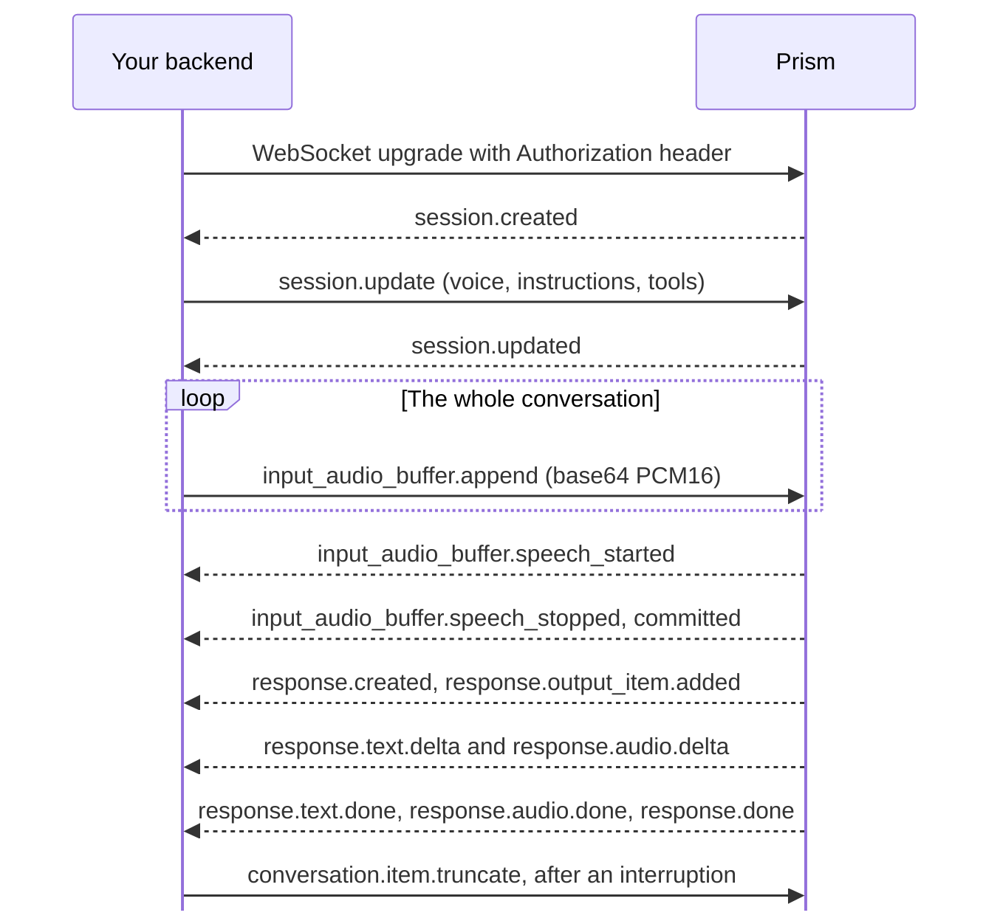

> ## Documentation Index
> Fetch the complete documentation index at: https://docs.rime.ai/llms.txt
> Use this file to discover all available pages before exploring further.

# Prism WebSocket

> Hold Prism conversations over a WebSocket, without the Rime SDK. This reference covers the connection, session setup, every client and server event, errors, limits, and differences from OpenAI Realtime.

Connect to `wss://prism.api.rime.ai/v1/realtime` from your backend, and send your [API key](https://docs.rime.ai/docs/api-authentication.md) on the upgrade request as `Authorization: Bearer YOUR_API_KEY`. Each connection is one conversation. Your backend sends the caller's audio as base64 16 kHz mono PCM16. Prism finds the end of each caller turn, and replies with text and with 24 kHz audio in the same format.

Use this API when your backend uses a language other than Python, Node.js, Go, or Rust. Otherwise, the [Rime SDK](https://docs.rime.ai/api-reference/sdk/prism.md) implements this protocol for you. The [WebSocket quickstart](https://docs.rime.ai/docs/prism/websocket-quickstart.md) makes a first call with a plain WebSocket client, and [Errors and limits](https://docs.rime.ai/docs/prism/errors.md) tells you what to do about each error code.

## Session at a glance



| Direction | Event | When |
| - | - | - |
| Receive | [`session.created`](#session-created) | First, on every connection |
| Send | [`session.update`](#session-update) | Right after `session.created`, and again each time you change a setting |
| Receive | [`session.updated`](#session-updated) | For each update that Prism accepts. The first one comes when the session is ready, up to 5 seconds later. |
| Send | [`input_audio_buffer.append`](#input_audio_buffer-append) | All the time, from `session.update` until you close. Include silence, and keep sending while Prism speaks. |
| Receive | [`input_audio_buffer.speech_started`](#input_audio_buffer-speech_started), [`speech_stopped`](#input_audio_buffer-speech_stopped), [`committed`](#input_audio_buffer-committed) | When Prism detects each caller turn |
| Receive | [`prism.input_audio_buffer.speech_hint`](#prism-input_audio_buffer-speech_hint) | When the caller may be starting to speak during a reply |
| Receive | [`conversation.item.input_audio_transcription.*`](#conversation-item-input_audio_transcription-completed) | The caller's words, for display |
| Receive | [`response.created`](#response-created) through [`response.done`](#response-done) | For each reply |
| Receive | [`response.function_call_arguments.done`](#response-function_call_arguments-done) | For each tool call |
| Send | [`conversation.item.create`](#conversation-item-create) | To return a tool result, or to add history |
| Send | [`response.create`](#response-create) | For a typed turn, a tool continuation, or a nudge |
| Receive | [`prism.typed_input.ready`](#prism-typed_input-ready) | Each time Prism becomes idle |
| Send | [`conversation.item.truncate`](#conversation-item-truncate) | After an interruption, to report how much the caller heard |
| Send | [`conversation.item.delete`](#conversation-item-delete) | To remove an item from the conversation. Prism answers with [`conversation.item.deleted`](#conversation-item-deleted). |
| Send | [`prism.conversation.get`](#prism-conversation-get) | To list the conversation. Prism answers with [`prism.conversation`](#prism-conversation). |
| Send | [`prism.playback.drained`](#prism-playback-drained) | Optional. When a reply finishes playing |
| Send | [`response.cancel`](#response-cancel) | To stop the running reply |
| Send | [`input_audio_buffer.clear`](#input_audio_buffer-clear) | To drop the caller's current speech |
| Receive | [`session.idle_timeout`](#session-idle_timeout) | Before Prism closes an idle conversation |
| Receive | [`error`](#error) | When Prism refuses a request, or when something fails |

## Guarantees

| Events | Guarantee |
| - | - |
| `session.created` | The first event on every connection. Prism sends it before it reads any client event. |
| `session.update`, `session.updated` | Prism answers each `session.update` that it accepts with one `session.updated`, which holds the whole session. A refused update changes nothing. |
| `response.created`, `response.done` | Every `response.created` has exactly one `response.done`. Only `response.done` ends a reply. |
| `response.text.done`, `response.audio.done` | A reply's `response.text.done` comes before its `response.done`, even for a cancelled, failed, or empty reply. If the reply sent audio, `response.audio.done` comes after `response.text.done`. A failed reply's `error` comes just before `response.done`. |
| `response.done` and playback | `response.done` ends generation, not playback. Audio that Prism already sent can still be playing. |
| `output_index`, `content_index` | In reply events, `output_index` is 0 for the assistant message, and 1, 2, and so on for each tool call. `content_index` is always 0. |
| Caller transcripts | Every committed caller turn gets exactly one `conversation.item.input_audio_transcription.completed` or `.failed`. It can arrive before or after the reply to that turn, and nothing waits for it. |
| `error` | An `error` never closes the connection or ends a reply by itself. The exception is `voice_activity_detection_failed`, which comes before a close with `1011`. |
| Acknowledgments | These events acknowledge a request: `session.updated`, `conversation.item.created`, `conversation.item.deleted`, `prism.conversation`, `response.created`, `input_audio_buffer.cleared`, `conversation.item.truncated`, and the `response.done` that answers `response.cancel`. Each one carries the request's `event_id` as a top-level `prism_request_event_id`. If a request has no `event_id`, its acknowledgment has none. |

## Complete example

This Python client holds one short conversation with the raw WebSocket API. It streams a recorded question at speaking pace, then keeps sending silence, as a microphone does. When Prism asks for the cafe's opening hours, the client runs `get_opening_hours`, returns the result, and asks Prism to continue, as [Tools](https://docs.rime.ai/docs/prism/tools.md) explains. It prints the caller's transcript, the tool call, and Prism's replies, and saves the spoken replies to `reply.wav`. It stops with an error if Prism refuses one of its requests or a reply does not complete. It also stops if no event arrives for 30 seconds while it waits for a reply.

The client does not play audio or report playback. A live client does both, as [Stop playback when the caller talks over a reply](https://docs.rime.ai/docs/prism/live-conversations.md#stop-playback-when-the-caller-talks-over-a-reply) explains.

The client needs Python 3.11 or later, and `websockets` 14 or later for the `additional_headers` argument. Before you run it, do these steps:

1. Install the package with `pip install "websockets>=14"`.
2. Set `RIME_API_KEY` in the environment of your backend.
3. Download the quickstart's [sample question](https://docs.rime.ai/audio/prism/question.wav).

To use your own recording, convert it first with [FFmpeg](https://ffmpeg.org/download.html). This command reads `input.m4a`, or any format that FFmpeg can decode. It writes `question.wav` as 16 kHz mono PCM16, and it keeps the WAV header.

```bash theme={null}
ffmpeg -i input.m4a -ac 1 -ar 16000 -c:a pcm_s16le question.wav
```

Record one question without long pauses. Prism decides when the caller has finished, and it can take a long pause as the end of the question.

> [accordion] prism\_ws.py
>
> ```python prism_ws.py theme={null}
> import asyncio
> import base64
> import contextlib
> import itertools
> import json
> import os
> import sys
> import wave
>
> import websockets
>
> URL = "wss://prism.api.rime.ai/v1/realtime"
> API_KEY = os.environ["RIME_API_KEY"]
> INSTRUCTIONS = (
>     "You answer the phone for Juniper Cafe. Call get_opening_hours before you "
>     "answer a question about opening hours. Answer in one short sentence."
> )
> TOOLS = [
>     {
>         "type": "function",
>         "name": "get_opening_hours",
>         "description": "Today's opening hours for Juniper Cafe.",
>         "parameters": {"type": "object", "properties": {}},
>     }
> ]
> CHUNK_BYTES = 1_280  # 40 ms of 16 kHz mono PCM16
>
>
> def get_opening_hours():
>     # Your application's own lookup. Prism asks for it and never runs it.
>     return {"opens": "8 a.m.", "closes": "4 p.m."}
>
>
> async def converse(path):
>     with wave.open(path, "rb") as source:
>         if (source.getnchannels(), source.getsampwidth(), source.getframerate()) != (1, 2, 16000):
>             raise ValueError("expected a 16 kHz mono 16-bit PCM WAV file")
>         question = source.readframes(source.getnframes())
>
>     headers = {"Authorization": f"Bearer {API_KEY}"}
>     async with websockets.connect(URL, additional_headers=headers) as socket:
>
>         async def send(event):
>             await socket.send(json.dumps(event))
>
>         async def receive():
>             event = json.loads(await socket.recv())
>             if event["type"] == "error":
>                 error = event["error"]
>                 print(f"Error {error['code']} (scope {error['scope']})")
>                 # Stop on an error that ends the conversation or refuses one of
>                 # this client's requests. A reply's own error is followed by a
>                 # failed response.done, which ends the loop below.
>                 if error["scope"] == "session" or error["event_id"] is not None:
>                     raise RuntimeError(error["code"])
>             return event
>
>         print("Request:", socket.response.headers["x-request-id"])
>         created = await receive()  # session.created always comes first
>         print("Session:", created["session"]["id"])
>
>         await send({
>             "type": "session.update",
>             "event_id": "evt_setup",
>             "session": {"voice": "aurora", "instructions": INSTRUCTIONS, "tools": TOOLS},
>         })
>         while (await receive())["type"] != "session.updated":
>             pass
>
>         async def send_audio():
>             # The question at speaking pace, then silence, as a live microphone sends it.
>             chunks = [question[i : i + CHUNK_BYTES] for i in range(0, len(question), CHUNK_BYTES)]
>             for chunk in itertools.chain(chunks, itertools.repeat(bytes(CHUNK_BYTES))):
>                 await send({
>                     "type": "input_audio_buffer.append",
>                     "audio": base64.b64encode(chunk).decode(),
>                 })
>                 await asyncio.sleep(0.04)
>
>         sender = asyncio.create_task(send_audio())
>         transcript, calls, words, status = None, [], [], "no reply"
>         reply_audio = bytearray()
>         try:
>             while True:
>                 event = await asyncio.wait_for(receive(), timeout=30)
>                 kind = event["type"]
>                 if kind == "conversation.item.input_audio_transcription.completed":
>                     transcript = event["transcript"]
>                 elif kind == "conversation.item.input_audio_transcription.failed":
>                     transcript = ""
>                 elif kind == "response.audio.delta":
>                     reply_audio += base64.b64decode(event["delta"])
>                 elif kind == "response.text.done" and event["text"]:
>                     words.append(event["text"])
>                 elif kind == "response.function_call_arguments.done":
>                     # Run the tool and return its result under the same call_id.
>                     result = get_opening_hours(**json.loads(event["arguments"]))
>                     calls.append(f"{event['name']}({event['arguments']}) -> {json.dumps(result)}")
>                     await send({
>                         "type": "conversation.item.create",
>                         "event_id": f"evt_result_{len(calls)}",
>                         "item": {
>                             "type": "function_call_output",
>                             "call_id": event["call_id"],
>                             "output": json.dumps(result),
>                         },
>                     })
>                 elif kind == "response.done":
>                     response = event["response"]
>                     status = response["status"]
>                     if status != "completed":
>                         reason = response["status_details"]["reason"]
>                         raise RuntimeError(f"Reply {status}: {reason}")
>                     made_calls = any(item["type"] == "function_call" for item in response["output"])
>                     if not made_calls:
>                         break
>                     # Every result is in, so ask Prism to answer with them.
>                     await send({
>                         "type": "response.create",
>                         "event_id": "evt_continue",
>                         "response": {
>                             "metadata": {
>                                 "prism_cause": "tool_continuation",
>                                 "prism_parent_response_id": response["id"],
>                             }
>                         },
>                     })
>             # The caller's transcript can arrive after the reply. Give it two seconds.
>             with contextlib.suppress(TimeoutError):
>                 while transcript is None:
>                     event = await asyncio.wait_for(receive(), timeout=2)
>                     if event["type"] == "conversation.item.input_audio_transcription.completed":
>                         transcript = event["transcript"]
>                     elif event["type"] == "conversation.item.input_audio_transcription.failed":
>                         transcript = ""
>         except TimeoutError:
>             raise TimeoutError("Prism sent no event for 30 seconds") from None
>         finally:
>             sender.cancel()
>
>     print("You:", transcript or "(no transcript)")
>     for call in calls:
>         print("Tool:", call)
>     print("Prism:", " ".join(words))
>     with wave.open("reply.wav", "wb") as reply:
>         reply.setnchannels(1)
>         reply.setsampwidth(2)
>         reply.setframerate(24_000)
>         reply.writeframes(reply_audio)
>     print(f"Saved reply.wav ({len(reply_audio) / 48_000:.1f} s, {status})")
>
>
> asyncio.run(converse(sys.argv[1]))
> ```

Run the client with the file name, for example `python prism_ws.py question.wav`. A run with the sample question printed this output:

```text theme={null}
Request: 0ec4b2df-90b3-414c-ada0-95a8e4bdc0c1
Session: sess_20b864bbcaf6f3a3
You: Hi there, I was just wondering, what time do you close today?
Tool: get_opening_hours({}) -> {"opens": "8 a.m.", "closes": "4 p.m."}
Prism: One moment. We close at 4 p.m. today.
Saved reply.wav (2.6 s, completed)
```

Prism sends two replies. The first reply makes the tool call, and the second reply uses its result. While the call is open, Prism speaks a short phrase, such as "One moment," and its wording varies. The phrase is also in the text of the first reply, so the `Prism:` line of your run shows it too. `reply.wav` holds both replies, in the `aurora` voice. If a run fails, send the request and session IDs to [support](https://docs.rime.ai/docs/prism/errors.md#report-a-problem).

### Rime SDK steps as WebSocket events

Each step in [Live conversations](https://docs.rime.ai/docs/prism/live-conversations.md) has a WebSocket event. The tool steps are in [Tools](#tools).

| Step | Rime SDK | WebSocket event |
| - | - | - |
| Stream the caller's audio | `send_audio` | [`input_audio_buffer.append`](#input_audio_buffer-append), base64 of 16 kHz mono PCM16 |
| The caller starts a turn | `speech.started` | [`input_audio_buffer.speech_started`](#input_audio_buffer-speech_started) |
| Report what the caller heard | `report_playback(PlaybackInterrupted(...))` | [`conversation.item.truncate`](#conversation-item-truncate) with the message's `item_id`, `content_index` 0, and `audio_end_ms` |
| Report a finished reply | `report_playback(PlaybackFinished(...))` | [`prism.playback.drained`](#prism-playback-drained) with the `drain_token` from `response.done.response.metadata.prism_drain_token` |
| Send a typed turn | `send_text` | [`response.create`](#response-create) with `prism_cause` `user_text` and `prism_input_text` |
| Nudge | `request_reply` | `response.create` with `prism_cause` `proactive` and an optional `prism_instruction` |
| Add history | `add_message` | [`conversation.item.create`](#conversation-item-create) with a `message` item |
| Turn interruption off | `interrupt_on_speech=False` | `turn_detection.interrupt_response` `false` in [`session.update`](#session-update) |

The SDK handles two waits. Without the SDK, your backend must handle them:

1. Send `session.update` before any audio or `response.create`, and then wait for `session.updated`, which confirms that Prism accepted the update. Until Prism accepts it, Prism refuses both with `session_not_initialized`.
2. Send a typed turn or a nudge only after `prism.typed_input.ready`. If Prism refuses it as busy, send it again after the next `prism.typed_input.ready`. Prism does not keep a refused request for later.

## Connect

| Property | Value |
| - | - |
| URL | `wss://prism.api.rime.ai/v1/realtime`, with no subprotocol |
| Region | US East (us-east-2) |
| Authentication | `Authorization: Bearer YOUR_API_KEY` on the upgrade request |
| Query parameters | Prism reads none. Do not put the key in the URL. |
| Handshake | Must complete within 5 seconds |
| Messages | One JSON object in each text frame, at most 1 MiB. The `type` field names the event. A binary frame gets `invalid_event`. |
| Unknown fields | Prism refuses the whole client event if one of its fields is unknown or has the wrong type. Prism answers with an `error` that names the event, and the conversation continues. |
| Repeated requests | Prism runs every request that it accepts, so a request that you send twice runs twice. `event_id` is not an idempotency key. |
| Keepalive | Prism sends a ping every 30 seconds. Prism answers pings from your backend. |
| Request ID | To use your own ID, send it in an `x-request-id` header, in printable ASCII and at most 128 characters. Otherwise Prism makes one. Successful and refused upgrade responses return the ID in `x-request-id`. The session also exposes it as `session.request_id`. |

### Authentication

Send `Authorization: Bearer YOUR_API_KEY` on the upgrade request. The `WebSocket` API in a browser cannot set this header. Open the connection from your backend, and keep the key there. Prism has no ephemeral keys or tokens for client devices. Browsers and phones send their audio to your backend, and your backend sends it to Prism.

### Upgrade refusals

Prism can refuse the upgrade with an HTTP response, before any event, and no `error` event follows. A successful upgrade returns `101 Switching Protocols`.

| HTTP status | Cause | What to do |
| - | - | - |
| `400` | The request is not a WebSocket upgrade. The body is `Expected WebSocket upgrade`. | Connect with a WebSocket client. |
| `401` | The upgrade request had no API key, or Prism did not accept the key. | Send `Authorization: Bearer` with a current [API key](https://docs.rime.ai/docs/api-authentication.md). If you retry with the same key, Prism refuses it again. |
| `404` | The path is not `/v1/realtime`. | Connect to `wss://prism.api.rime.ai/v1/realtime`. |
| `503` | Prism is not ready, is shutting down, has no capacity for another conversation, or could not check the API key. | Retry after a backoff. |

### Close codes

| Close code | Cause | What to do |
| - | - | - |
| `1000` "idle" | The conversation was idle for 5 minutes. Prism sends [`session.idle_timeout`](#session-idle_timeout) first. A conversation is idle while no reply is running or waiting, Prism detects no speech, and your backend sends only audio. | Reconnect when the caller returns. |
| `1001` | Prism is draining or shutting down. A draining server finishes the running reply. It does not start another reply. | Reconnect after a short backoff. |
| `1011` | Speech detection failed. A `voice_activity_detection_failed` error comes first. | Reconnect. |
| None | Your backend sent a message over 1 MiB. Or Prism could not deliver a message to your backend for 10 seconds. No `error` event comes first. Prism sends no close code, and client libraries report `1005` or `1006`. | Split large messages. Read events as they arrive. |

Audio appends do not count as activity, so a conversation that streams only silence still closes after 5 minutes. Any other client event, detected speech, or a reply starts the timer again.

Each reconnect starts a new conversation with no memory of the old one. Send `session.update` again, and add the history that the agent needs with [`conversation.item.create`](#conversation-item-create) messages.

## Audio formats

| Property | Caller to Prism | Prism to caller |
| - | - | - |
| Carried in | The `audio` field of [`input_audio_buffer.append`](#input_audio_buffer-append) | The `delta` field of [`response.audio.delta`](#response-audio-delta) |
| Samples | Headerless PCM16, little-endian, mono, 16 kHz | Headerless PCM16, little-endian, mono, 24 kHz, in whole 16-bit samples |
| Encoding | Standard padded base64 | Standard padded base64 |
| Setting | `input_audio_format`. `pcm16` is the only input format. | None. The output format is fixed. |
| Messages | The complete JSON message must fit within 1 MiB, including base64 audio and other fields. A convenient chunk size is 40 ms, or 1,280 bytes of PCM. Prism ignores empty audio. | Reply audio arrives faster than real time. Buffer it in your player, and record how much has played. |
| Other formats | Prism does not accept mu-law, A-law, or other G.711 audio. Audio at a different sample rate gets no error, but Prism hears it as too slow or too fast. Convert it first. | Prism does not send mu-law, A-law, or other G.711 audio. |
| WAV files | A WAV file has the same samples, plus a header. Remove the header before you send a recording, or read the file with a WAV reader, as the [complete example](#complete-example) does. | Add a header before you save a reply as WAV. |
| Phone calls | A bridge decodes the caller's G.711 audio and resamples it to 16 kHz PCM16. | A bridge resamples Prism's 24 kHz replies and encodes them for the call. |

Send the caller's audio all the time, as [Stream audio for the whole call](https://docs.rime.ai/docs/prism/live-conversations.md#stream-audio-for-the-whole-call) explains. Include silence, because Prism uses the audio after the caller stops to decide that the turn has ended. Keep sending while Prism speaks, because Prism hears an interruption only in the audio that it receives. While the caller is muted, send silence. If no audio arrives for several seconds, turn detection works less well for the rest of the call, and Prism sends no error.

The reply text holds every word of the reply audio, including these short lines that Prism adds to a spoken reply:

| Spoken line | When Prism says it | Where it is in the reply text |
| - | - | - |
| A word that opens the reply, such as "Okay." or "Hmm." | After an interruption that you report with [`conversation.item.truncate`](#conversation-item-truncate) | The first `response.text.delta` |
| A short phrase, such as "One moment." | While a tool call is open. A tool continuation and a nudge with `prism_call_id` never say it. | A `response.text.delta` after `response.function_call_arguments.done` |
| "Sorry, could you say that again?" | When the reply has no other words | The only `response.text.delta` |

Use the text for captions and logs. A reply can also have no audio at all. If a reply makes only tool calls and says no phrase, the reply has no audio, no `response.audio.done`, and no `prism_drain_token`. Prism says no phrase in a tool continuation, in a nudge with `prism_call_id`, or for a tool with `prism_filler` `{"type": "none"}`.

## Session configuration

These are the fields of the `session` object in [`session.update`](#session-update). Every field is optional. In the first update, a field that you leave out takes its default. In a later update, a field that you leave out keeps its current value. Prism refuses any other field with `invalid_client_event`, and the error's `param` names the field.

A later update can change these fields:

| Field | Type | Default | Values and notes |
| - | - | - | - |
| `voice` | string | `astra` | The voice of every reply: `astra`, `aurora`, `brando`, or `wawona`. An empty string or `"default"` also means `astra`. Prism refuses any other voice with `invalid_voice`. The text-to-speech voice catalog does not apply to Prism. |
| `instructions` | string | Prism's own prompt | The system prompt. It tells Prism who the agent is, what it knows, and how it replies. If you send it empty, Prism uses its own default prompt. |
| `tools` | object\[] | None | Functions that Prism can ask your backend to run, in either OpenAI shape below. A later update replaces the whole list. Prism refuses a tool without a name with `invalid_session`. |
| `tools[].prism_filler` | object | `{"type": "auto"}` | What Prism says while this tool runs, except in a tool continuation or a nudge with `prism_call_id`. `{"type": "text", "text": "One moment while I check the weather."}` says that line. `{"type": "none"}` says nothing. `{"type": "auto"}`, the default, has Prism write a short line from the tool's description, and `instructions` can say what it should cover, such as `{"type": "auto", "instructions": "Say you're checking the forecast."}`. When a reply calls several tools, the first call's tool decides. Prism refuses a blank `text` with `invalid_client_event`. |
| `turn_detection.interrupt_response` | boolean | `true` | Sets whether the caller's speech during a reply interrupts the reply. See [How a turn ends](https://docs.rime.ai/docs/prism/live-conversations.md#how-a-turn-ends) for interruption behavior. Prism refuses other `turn_detection` fields, such as `type`, `threshold`, and `silence_duration_ms`, with `invalid_client_event`. Prism also refuses `turn_detection: null`. |
| `prism_client_caps` | string\[] | None | `["playback_drained"]` tells Prism that your backend sends [`prism.playback.drained`](#prism-playback-drained). Prism accepts this value and changes nothing. Prism refuses any other value, or a value named twice, with `invalid_client_event`. |
| `truncation` | string or object | `"auto"` | What Prism does when the conversation outgrows the [context](#limits). `"auto"` leaves the oldest turns out of the prompt, as [When the conversation outgrows the context](#when-the-conversation-outgrows-the-context) explains. `"disabled"` keeps every turn, so each reply past the limit fails with `context_length_exceeded`. `{"type": "retention_ratio", "retention_ratio": 0.9}` is `"auto"` with another share, above 0 and up to 1. Prism refuses any other value, also `null`, with `invalid_client_event`. |
| `prism_response_metadata` | object | `{}` | Labels for every reply, such as `{"sim_id": "abc123"}`. Each reply's `response.metadata` starts with the labels in effect when the reply starts. A key in the `metadata` of a `response.create` replaces the label with the same name, for that reply only. A later update replaces all the labels, and `{}` clears them. Use up to 16 labels. Each key has up to 64 characters and does not start with `prism_`. Each value is a string of up to 512 characters. Prism refuses labels that break these limits with `invalid_session`, and a value that is not a string with `invalid_client_event`. |

These fields keep the values from the first update. A later update can repeat the current value, but Prism refuses a new one:

| Field | Type | Default | Values and notes |
| - | - | - | - |
| `turn_detection.eagerness` | string | `auto` | How readily Prism decides that the caller has finished. `low` waits for more certainty, so Prism cuts in less and replies later. `high` replies sooner and cuts in more. `medium` and `auto` use Prism's standard setting. Use `low` when callers often pause mid-sentence. |
| `turn_detection.prism_end_of_turn_timeout_ms` | integer | `5000` | The silence, in milliseconds, that ends the caller's turn even when Prism is not sure they have finished. From 1000 to 10000. |
| `modalities` | string\[] | `["text", "audio"]` | Sessions require `["text", "audio"]`. Leave this field out or send the default. Some replies [produce no audio](#audio-formats). Prism refuses a list without `"text"`, or `["text"]` alone, with `unsupported_modality`. |
| `tool_choice` | string | `auto` | Only `"auto"`. Prism decides when to call a tool, and your backend cannot force a call. To stop calls to a tool, remove it with a later `session.update`. Prism refuses any other value with `invalid_client_event`. |
| `input_audio_format` | string | `pcm16` | Only `"pcm16"`, which is headerless 16 kHz mono PCM16, little-endian. Prism refuses any other value, such as `"g711_ulaw"`, with `invalid_client_event`. |

Prism reads the tool definitions itself, so say in `instructions` when to call each tool, as [Tools](https://docs.rime.ai/docs/prism/tools.md#define-tools-when-the-session-starts) explains. `parameters` is a JSON Schema object. Each tool can use either OpenAI shape, and if a tool has both, Prism uses the nested `function`:

* Flat: `{"type": "function", "name": ..., "description": ..., "parameters": {...}}`
* Nested: `{"type": "function", "function": {"name": ..., "description": ..., "parameters": {...}}}`

Prism accepts the first `session.update` that passes its checks, and that update sets up the session. After that, you can send `session.update` at any time, even while a reply runs. Prism refuses a new `eagerness` or `prism_end_of_turn_timeout_ms` with `session_setting_fixed`, and a new `modalities` value with `unsupported_modality`. Prism rejects the entire update if any field is invalid. Correct the field and send the update again. A reply that is already running keeps the settings that it started with, and the next reply uses the new settings. `prism_settings_revision` in the [session object](#the-session-object) counts the updates that Prism accepted, and each reply carries the revision that it started with.

### When the conversation outgrows the context

With `truncation` `"auto"`, Prism leaves whole turns out of the prompt, oldest first, when the conversation no longer fits the [context](#limits). Prism cuts until the history fills at most 80% of the context left after the instructions, tools, current turn, and reply. It cuts more than it must, so that the next turns keep the same cut and stay fast. A `retention_ratio` sets a share other than 80%. The turns that Prism leaves out stay in the conversation, and [`prism.conversation.get`](#prism-conversation-get) still lists them. When Prism leaves turns out of a reply's prompt, that reply's [`response.done`](#response-done) says so in `prism_truncation`. A `system` message that you add goes out with its turn, so put lasting rules in `instructions`. Truncation leaves out only history, so if the instructions, tools, and current turn alone leave no room for the 512-token reply, the reply fails with `context_length_exceeded`.

## Turns and interruptions

[How a turn ends](https://docs.rime.ai/docs/prism/live-conversations.md#how-a-turn-ends) explains how Prism ends the caller's turns, what `interrupt_response` changes, and how your backend handles an interruption.

## Report playback

[Stop playback when the caller talks over a reply](https://docs.rime.ai/docs/prism/live-conversations.md#stop-playback-when-the-caller-talks-over-a-reply) explains when to send `conversation.item.truncate`, and [Report when a reply finishes playing](https://docs.rime.ai/docs/prism/live-conversations.md#report-when-a-reply-finishes-playing) explains `prism.playback.drained`.

## Tools

[Tools](https://docs.rime.ai/docs/prism/tools.md) explains a full tool round, from the call to the continuation. [Timeouts and late results](https://docs.rime.ai/docs/prism/long-running-tasks.md#timeouts-and-late-results) explains the two waits that `prism_tool_waits` reports. Over the WebSocket API, a tool round uses these events:

| Step | Rime SDK | WebSocket event |
| - | - | - |
| Define tools | `tools` when you connect | `tools` in [`session.update`](#session-update) |
| Receive a call | `tool.call` | [`response.function_call_arguments.done`](#response-function_call_arguments-done), with `call_id`, `name`, and the arguments as a JSON string |
| Return the result | `submit_tool_result` | [`conversation.item.create`](#conversation-item-create) with a `function_call_output` item |
| Continue | `continue_reply` | [`response.create`](#response-create) with `prism_cause` `tool_continuation`, and the ID of the parent reply as `prism_parent_response_id` |
| Report a result later | `request_reply(tool_call=...)` | `response.create` with `prism_cause` `proactive` and `prism_call_id` |

Without the SDK, wait for these events before you continue:

* The `response.done` of the parent reply
* A `conversation.item.created` for every result

Prism refuses an earlier continuation with `tool_continuation_not_ready`, and does not keep the early continuation for later. The [complete example](#complete-example) runs one tool round this way.

## Typed turns, nudges, and history

[Typed turns and nudges](https://docs.rime.ai/docs/prism/typed-turns.md) explains when Prism accepts a `response.create` without new speech, and how to add history with `conversation.item.create`. Over the WebSocket API, you can also remove items with [`conversation.item.delete`](#conversation-item-delete) and list the conversation with [`prism.conversation.get`](#prism-conversation-get).

## Client events

Any client event can carry an `event_id`, a string that you choose, such as `"evt_setup"`. No client event requires one. When a request has one, Prism copies it into `prism_request_event_id` on the acknowledgment, or into `error.event_id` on a refusal. Prism runs a request without an `event_id` too. Its acknowledgment then has no `prism_request_event_id`, and a refusal of it has `error.event_id` `null`. Prism refuses an `event_id` that is not a string, such as `null` or a number, with `invalid_event`. Prism does not check that an `event_id` is unique.

Send an `event_id` on `session.update`, `conversation.item.create`, `conversation.item.delete`, `prism.conversation.get`, and `response.create`. Your backend waits for the answer to each of these, and the ID matches each answer to its request. Without an `event_id`, Prism suppresses these refusals: `tool_call_not_found` for a tool result that names a call this conversation never made, and `response_superseded` or `nudge_superseded` for a requested reply that does not run because the caller spoke first.

### session.update

Sets up the conversation, and later changes its settings. Send the first update right after `session.created`. Prism answers with [`session.updated`](#session-updated) when the session is ready, up to 5 seconds later. Prism keeps audio and `response.create` that you send after Prism accepts the first update, even before `session.updated` arrives. Before Prism accepts an update, it refuses both with `session_not_initialized`. Send another update at any time to change a field that [Session configuration](#session-configuration) lists as changeable, such as the voice. Prism answers each accepted update with `session.updated`, and the next reply uses the new settings.

| Field | Type | Notes |
| - | - | - |
| `type` | `"session.update"` | Required |
| `event_id` | string | Recommended. `session.updated` echoes it as `prism_request_event_id`. Without it, Prism still applies the update, and `session.updated` has no `prism_request_event_id`. |
| `session` | object | Required. The fields in [Session configuration](#session-configuration). In the first update, `{}` uses every default. In a later update, `{}` keeps every setting. |

Refusals: `invalid_client_event`, `invalid_session`, `unsupported_modality`, `invalid_voice`, `voice_required`, and `session_setting_fixed`. A refused update changes nothing.

The first update sets up the session:

```json theme={null}
{
  "type": "session.update",
  "event_id": "evt_setup",
  "session": {
    "voice": "aurora",
    "instructions": "You answer the phone for Juniper Cafe. Call get_opening_hours before you answer a question about opening hours. Answer in one short sentence.",
    "tools": [
      {
        "type": "function",
        "name": "get_opening_hours",
        "description": "Today's opening hours for Juniper Cafe.",
        "parameters": { "type": "object", "properties": {} }
      }
    ]
  }
}
```

A later update needs only the fields that it changes. This one changes the voice and the instructions:

```json theme={null}
{
  "type": "session.update",
  "event_id": "evt_upd2",
  "session": {
    "voice": "brando",
    "instructions": "Answer in one short sentence."
  }
}
```

### input\_audio\_buffer.append

The caller's audio, as you capture it. Prism sends no acknowledgment, and an append does not count as activity for the idle timeout.

| Field | Type | Notes |
| - | - | - |
| `type` | `"input_audio_buffer.append"` | Required |
| `audio` | string | Required. Standard, padded base64 of headerless 16 kHz mono PCM16, little-endian. Prism ignores empty audio. |
| `event_id` | string | Optional. Prism sends no acknowledgment. A refusal echoes it in `error.event_id`. |

Refusals: `invalid_audio` for audio that is not base64, and `session_not_initialized` for audio that arrives before Prism accepts a `session.update`. Prism drops that early audio. It reports the first dropped append at once, and then sends at most one report every 5 seconds.

The base64 value is shortened here:

```json theme={null}
{ "type": "input_audio_buffer.append", "audio": "UABtAFsAaABpAG8AcgB4AG8AgAB9AIgAiACTAKAA..." }
```

### input\_audio\_buffer.clear

Drops the caller's speech that Prism has not committed as a turn, including speech that Prism holds while a reply plays, and resets speech detection. If Prism already sent a `speech_started` for that speech, no `speech_stopped` or `committed` follows. Prism answers with [`input_audio_buffer.cleared`](#input_audio_buffer-cleared).

| Field | Type | Notes |
| - | - | - |
| `type` | `"input_audio_buffer.clear"` | Required |
| `event_id` | string | Optional. `input_audio_buffer.cleared` echoes it as `prism_request_event_id`. Without it, the acknowledgment has no `prism_request_event_id`. |

```json theme={null}
{ "type": "input_audio_buffer.clear", "event_id": "evt_clear" }
```

### conversation.item.create

Adds a tool result, a message, or a past tool call to the conversation, without starting a reply. Prism answers with [`conversation.item.created`](#conversation-item-created). The new item goes at the end of the conversation, unless `previous_item_id` puts it somewhere else.

| Field | Type | Notes |
| - | - | - |
| `type` | `"conversation.item.create"` | Required |
| `event_id` | string | Recommended. `conversation.item.created` echoes it as `prism_request_event_id`. Without it, Prism still adds the item, and the acknowledgment has no `prism_request_event_id`. |
| `item` | object | Required. A `function_call_output`, a `message`, or a past `function_call`. Prism refuses any other item `type` with `invalid_client_event`. |
| `previous_item_id` | string | Optional. Puts the item after the item with this ID, and after the rest of that item's turn, such as the reply to it. `"root"` puts the item first. The ID can name a deleted item, and the new item then takes the place of the deleted item. A `function_call_output` does not take this field, because a result always goes after its call. |

A `function_call_output` item returns the result of a tool:

| Field | Type | Notes |
| - | - | - |
| `type` | `"function_call_output"` | Required |
| `call_id` | string | Required. The `call_id` from `response.function_call_arguments.done`, or from a past `function_call` that you added |
| `output` | string | The result. Prism uses it as it is, at any length. It counts toward the [context](https://docs.rime.ai/docs/prism/errors.md#limits) of the conversation. The default is `""`. |

```json theme={null}
{
  "type": "conversation.item.create",
  "event_id": "evt_result_1",
  "item": {
    "type": "function_call_output",
    "call_id": "call_a62cd86c6338458fa99817e5",
    "output": "{\"opens\": \"8 a.m.\", \"closes\": \"4 p.m.\"}"
  }
}
```

Refusals: `tool_call_not_found` for a call that this conversation did not make, and `conflict` for a second, different result. If a result for an unknown call has no `event_id`, Prism drops it with no error.

A `message` item adds history, and it stays in the history until you delete it with [`conversation.item.delete`](#conversation-item-delete). Its words can be up to 4,000 code points, and Prism refuses a longer message with `item_too_long`.

| Field | Type | Notes |
| - | - | - |
| `type` | `"message"` | Required |
| `id` | string | Optional. Your own ID for the item, from 1 to 32 characters, such as `"msg_greeting"`. Without it, Prism gives the item an ID. |
| `role` | `"user"`, `"assistant"`, or `"system"` | Required. `user` is something that the caller said. `assistant` is a reply that your application played, such as a greeting. Prism records it as the reply to the caller input just before it. `system` is a note for the model, such as a fact about the caller. The model sees the note at its place in the conversation. |
| `text` | string | The words of the message |
| `content` | object\[] | Parts in the OpenAI style. Prism reads them when `text` is absent or empty. Prism joins the `text` of each part, or else its `transcript`, with spaces. Prism does not read the `type` of a part. |

```json theme={null}
{
  "type": "conversation.item.create",
  "event_id": "evt_greeting",
  "item": { "type": "message", "role": "assistant", "text": "Juniper Cafe, how can I help?" }
}
```

This request adds a note for the model, with an ID that the client chose:

```json theme={null}
{
  "type": "conversation.item.create",
  "event_id": "evt_sys",
  "item": {
    "id": "sys_note_1",
    "type": "message",
    "role": "system",
    "text": "The caller is a premium member. Address them by name."
  }
}
```

This request puts a caller message right after the item `msg_client_1`:

```json theme={null}
{
  "type": "conversation.item.create",
  "event_id": "evt_prev_mid",
  "item": { "id": "msg_after_name", "type": "message", "role": "user", "text": "I am calling about a refund." },
  "previous_item_id": "msg_client_1"
}
```

A `function_call` item adds a past tool call, for example one from an earlier conversation. Prism shows the call to the model only after you add its result as a `function_call_output` with the same `call_id`. A past call never starts a tool round.

| Field | Type | Notes |
| - | - | - |
| `type` | `"function_call"` | Required |
| `id` | string | Optional. Your own ID for the item, as for a message |
| `call_id` | string | Required. Your ID for the call. Its result names the call with this ID. |
| `name` | string | Required. The name of the tool |
| `arguments` | string | The arguments, as a JSON object in text. The default is `""`. |

```json theme={null}
{
  "type": "conversation.item.create",
  "event_id": "evt_pastcall",
  "item": {
    "type": "function_call",
    "id": "item_pastcall",
    "call_id": "call_past_1",
    "name": "get_weather",
    "arguments": "{\"city\":\"Rome\"}"
  }
}
```

Prism also refuses these requests, and each refusal changes nothing:

| Code | When |
| - | - |
| `item_id_in_use` | The new item's `id` is the ID of an item that is in the conversation and not deleted. After you delete that item, you can use its ID again. |
| `call_id_in_use` | A past `function_call` has the `call_id` of a call that is in the conversation and not deleted. That call can be one that you added or one that the model made. Prism also refuses the `call_id` of a call that the model made and you deleted, until the result of that call arrives. |
| `item_not_found` | `previous_item_id` names no item that this conversation has had. |
| `invalid_client_event` | The item's `id` is not 1 to 32 characters, or a `function_call_output` has `previous_item_id`. The error's `param` names the field. |

### response.create

Asks for a reply without new speech. `response.metadata.prism_cause` names the kind of reply, and Prism refuses a missing or unknown value with `invalid_response_cause`. Prism checks the whole request first, so a refused request changes nothing. Prism answers an accepted request with [`response.created`](#response-created). For a typed turn, Prism first sends [`conversation.item.created`](#conversation-item-created) for the caller's item.

| Field | Type | Notes |
| - | - | - |
| `type` | `"response.create"` | Required |
| `event_id` | string | Recommended. `response.created` echoes it as `prism_request_event_id`, and so does the `conversation.item.created` of a typed turn. Without it, Prism still runs the request, and neither event has `prism_request_event_id`. |
| `response.metadata.prism_cause` | `"user_text"`, `"tool_continuation"`, or `"proactive"` | Required |
| `response.metadata.*` | string | Optional. Your own labels for this reply, without the `prism_` prefix and with the limits of [`prism_response_metadata`](#session-configuration). A label here replaces the session label with the same name, for this reply only. Prism copies the labels into the reply's `response.created` and `response.done`. Prism refuses a request that breaks the limits with the refusal code of its kind, such as `invalid_typed_input`. |
| `response.prism_input_text` | string | Typed turn only. Required. Not blank, at most 4,000 code points |
| `response.metadata.prism_parent_response_id` | string | Tool continuation only. Required. The `response.id` of the reply that made the calls |
| `response.prism_instruction` | string | Nudge only. Optional. Tells this one reply what to do, at most 4,000 code points. The session's `instructions` do not change. |
| `response.prism_call_id` | string | Nudge only. Optional. A tool call whose result the reply reports. Your backend must return that result first. |

A typed turn:

```json theme={null}
{
  "type": "response.create",
  "event_id": "evt_typed",
  "response": {
    "prism_input_text": "Hi, what time do you close today?",
    "metadata": { "prism_cause": "user_text" }
  }
}
```

A tool continuation:

```json theme={null}
{
  "type": "response.create",
  "event_id": "evt_continue",
  "response": {
    "metadata": {
      "prism_cause": "tool_continuation",
      "prism_parent_response_id": "resp_90c4f4648983abcb"
    }
  }
}
```

A nudge:

```json theme={null}
{
  "type": "response.create",
  "event_id": "evt_nudge",
  "response": {
    "prism_instruction": "Greet the caller and ask how you can help.",
    "metadata": { "prism_cause": "proactive" }
  }
}
```

Refusals for each kind of reply:

| Kind | Refusals |
| - | - |
| Typed turn | `invalid_typed_input`, `typed_turn_busy`, and `typed_turn_superseded`. Prism sends `typed_turn_superseded` if the caller speaks before the reply starts. It also removes the typed text from the history. |
| Tool continuation | `invalid_tool_continuation`, `tool_continuation_not_ready`, `tool_continuation_unavailable`, and `response_superseded`. Prism sends `response_superseded` only for a request with an `event_id`. |
| Nudge | `invalid_instruction`, `instructions_busy`, `proactive_unavailable`, `tool_call_not_found`, `tool_result_not_ready`, and `nudge_superseded`. Prism sends `nudge_superseded` only for a request with an `event_id`. |

### response.cancel

Stops the running reply. If you set `response_id`, Prism stops the reply only if it is the running reply. The `response.done` of that reply follows, with `status` `cancelled` and reason `client_cancelled`, and it carries the `event_id` of this request as `prism_request_event_id`. After that, the next waiting reply starts.

| Field | Type | Notes |
| - | - | - |
| `type` | `"response.cancel"` | Required |
| `event_id` | string | Optional. The cancelled reply's `response.done` echoes it as `prism_request_event_id`. Without it, that `response.done` has no `prism_request_event_id`. |
| `response_id` | string | Optional. Cancel only if this reply is the running reply |

Refusals: `response_cancel_not_active` when no reply with that ID is running. You cannot cancel a reply that is still waiting to start.

```json theme={null}
{ "type": "response.cancel", "event_id": "evt_cancel" }
```

A cancel is not an interruption:

* Prism removes the words of the cancelled reply from the history, unless the reply made tool calls.
* Prism's next reply does not acknowledge an interruption.
* Prism does not undo tool calls that it already sent.

### conversation.item.truncate

Reports how much of the reply audio the caller heard. Send it after an interruption, as [What Prism remembers of an interrupted reply](https://docs.rime.ai/docs/prism/live-conversations.md#what-prism-remembers-of-an-interrupted-reply) describes. Prism answers with [`conversation.item.truncated`](#conversation-item-truncated), which gives the words of the reply that Prism keeps. The report also lets Prism acknowledge the interruption with a word, such as "Okay," at the start of its next spoken reply. Prism does this when the report shows that the caller did not hear 300 ms or more of the reply audio.

| Field | Type | Notes |
| - | - | - |
| `type` | `"conversation.item.truncate"` | Required |
| `event_id` | string | Optional. `conversation.item.truncated` echoes it as `prism_request_event_id`. Without it, the acknowledgment has no `prism_request_event_id`. |
| `item_id` | string | Required. The `item.id` of the reply's message, from `response.output_item.added`. Or the ID of an assistant message that you added. |
| `content_index` | `0` | Required |
| `audio_end_ms` | integer | Required. How many milliseconds of the message audio the caller heard, from the start. 0 to 4,294,967,295 |

Refusals: `item_not_found` for an unknown `item_id`, `invalid_content_index` for a `content_index` other than 0, and `truncate_not_current` for a reply from an earlier period of playback.

```json theme={null}
{
  "type": "conversation.item.truncate",
  "event_id": "evt_truncate",
  "item_id": "item_64313aa713758343",
  "content_index": 0,
  "audio_end_ms": 800
}
```

### conversation.item.delete

Removes an item from the conversation. The next reply no longer sees the item, but a reply that is already running still uses it. Prism answers with [`conversation.item.deleted`](#conversation-item-deleted) at once, even while a reply runs, and even for an item that is already deleted.

| Field | Type | Notes |
| - | - | - |
| `type` | `"conversation.item.delete"` | Required |
| `event_id` | string | Recommended. `conversation.item.deleted` echoes it as `prism_request_event_id`. Without it, Prism still deletes the item, and the acknowledgment has no `prism_request_event_id`. |
| `item_id` | string | Required. The `id` of the item, as [`prism.conversation`](#prism-conversation) lists it. For example, the `item.id` from `conversation.item.created` or `response.output_item.added`, or the `item_id` of the caller's turn from `input_audio_buffer.speech_started` |

Refusals: `item_not_found` for an ID that this conversation never had.

```json theme={null}
{ "type": "conversation.item.delete", "event_id": "evt_del_code", "item_id": "item_dc31e20b6b276846" }
```

Four cases work differently after a delete:

* **A tool call or its result:** when you delete one of them, Prism removes both from what the model sees. The other calls of the same reply stay.
* **One part of a spoken turn:** [`prism.conversation`](#prism-conversation) can list a spoken turn in several parts, each with its transcript. When you delete one part, the model no longer sees its transcript. The model still hears the audio of the turn while another part of the turn remains.
* **A tool call that waits for its result:** after you delete the call, the tool round still waits. When the result arrives, Prism acknowledges it with `conversation.item.created`, but the model never sees the call or the result.
* **An item with an ID that you chose:** after the delete, you can give that ID to a new item.

### prism.conversation.get

Requests the stored conversation, including turns that [truncation](#when-the-conversation-outgrows-the-context) may omit from the next prompt. Prism answers with [`prism.conversation`](#prism-conversation) at once, even while a reply runs.

| Field | Type | Notes |
| - | - | - |
| `type` | `"prism.conversation.get"` | Required |
| `event_id` | string | Recommended. `prism.conversation` echoes it as `prism_request_event_id`. Without it, Prism still lists the conversation, and the listing has no `prism_request_event_id`. |

```json theme={null}
{ "type": "prism.conversation.get", "event_id": "evt_get1" }
```

### prism.playback.drained

An optional receipt that tells Prism that your player played the last sample of a reply. Prism does not acknowledge it. Only the most recent reply that sent audio has a live token, and Prism ignores a receipt with any other token.

| Field | Type | Notes |
| - | - | - |
| `type` | `"prism.playback.drained"` | Required |
| `drain_token` | string | Required. The reply's `response.done.response.metadata.prism_drain_token` |
| `event_id` | string | Optional. Prism sends no acknowledgment. A refusal echoes it in `error.event_id`. |
| `response_id`, `played_ms`, `audible_tail_ms` | string, number, number | Optional. Prism accepts them and does not read them. |

```json theme={null}
{ "type": "prism.playback.drained", "drain_token": "drn_d7ed43493dfc68b0" }
```

Prism also accepts `prism.client.turn_metrics`, a timing report from the client, with an optional `event_id`. Prism does not read or acknowledge the report, and you do not need to send it.

## Server events

Every server event has its own unique `event_id`, such as `"evt_4a4fe962c23bf40b"`. The tables below list the other fields. Long values in the examples are shortened.

### session.created

The first event on every connection, with the session's defaults. Its `prism_settings_revision` is 0.

| Field | Type | Notes |
| - | - | - |
| `session` | object | The [session object](#the-session-object) |

### session.updated

Prism sends this event for every `session.update` that it accepts, including an empty update or one that repeats the current values. The event contains the whole session, with the settings in effect and the new `prism_settings_revision`. After the first update, [`prism.typed_input.ready`](#prism-typed_input-ready) follows, because a new conversation is idle.

| Field | Type | Notes |
| - | - | - |
| `session` | object | The [session object](#the-session-object) |
| `prism_request_event_id` | string | The `event_id` of the `session.update`, if it had one |

This event answers the first update, which sets up the session:

```json theme={null}
{
  "type": "session.updated",
  "event_id": "evt_7ed08239b1c0bdd5",
  "prism_request_event_id": "evt_setup",
  "session": {
    "id": "sess_49126d9a86999883",
    "request_id": "4bfeb938-999a-4db0-8ca8-f739f4c56df7",
    "object": "realtime.session",
    "model": "prism",
    "modalities": ["text", "audio"],
    "voice": "aurora",
    "instructions": "You answer the phone for Juniper Cafe. Call get_opening_hours before you answer a question about opening hours. Answer in one short sentence.",
    "tools": [
      {
        "type": "function",
        "name": "get_opening_hours",
        "description": "Today's opening hours for Juniper Cafe.",
        "parameters": { "properties": {}, "type": "object" }
      }
    ],
    "tool_choice": "auto",
    "input_audio_format": "pcm16",
    "turn_detection": { "interrupt_response": true, "eagerness": "auto", "prism_end_of_turn_timeout_ms": 5000 },
    "truncation": "auto",
    "prism_effective_interrupt_response": true,
    "prism_tool_waits": { "result_timeout_s": 90.0, "continuation_timeout_s": 60.0 },
    "prism_settings_revision": 1,
    "version": "20261023a",
    "prism_response_metadata": {}
  }
}
```

This event answers a later update that changes the voice and the instructions while a reply runs. The running reply keeps revision 2, and the next reply uses revision 3:

```json theme={null}
{
  "type": "session.updated",
  "event_id": "evt_8d6e15547f0ece07",
  "prism_request_event_id": "evt_upd3_midreply",
  "session": {
    "id": "sess_1236f163dc474fcb",
    "request_id": "b6ec95af-ac01-44bb-8926-800d52a4a958",
    "object": "realtime.session",
    "model": "prism",
    "modalities": ["text", "audio"],
    "voice": "aurora",
    "instructions": "You answer the phone for Juniper Cafe. Answer in one short sentence.",
    "tools": [],
    "tool_choice": "auto",
    "input_audio_format": "pcm16",
    "turn_detection": { "interrupt_response": true, "eagerness": "auto", "prism_end_of_turn_timeout_ms": 5000 },
    "truncation": "auto",
    "prism_effective_interrupt_response": true,
    "prism_tool_waits": { "result_timeout_s": 90.0, "continuation_timeout_s": 60.0 },
    "prism_settings_revision": 3,
    "version": "20261023a",
    "prism_response_metadata": {}
  }
}
```

#### The session object

| Field | Type | Notes |
| - | - | - |
| `id` | string | The ID of the conversation, such as `"sess_49126d9a86999883"`. Include it when you report a problem. |
| `request_id` | string | The request ID of the connection, the same as the `x-request-id` header of the upgrade response |
| `object` | `"realtime.session"` | |
| `model` | `"prism"` | Always `"prism"`. You cannot use it to select a model. |
| `modalities` | `["text", "audio"]` | |
| `voice` | string | The voice in effect |
| `instructions` | string | Your instructions, or `""` for Prism's default prompt |
| `tools` | object\[] | Your tools, in the shape that you sent |
| `tool_choice` | `"auto"` | |
| `input_audio_format` | `"pcm16"` | |
| `turn_detection` | object | The `interrupt_response`, `eagerness`, and `prism_end_of_turn_timeout_ms` values in effect |
| `truncation` | string or object | The `truncation` setting in effect |
| `prism_effective_interrupt_response` | boolean | Whether the caller's speech during a reply interrupts the reply |
| `prism_tool_waits.result_timeout_s` | number or `null` | Seconds that Prism waits for all results of a tool round. `null` means no deadline. |
| `prism_tool_waits.continuation_timeout_s` | number or `null` | Seconds that Prism waits for the continuation. `null` means no deadline. |
| `prism_settings_revision` | integer | How many `session.update` requests Prism has accepted. It is 0 in `session.created`, and each accepted update adds 1, including an empty update or one that repeats the current values. A refused update does not count. |
| `version` | string | The release of Prism that serves the conversation, such as `"20261023a"` |
| `prism_response_metadata` | object | The labels in effect, or `{}` |

### session.idle\_timeout

The conversation was idle for `idle_timeout_s` seconds. Prism closes the connection with `1000` "idle" immediately after this event.

| Field | Type | Notes |
| - | - | - |
| `reason` | `"idle_timeout"` | |
| `idle_timeout_s` | number | The idle timeout, `300.0` |

```json theme={null}
{ "type": "session.idle_timeout", "event_id": "evt_1ceac4a749187316", "reason": "idle_timeout", "idle_timeout_s": 300.0 }
```

### prism.typed\_input.ready

Prism is idle and can accept a typed turn or a nudge now. Prism sends this event after `session.updated` and each time it becomes idle again, but does not repeat it while it stays idle. The event is true only at the moment Prism sends it, because the caller can start to speak before your request arrives. Treat typed input as unavailable from `response.created`, `input_audio_buffer.speech_started`, or an accepted typed turn until the next `prism.typed_input.ready`.

The event has no fields other than `type` and `event_id`:

```json theme={null}
{ "type": "prism.typed_input.ready", "event_id": "evt_fd4449067349de6f" }
```

### input\_audio\_buffer.speech\_started

The caller started to speak. When interruption is on, [stop playback](https://docs.rime.ai/docs/prism/live-conversations.md#stop-playback-when-the-caller-talks-over-a-reply) and drop the queued audio on every `speech_started`, even if `response.done` already arrived. Prism also cancels any reply that it is still producing.

| Field | Type | Notes |
| - | - | - |
| `item_id` | string | The ID of the caller's turn. `speech_stopped`, `committed`, and the transcripts of the turn have the same value. |
| `audio_start_ms` | integer | Where the speech starts, in milliseconds of received audio since the first sample of the conversation. The event can arrive up to 3.2 seconds after this point. |

```json theme={null}
{ "type": "input_audio_buffer.speech_started", "event_id": "evt_de1e101cc31b500a", "audio_start_ms": 0, "item_id": "item_4a683df8545363e9" }
```

### input\_audio\_buffer.speech\_stopped

The caller stopped speaking. `input_audio_buffer.committed` for the same item follows, unless `pending_speech_overflow` discards the turn.

| Field | Type | Notes |
| - | - | - |
| `item_id` | string | The caller's turn |
| `audio_end_ms` | integer | Where Prism decided that the speech ended, in milliseconds since the first sample of the conversation |
| `prism_end_reason` | string | What ended the turn, from the table below |

```json theme={null}
{ "type": "input_audio_buffer.speech_stopped", "event_id": "evt_2d47e5ad8fc8883d", "audio_end_ms": 2720, "item_id": "item_4a683df8545363e9", "prism_end_reason": "semantic" }
```

| `prism_end_reason` | Meaning |
| - | - |
| `semantic` | Prism judged from the caller's speech that they had finished. `eagerness` sets how readily Prism does this. |
| `timeout` | The caller was silent for `prism_end_of_turn_timeout_ms` before Prism judged that they had finished. |
| `silence` | Prism's backup turn detection ended the turn at a short pause. It does not use `eagerness` or `prism_end_of_turn_timeout_ms`. |
| `max_duration` | The caller spoke for the longest turn, 55 seconds. What the caller says next starts a new turn. |
| `detector_changed` | Prism switched between its main and backup turn detection while the caller spoke. The caller did not end the turn. |

Prism can add values later, so accept a value that you do not know.

### input\_audio\_buffer.committed

Prism committed the caller's turn, and a reply to the turn follows. Prism can commit more turns while the next reply waits to start, and that reply answers all of these turns together.

| Field | Type | Notes |
| - | - | - |
| `item_id` | string | The caller's turn |

```json theme={null}
{ "type": "input_audio_buffer.committed", "event_id": "evt_1e40a6e3d40171e8", "item_id": "item_4a683df8545363e9" }
```

### prism.input\_audio\_buffer.speech\_hint

An early, advisory hint that the caller may have started to speak during a reply, while the reply can still be playing. The Rime SDKs deliver it as `SpeechHint` in Python and `speech.hint` in Node.js. [Lower playback on the early speech hint](https://docs.rime.ai/docs/prism/live-conversations.md#lower-playback-on-the-early-speech-hint) tells you how to use it.

| Field | Type | Notes |
| - | - | - |
| `audio_start_ms` | integer | How much audio Prism had received when it sent the hint, in milliseconds since the first sample of the conversation |

```json theme={null}
{ "type": "prism.input_audio_buffer.speech_hint", "event_id": "evt_d5aa34e0211d7fbe", "audio_start_ms": 160 }
```

### input\_audio\_buffer.cleared

Acknowledges `input_audio_buffer.clear`.

| Field | Type | Notes |
| - | - | - |
| `prism_request_event_id` | string | The `event_id` of the `input_audio_buffer.clear`, if it had one |

```json theme={null}
{ "type": "input_audio_buffer.cleared", "event_id": "evt_f0ca4e9d228aea33", "prism_request_event_id": "evt_clear" }
```

### conversation.item.input\_audio\_transcription.delta

More of the caller's words, for display while the caller speaks. Prism replies to the caller's audio, not to these transcripts.

| Field | Type | Notes |
| - | - | - |
| `item_id` | string | The caller's turn |
| `content_index` | `0` | |
| `delta` | string | The new words to add to the text so far |

```json theme={null}
{ "type": "conversation.item.input_audio_transcription.delta", "event_id": "evt_a8c9dccea1811b9d", "item_id": "item_4a683df8545363e9", "content_index": 0, "delta": "Hi there. I" }
```

### conversation.item.input\_audio\_transcription.completed

The caller's words for the whole turn. It can arrive before or after the reply to the turn. If this transcript differs from the deltas, use this transcript, because Prism keeps this one in the history.

| Field | Type | Notes |
| - | - | - |
| `item_id` | string | The caller's turn |
| `content_index` | `0` | |
| `transcript` | string | What the caller said |

```json theme={null}
{ "type": "conversation.item.input_audio_transcription.completed", "event_id": "evt_3b9dc2824aabddb3", "item_id": "item_4a683df8545363e9", "content_index": 0, "transcript": "Hi there, I was just wondering, what time do you close today?" }
```

### conversation.item.input\_audio\_transcription.failed

Prism could not make a transcript of the turn, and the reply continues without it. This is not an `error` event.

| Field | Type | Notes |
| - | - | - |
| `item_id` | string | The caller's turn |
| `content_index` | `0` | |
| `error.type` | `"transcription_failed"` | |
| `error.code` | `"no_transcript"` | |
| `error.message` | string | For people. Do not parse it. |

### response.created

A reply started. `response.output_item.added` for the reply's message follows immediately.

| Field | Type | Notes |
| - | - | - |
| `response.id` | string | The ID of the reply, until its `response.done` |
| `response.object` | `"realtime.response"` | |
| `response.status` | `"in_progress"` | |
| `response.output` | `[]` | Empty here. `response.done` fills it. |
| `response.metadata` | object | The session's [`prism_response_metadata`](#session-configuration) labels. For a reply that `response.create` asked for, Prism also copies the `metadata` of that request. Its keys replace labels with the same name. Prism adds `prism_input_item_id` for a typed turn, `prism_instruction_item_id` for a nudge with a `prism_instruction`, and `prism_call_id` for a nudge that reports a call. Absent when it would be empty, such as for a reply to the caller's speech in a session without labels |
| `response.prism_input_item_ids` | string\[] | The caller items that the reply answers, oldest first. Each one is the `item_id` of a committed turn, or the `item.id` of a typed turn. Absent for a nudge or a tool continuation |
| `response.prism_settings_revision` | integer | The `prism_settings_revision` that the reply began with. The reply keeps those settings to its end, even if a `session.update` arrives while it runs. |
| `response.usage` | `null` | Always `null` here. [`response.done`](#response-done) reports the reply's tokens. |
| `prism_request_event_id` | string | The `event_id` of the `response.create` that asked for this reply, if it had one. Absent for a reply to the caller's speech |

This reply answers a spoken turn:

```json theme={null}
{ "type": "response.created", "event_id": "evt_3cb94804aa5d5150", "response": { "id": "resp_90c4f4648983abcb", "object": "realtime.response", "status": "in_progress", "output": [], "prism_input_item_ids": ["item_4a683df8545363e9"], "prism_settings_revision": 1, "usage": null } }
```

When every reply slot is busy, a reply can wait after `response.output_item.added`. The reply has a first-output timeout of 20 seconds. If no slot becomes free in that time, the reply fails with `capacity_exceeded`.

### response.output\_item.added

One output item of the reply, without its content. The assistant message comes first, at `output_index` 0, and each tool call follows in order, from 1.

| Field | Type | Notes |
| - | - | - |
| `response_id` | string | The reply |
| `output_index` | integer | 0 for the message, 1 and up for tool calls |
| `item.type` | `"message"` or `"function_call"` | |
| `item.id` | string | For the message, the `item_id` that `conversation.item.truncate` names |
| `item.object` | `"realtime.item"` | |
| `item.role` | `"assistant"` | Message only |
| `item.call_id`, `item.name` | string | Tool call only. `arguments` comes later. |

```json theme={null}
{ "type": "response.output_item.added", "event_id": "evt_9e022bf860409773", "response_id": "resp_90c4f4648983abcb", "output_index": 0, "item": { "type": "message", "id": "item_19437a86ed5f4a79", "object": "realtime.item", "role": "assistant" } }
```

### response.text.delta

The next piece of the reply's text, as Prism writes it.

| Field | Type | Notes |
| - | - | - |
| `response_id` | string | The reply |
| `item_id` | string | The reply's message |
| `output_index` | `0` | |
| `content_index` | `0` | |
| `delta` | string | The next piece of text |

```json theme={null}
{ "type": "response.text.delta", "event_id": "evt_c91158c212eb127a", "response_id": "resp_402767ab8f4f3748", "item_id": "item_a0cafb05e40dca3e", "output_index": 0, "content_index": 0, "delta": "We" }
```

### response.audio.delta

The next piece of the reply's speech, with the same fields as `response.text.delta`. Here, `delta` holds base64 of headerless 24 kHz mono PCM16, little-endian, in whole samples. Deltas arrive faster than real time. The base64 value is shortened here:

```json theme={null}
{ "type": "response.audio.delta", "event_id": "evt_410f854701d38b89", "response_id": "resp_90c4f4648983abcb", "item_id": "item_19437a86ed5f4a79", "output_index": 0, "content_index": 0, "delta": "CwARABIAEgATABQAEwAUABUAFgAXABgA..." }
```

### response.function\_call\_arguments.done

A tool call for your backend to run, with all of its arguments. Prism sends no argument deltas. [Tools](#tools) lists the events of the full round.

| Field | Type | Notes |
| - | - | - |
| `response_id` | string | The reply that made the call. A tool continuation names it as `prism_parent_response_id`. |
| `item_id` | string | The item of the call |
| `output_index` | integer | 1 and up |
| `call_id` | string | Return the result with this ID. |
| `name` | string | The name of the function |
| `arguments` | string | A JSON object, as text, such as `"{}"` |

```json theme={null}
{
  "type": "response.function_call_arguments.done",
  "event_id": "evt_cf8c5947c128bfb1",
  "response_id": "resp_90c4f4648983abcb",
  "item_id": "item_702ae9407435f710",
  "output_index": 1,
  "call_id": "call_a62cd86c6338458fa99817e5",
  "name": "get_opening_hours",
  "arguments": "{}"
}
```

### response.output\_item.done

The complete item of a tool call. Prism sends it only for tool calls, right after `response.function_call_arguments.done`. The content of the assistant message arrives in `response.done`.

| Field | Type | Notes |
| - | - | - |
| `response_id` | string | The reply |
| `output_index` | integer | 1 and up |
| `item` | object | `type` `"function_call"`, `id`, `object`, `call_id`, `name`, `arguments`, and `status` `"completed"` |

```json theme={null}
{ "type": "response.output_item.done", "event_id": "evt_75f45b34474acfaa", "response_id": "resp_90c4f4648983abcb", "output_index": 1, "item": { "type": "function_call", "id": "item_702ae9407435f710", "object": "realtime.item", "call_id": "call_a62cd86c6338458fa99817e5", "name": "get_opening_hours", "arguments": "{}", "status": "completed" } }
```

### response.text.done

The full text of the reply. Prism sends it before `response.done` for every reply, including cancelled, failed, and empty replies. A reply that only made tool calls and said no phrase has empty text.

| Field | Type | Notes |
| - | - | - |
| `response_id`, `item_id`, `output_index`, `content_index` | | As in `response.text.delta` |
| `text` | string | The full text. It can be `""`. |

```json theme={null}
{ "type": "response.text.done", "event_id": "evt_b752cac50f407034", "response_id": "resp_402767ab8f4f3748", "item_id": "item_a0cafb05e40dca3e", "output_index": 0, "content_index": 0, "text": "We close at 4 p.m. today." }
```

### response.audio.done

Prism finished sending the reply's speech, and playback can still continue. Prism sends this event after `response.text.done`, only for a reply that sent audio. A reply that only made tool calls and said no phrase does not send it. This event has the same fields as `response.text.delta`, without `delta`.

```json theme={null}
{ "type": "response.audio.done", "event_id": "evt_07b6aa89dbab7652", "response_id": "resp_402767ab8f4f3748", "item_id": "item_a0cafb05e40dca3e", "output_index": 0, "content_index": 0 }
```

### response.done

Ends a reply. Prism sends exactly one for each `response.created`. It ends generation, not playback.

| Field | Type | Notes |
| - | - | - |
| `response.id` | string | The reply |
| `response.object` | `"realtime.response"` | |
| `response.status` | `"completed"`, `"cancelled"`, or `"failed"` | |
| `response.status_details.type` | string | The same as `status` |
| `response.status_details.reason` | string | Why the reply ended, from the table below |
| `response.status_details.error` | object | Failed replies only. The `type` and `code` of the `error` that came just before |
| `response.output` | object\[] | The assistant message with its one content part. Then each complete tool call |
| `response.metadata` | object | As in `response.created`. It also has `prism_drain_token` if Prism sent any of the reply's audio. |
| `response.prism_input_item_ids` | string\[] | As in `response.created` |
| `response.prism_settings_revision` | integer | The revision that the reply began with, the same as in `response.created` |
| `response.prism_truncation` | object | Present when [truncation](#when-the-conversation-outgrows-the-context) left part of the conversation out of this reply's prompt. Absent when nothing was left out, so always with `truncation` `"disabled"` |
| `response.prism_truncation.items_left_out` | integer | How many items Prism left out, oldest first |
| `response.prism_truncation.first_kept_item_id` | string | The oldest item that the prompt kept. [`prism.conversation.get`](#prism-conversation-get) lists the items left out before it. |
| `response.usage` | object or `null` | The reply's tokens, in the four fields below. `null` if the reply was cancelled or failed before Prism counted its tokens |
| `response.usage.input_tokens` | integer | Tokens in the prompt: instructions, tools, history, and this turn, including its speech |
| `response.usage.output_tokens` | integer | Tokens that the model wrote for the reply, including its tool calls. The phrase while a tool runs does not count. |
| `response.usage.total_tokens` | integer | `input_tokens` plus `output_tokens` |
| `response.usage.context_window` | integer | The [context](#limits) size, `65536`. The prompt and the reply share it. |
| `prism_request_event_id` | string | Only when `response.cancel` ended the reply. The `event_id` of that request, if it had one |

| `status` | `status_details.reason` | Meaning |
| - | - | - |
| `completed` | `stop` | The reply finished. |
| `cancelled` | `turn_detected` | Interruption is on, and the caller spoke while Prism was still producing the reply. |
| `cancelled` | `client_cancelled` | Your `response.cancel` stopped the reply. |
| `cancelled` | `disconnected` | The conversation closed while the reply ran. |
| `failed` | `turn_failed` | The reply failed. The `error` before it gives the cause, for example `turn_failed`, `capacity_exceeded`, `unavailable`, or `context_length_exceeded`. |
| `failed` | `response_timeout` | The reply produced nothing in time. A `response_timeout` error comes first. |

If Prism sent any of the reply's audio, the message's content part is `{"type": "audio", "transcript": ...}`. If not, it is `{"type": "text", "text": ...}`. In both cases, the content part holds the reply text from `response.text.done`, including the spoken lines that [Audio formats](#audio-formats) lists.

This reply to a spoken turn makes a tool call:

```json theme={null}
{
  "type": "response.done",
  "event_id": "evt_6592c3b03981dda5",
  "response": {
    "id": "resp_90c4f4648983abcb",
    "object": "realtime.response",
    "status": "completed",
    "status_details": { "type": "completed", "reason": "stop" },
    "output": [
      {
        "type": "message",
        "id": "item_19437a86ed5f4a79",
        "object": "realtime.item",
        "role": "assistant",
        "content": [{ "type": "audio", "transcript": "Just a second." }]
      },
      {
        "type": "function_call",
        "id": "item_702ae9407435f710",
        "object": "realtime.item",
        "call_id": "call_a62cd86c6338458fa99817e5",
        "name": "get_opening_hours",
        "arguments": "{}",
        "status": "completed"
      }
    ],
    "metadata": { "prism_drain_token": "drn_c26c4c67204abdf0" },
    "prism_input_item_ids": ["item_4a683df8545363e9"],
    "prism_settings_revision": 1,
    "usage": { "input_tokens": 573, "output_tokens": 16, "total_tokens": 589, "context_window": 65536 }
  }
}
```

### conversation.item.created

Acknowledges `conversation.item.create`. It also acknowledges the caller's item of a typed turn, before the `response.created` of that turn. It names the item, but does not repeat its text or output.

| Field | Type | Notes |
| - | - | - |
| `prism_request_event_id` | string | The `event_id` of the request, if it had one. For a typed turn, the request is the `response.create`. |
| `item` | object | A message as `{"type": "message", "id", "role"}`. A tool result as `{"type": "function_call_output", "id", "call_id"}`, or a past call as `{"type": "function_call", "id", "call_id"}`. The `id` is the one that you chose, or else the one that Prism gave the item. For a typed turn, the reply gives the message `id` in its `metadata.prism_input_item_id`. |

```json theme={null}
{ "type": "conversation.item.created", "event_id": "evt_d6a3d4c380e86595", "item": { "type": "function_call_output", "id": "item_6b08c912844856a5", "call_id": "call_a62cd86c6338458fa99817e5" }, "prism_request_event_id": "evt_result_1" }
```

This event acknowledges the past call in the [`conversation.item.create`](#conversation-item-create) example:

```json theme={null}
{ "type": "conversation.item.created", "event_id": "evt_26a5599eed1f3e4b", "item": { "type": "function_call", "id": "item_pastcall", "call_id": "call_past_1" }, "prism_request_event_id": "evt_pastcall" }
```

### conversation.item.truncated

Acknowledges `conversation.item.truncate`. It repeats the values of the report and gives the words of the reply that Prism keeps.

| Field | Type | Notes |
| - | - | - |
| `prism_request_event_id` | string | The `event_id` of the request, if it had one |
| `item_id` | string | The message that the report named |
| `content_index` | `0` | |
| `audio_end_ms` | integer | As reported |
| `prism_kept_text` | string | The words of the reply that Prism keeps, so you can log what the caller heard without reading the history. [`prism.conversation.get`](#prism-conversation-get) lists the same text. A reply that made tool calls keeps all its words. `""` means that the reply keeps no words, such as a reply interrupted during generation. Absent if the report arrives while the reply is still being generated, because its words are final only when it ends. |

```json theme={null}
{ "type": "conversation.item.truncated", "event_id": "evt_8831894c529ce90b", "item_id": "item_64313aa713758343", "content_index": 0, "audio_end_ms": 800, "prism_request_event_id": "evt_truncate" }
```

### conversation.item.deleted

Acknowledges `conversation.item.delete`, even if the item is already deleted. From the next reply on, the model does not see the item.

| Field | Type | Notes |
| - | - | - |
| `prism_request_event_id` | string | The `event_id` of the request, if it had one |
| `item_id` | string | The item that the request named |

```json theme={null}
{ "type": "conversation.item.deleted", "event_id": "evt_73222d4d481ad070", "item_id": "item_dc31e20b6b276846", "prism_request_event_id": "evt_del_code" }
```

### prism.conversation

Answers `prism.conversation.get` with the items of the conversation, in the order that the model sees them. The list also has any turns that [truncation](#when-the-conversation-outgrows-the-context) leaves out of the prompt.

| Field | Type | Notes |
| - | - | - |
| `prism_request_event_id` | string | The `event_id` of the request, if it had one |
| `items` | object\[] | The items, in order |

Each item has only the fields that its row lists:

| Item `type` | Fields |
| - | - |
| `message` | `id`, `role`, and `text`. The `role` is `user`, `assistant`, or `system`. |
| `function_call` | A tool call: `id`, `call_id`, `name`, and `arguments` |
| `function_call_output` | A tool result: `id`, `call_id`, and `output` |

Prism lists each item from the moment that the last column shows, until you delete the item:

| Item | Listed as | Appears |
| - | - | - |
| A message that you added | A `message` in its own role | At once |
| A typed turn or a spoken turn of the caller | A `user` message. A spoken turn shows its transcript. | After the `response.done` of the reply to it |
| A reply | An `assistant` message | After its `response.done` |
| A nudge's `prism_instruction` | A `system` message. Its `id` is the reply's `metadata.prism_instruction_item_id`. | After the `response.done` of the nudge's reply |
| A tool call and its result | A `function_call` and a `function_call_output` | The call with its reply, and the result when it arrives |
| A past `function_call` that you added | A `function_call` | With its result, after you add the result |

In this listing, `msg_root` was added with `previous_item_id` `"root"`, and `msg_after_name` with `previous_item_id` `"msg_client_1"`:

```json theme={null}
{
  "type": "prism.conversation",
  "event_id": "evt_30b0c8fe6636cd4e",
  "prism_request_event_id": "evt_get3",
  "items": [
    { "type": "message", "id": "msg_root", "role": "user", "text": "Hello." },
    { "type": "message", "id": "msg_client_1", "role": "user", "text": "My name is Priya." },
    { "type": "message", "id": "msg_after_name", "role": "user", "text": "I am calling about a refund." },
    { "type": "message", "id": "sys_note_1", "role": "system", "text": "The caller is a premium member. Address them by name." },
    { "type": "function_call", "id": "item_pastcall", "call_id": "call_past_1", "name": "get_weather", "arguments": "{\"city\":\"Rome\"}" },
    { "type": "function_call_output", "id": "item_01071bc239481fc9", "call_id": "call_past_1", "output": "{\"temp_c\":31,\"sky\":\"sunny\"}" }
  ]
}
```

### error

Reports a refused request or a failure. [Errors](#errors) describes its fields.

## Errors

An `error` event tells you what went wrong and what it affects. Base your logic on `code` and `scope`, never on `message`. [Errors and limits](https://docs.rime.ai/docs/prism/errors.md#error-codes) lists all 41 codes and what to do about each one.

| Field | Type | Notes |
| - | - | - |
| `error.type` | `"invalid_request_error"` or `"server_error"` | `invalid_request_error` means that the client asked for something that Prism does not accept. `server_error` means that Prism could not complete the request. |
| `error.code` | string | What went wrong |
| `error.message` | string | For people. It can change, so do not parse it. |
| `error.param` | string or `null` | The path of a field that Prism does not accept, such as `"session.temperature"` |
| `error.event_id` | string or `null` | The `event_id` of the client event that Prism refused. `null` when the event had none, or had one that is not a string |
| `error.correlation_id` | string | Identifies this error in Rime's logs. Include it when you report a problem. |
| `error.scope` | string | What the error affects, from the table below |
| `error.owner` | object | `kind`, which is the same as `scope`, and the IDs for that scope |

| `scope` | What it affects | `owner` also holds |
| - | - | - |
| `event` | Prism refused or dropped one client event or one caller turn. Everything that Prism accepted before it stays in effect. | `event_id`, or `null` |
| `utterance` | Prism dropped some of the caller's input: held speech, or a typed turn that no reply answered. | `item_id` |
| `response` | One reply. Its `response.done` follows with `status` `failed`. The exception is `no_audio`, which means that the reply produced words but no audio. That reply still completes with its text. | `response_id` |
| `tool_roundtrip` | The tool calls of one reply | `response_id` and `call_ids` |
| `session` | The whole conversation. The conversation closes. | Nothing more |

These reply errors report a failure inside Prism and a conversation that is too long. [Reply failures](https://docs.rime.ai/docs/prism/errors.md#reply-failures) lists the other reply errors.

| `code` | `type` | Cause | What to do |
| - | - | - | - |
| `turn_failed` | `server_error` | The reply failed inside Prism. | Do not send the same request again. Report the `correlation_id`. |
| `context_length_exceeded` | `invalid_request_error` | The reply doesn't fit in the [context](#limits). With `truncation` `"disabled"`, the whole conversation counts. With `"auto"`, it happens only when the instructions, tools, and this turn alone leave no room for the 512-token reply. | Do not ask again unchanged, because every later reply fails the same way. With `"disabled"`, delete items with [`conversation.item.delete`](#conversation-item-delete), set `truncation` to `"auto"` with `session.update`, or start a new conversation. With `"auto"`, shorten the instructions or tools. |

This error answers a `session.update` that sets `temperature`:

```json theme={null}
{
  "type": "error",
  "event_id": "evt_e4601e166bbbf36d",
  "error": {
    "type": "invalid_request_error",
    "code": "invalid_client_event",
    "message": "session.temperature is not a field of session.update",
    "param": "session.temperature",
    "event_id": "evt_temp",
    "correlation_id": "evt_e9f350c87c1051c6",
    "scope": "event",
    "owner": { "kind": "event", "event_id": "evt_temp" }
  }
}
```

## Differences from OpenAI Realtime

Prism uses the event names of the OpenAI Realtime beta interface. An OpenAI Realtime client needs the changes below before it works with Prism. [Move from OpenAI Realtime](https://docs.rime.ai/docs/prism/migrate-from-openai.md) walks through them step by step.

| In OpenAI Realtime | In Prism |
| - | - |
| The `OpenAI-Beta` header and the `model` query | Prism ignores them, so you can remove them at your own pace. |
| `session.update` at any time | A later `session.update` can change the voice, instructions, tools, `interrupt_response`, `truncation`, and `prism_response_metadata` at any time. `eagerness` and `prism_end_of_turn_timeout_ms` keep the values from the first update. |
| `instructions` and `tools` | Keep them. Prism accepts tools in either OpenAI shape. |
| `voice`, such as `alloy` | Use `aurora`, `wawona`, `brando`, or `astra`. Prism refuses other voices with `invalid_voice`. |
| `turn_detection` settings such as `type`, `threshold`, and `silence_duration_ms` | Prism finds the turns. You can set `interrupt_response`, `eagerness`, and `prism_end_of_turn_timeout_ms`. |
| `input_audio_transcription` | Remove it. Prism sends the caller's transcript in `conversation.item.input_audio_transcription.delta` and `.completed` without being asked. |
| `temperature`, `output_audio_format`, `max_response_output_tokens`, and other session fields | Prism refuses the whole update with `invalid_client_event`, and the error's `param` names the field. |
| `modalities`, `input_audio_format`, and `tool_choice` | Remove them, or keep only `["text", "audio"]`, `"pcm16"`, and `"auto"`. Prism's spoken replies always come with their text, and Prism always decides when to call a tool. |
| `truncation`, with `retention_ratio` and `token_limits` | Prism refuses `token_limits`. `"auto"` cuts until the history fills at most 80% of the room, so it cuts more turns at a time. |
| PCM16 at 24 kHz in both directions, or G.711 | PCM16 at 16 kHz in and 24 kHz out. Audio at the wrong rate gets no error, but Prism hears it too fast or too slow. |
| A bare `response.create`, for example after a tool result | Needs `metadata.prism_cause`: a typed turn, a tool continuation, or a nudge. A bare one gets `invalid_response_cause`. |
| A user text item with `conversation.item.create`, then `response.create` | One `response.create` with `prism_input_text` and `prism_cause` `user_text`, a [typed turn](https://docs.rime.ai/docs/prism/typed-turns.md) |
| `response.create` with `instructions`, such as a greeting | `response.create` with `prism_instruction` and `prism_cause` `proactive`, a [nudge](https://docs.rime.ai/docs/prism/typed-turns.md). Prism accepts typed turns and nudges only while it's idle, and it sends `prism.typed_input.ready` when it is. |
| `response.audio_transcript.delta` and `response.content_part.*` | The reply text arrives as `response.text.delta`. It includes the short lines that Prism adds, such as "One moment" while a tool runs. |
| `response.function_call_arguments.delta` | The arguments arrive whole in `response.function_call_arguments.done`. |
| `input_audio_buffer.commit` for push-to-talk, `conversation.item.delete`, and `conversation.item.retrieve` | Prism accepts `conversation.item.delete`. `conversation.item.retrieve` is not available, and `prism.conversation.get` lists the whole conversation instead. `input_audio_buffer.commit` for push-to-talk is not available, so send a typed turn for a turn that you control. |
| Token usage and `rate_limits.updated` | `usage` in `response.done` has `input_tokens`, `output_tokens`, `total_tokens`, and `context_window`, without token details. There is no rate-limit event. |
| OpenAI SDKs, ephemeral keys, WebRTC, or SIP | Not available. Connect from your backend with the Rime SDK or a WebSocket client. |
| Current event names, such as `response.output_audio.delta` | Prism uses the beta names, so map them as [The current OpenAI interface](#the-current-openai-interface) shows. |

### The current OpenAI interface

OpenAI's current interface renamed some events and nested the session settings. Prism uses the beta names and the flat session, so map them back:

| OpenAI's current interface | On Prism |
| - | - |
| `response.output_audio.delta` and `.done` | `response.audio.delta` and `.done` |
| `response.output_audio_transcript.delta` and `.done`, or `response.output_text.delta` and `.done` | `response.text.delta` and `.done` |
| `conversation.item.added` and `conversation.item.done` | `conversation.item.created` |
| `session.audio.output.voice` | `session.voice` |
| `session.audio.input.turn_detection` | `session.turn_detection`, with only `interrupt_response`, `eagerness`, and `prism_end_of_turn_timeout_ms` |
| `session.type`, `session.output_modalities`, `session.audio.input.format`, `session.audio.input.transcription`, `max_output_tokens` | Remove them, and send 16 kHz PCM16 audio |

Client event names are the same in both interfaces. Prism refuses the nested session with `invalid_client_event`, and the error names `session.audio`, `session.type`, or `session.output_modalities`. GPT-Live is a different OpenAI API with its own events, so these tables don't map it.

Prism's own events and fields have a `prism` prefix. The exceptions are `session.idle_timeout`, the session fields `version` and `request_id`, the usage field `context_window`, the error fields `correlation_id`, `scope`, and `owner`, and the reasons `stop`, `disconnected`, `turn_failed`, and `response_timeout`.

## Limits

| Limit | Value |
| - | - |
| Turn length | A caller's turn ends after 55 seconds of continuous speech. What the caller says after that point is the next turn. |
| Idle time | A conversation closes after 5 minutes idle. Silence from your backend does not keep it open. |
| Conversation length | No time limit |
| Context | 65,536 tokens in all: instructions, tools, history, and tool results, plus 512 tokens kept for the reply. Past the limit, Prism [leaves the oldest turns out](#when-the-conversation-outgrows-the-context) of the prompt. With `truncation` `"disabled"`, every reply past the limit fails with `context_length_exceeded`. If the instructions, tools, and the current turn alone don't fit, the reply fails with `context_length_exceeded` even with `"auto"`. `usage` in each `response.done` shows how many tokens the prompt uses. |

[Errors and limits](https://docs.rime.ai/docs/prism/errors.md#limits) lists every limit and what happens when you pass it.


This documentation is built and hosted on [Mintlify](https://mintlify.com), a developer documentation platform.