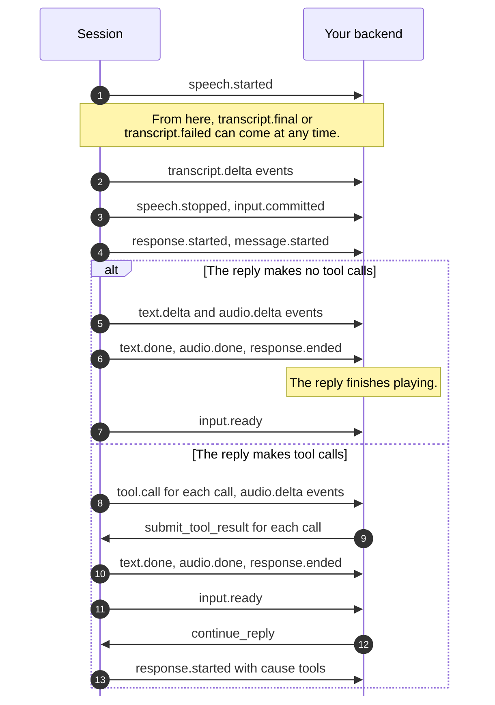

> ## Documentation Index
> Fetch the complete documentation index at: https://docs.rime.ai/llms.txt
> Use this file to discover all available pages before exploring further.

# Prism SDK reference

> Hold Prism conversations with the Rime SDK in Python, Node.js, Go, or Rust. This reference covers the connect options, session methods, events, tool calls, limits, and errors.

`client.realtime.connect` opens one Prism conversation and returns a session. With the session, your application streams the caller's audio and reads the session events on a separate task. It also plays the reply audio, reports how much of each reply the caller heard, and runs tools when Prism asks. The [conversation runner](#run-a-conversation) can do the audio part of that work for you.

Install the SDK from the [SDK overview](https://docs.rime.ai/api-reference/sdk/overview.md#install). For complete programs, see the [SDK guides and examples](#guides-and-examples). Most tables below use Python and Node.js names, with [Go and Rust](#go-and-rust) names in their own section. For older SDK installations, check [SDK compatibility](#sdk-compatibility).

For LiveKit Agents, follow the [Prism LiveKit quickstart](https://docs.rime.ai/docs/prism/livekit.md) to install the plugin and build your agent.

## Open a session

Each example below opens a session with a voice and instructions. It starts your capture loop and reads every event until the session closes.

```python Python theme={null}
async with client.realtime.connect(
    endpoint="wss://prism.api.rime.ai/v1/realtime",
    voice="aurora",
    instructions="You answer the phone for Juniper Cafe.",
) as session:
    capture = asyncio.create_task(stream_microphone(session))
    try:
        async for event in session.events:
            handle(event.payload)
    finally:
        capture.cancel()
```

```typescript Node.js / TypeScript theme={null}
const session = await client.realtime.connect({
  endpoint: "wss://prism.api.rime.ai/v1/realtime",
  voice: "aurora",
  instructions: "You answer the phone for Juniper Cafe.",
});
const capture = new AbortController();
try {
  void streamMicrophone(session, capture.signal);
  for await (const event of session.events) {
    handle(event.payload);
  }
} finally {
  capture.abort();
  await session.close();
}
```

```go Go theme={null}
session, err := client.Realtime.Connect(ctx, rime.RealtimeConnectOptions{
	Voice:        "aurora",
	Instructions: "You answer the phone for Juniper Cafe.",
})
if err != nil {
	return err
}
defer session.Close()
captureCtx, stopCapture := context.WithCancel(ctx)
defer stopCapture()
go streamMicrophone(captureCtx, session)
for {
	event, err := session.Recv(ctx)
	if err == io.EOF {
		return nil
	}
	if err != nil {
		return err
	}
	handle(event.Payload)
}
```

```rust Rust theme={null}
let options = RealtimeConnectOptions::default()
    .voice("aurora")
    .instructions("You answer the phone for Juniper Cafe.");
let session = client.realtime().connect(options).await?;
let capture = tokio::spawn(stream_microphone(session.clone()));
let mut events = session.events()?;
let result = async {
    while let Some(event) = events.next().await {
        handle(event?.payload);
    }
    Ok::<_, rimelabs_sdk::Error>(())
}
.await;
capture.abort();
session.close().await;
result?;
```

The examples use these names:

* `client`: an open client.
* `stream_microphone` and `streamMicrophone`: your capture loop, which calls the audio method in [Send audio](#send-audio).
* `handle`: your event handling, which must return quickly.
* `ctx`: in Go, the context that owns the session. When it ends, the session closes.

## Run a conversation

`run_conversation` in Python and `runConversation` in Node.js run a whole conversation with your audio adapters. The runner sends the caller's audio, plays each reply in order, and handles interruptions. It also reports how much of each reply the caller heard. When the conversation ends, it stops playback and closes the session. The [SDK quickstart](https://docs.rime.ai/docs/prism/quickstart.md) uses it with a page in the browser.

```python Python theme={null}
from rimelabs_sdk.realtime import run_conversation

await run_conversation(session, source=microphone, playback=speaker, on_event=show)
```

```javascript Node.js theme={null}
import { runConversation } from "@rimelabs/sdk";

await runConversation(session, { source: microphone, playback: speaker, onEvent: show, signal });
```

```go Go theme={null}
runner := rime.ConversationRunner{Session: session, Source: microphone, Playback: speaker, OnEvent: show}
err := runner.Run(ctx)
```

```rust Rust theme={null}
use rimelabs_sdk::realtime::ConversationRunner;

ConversationRunner::new(session, microphone, speaker).on_event(show).run(stop).await?;
```

The table gives the Python and Node.js names. In Go, these are the `ConversationRunner` fields, and the context of `Run` ends the run. In Rust, `ConversationRunner::new` takes the session and the two adapters, `on_event` sets the callback, and `stop` is a `CancellationToken` that ends the run.

| Python | Node.js | What it is |
| - | - | - |
| `source` | `source` | Your `ConversationSource`, which reads the caller's audio |
| `playback` | `playback` | Your `ConversationPlayback`, which plays replies and measures how much the caller heard |
| `on_event` | `onEvent` | Optional. It receives every event in order. It must be synchronous and must not block. In Go, it is a `func(SessionEvent) error`. In Rust, it is an `FnMut(&SessionEvent) -> Result<(), Error> + Send + 'static`. An error from it ends the run. |
| Cancel the task | `signal` | Ends the run |

Your adapters implement these methods. In Node.js, `read`, `stop`, and `completion` also take an `AbortSignal`. In Go, they take a `context.Context`, and in Rust, a `CancellationToken`. Go and Rust use the same method names, with a capital first letter in Go:

| Adapter | Method | Contract |
| - | - | - |
| Source | `read()` | Returns one `AudioChunk`, or `None` (`null`) at the end of input. A chunk without a format is 16 kHz mono PCM16. In Go, `Read(context.Context)` returns `(AudioChunk, error)`, with `io.EOF` at the end of input. The end of input ends the run, and the runner closes the session. |
| Playback | `open(output)` | Queues a reply after the replies opened before it, and returns the output for that reply |
| Playback | `interrupt(outputs)` | Stops the selected replies as one batch and discards their unplayed audio. Then the rest of the queue plays in order. |
| Playback | `stop()` | Returns only when all playback has stopped and the queued audio is gone. The runner requests cancellation after 5 seconds and waits for adapter cleanup. Your adapter must honor cancellation. |
| Output | `write(chunk)` | Queues 24 kHz mono PCM16 without blocking. It raises an error when the queue is full. |
| Output | `end()` | Accepts no more audio, and lets the queued audio play out |
| Output | `completion()` | Returns how many milliseconds of the reply played, measured from the output clock. It raises an error when it cannot measure. |

Four rules for the runner and its adapters:

* Play replies one at a time, in the order that the runner opens them. Prism assumes that an interrupted reply leaves later replies in the same turn unheard.
* Measure playback from the audio output clock. Audio that you sent or queued has not played yet.
* During a run, the runner is the only reader of the session events and the only source of playback reports. Tool results and typed messages still use the session methods, such as `submit_tool_result` (`submitToolResult`).
* The runner does not open audio devices, run your tools, or close your adapters.

## Guides and examples

The [Rime SDK repository](https://github.com/rimelabs/rime-sdk) keeps the Prism guide and runnable examples for each language next to the SDK source. Every example connects to `wss://prism.api.rime.ai/v1/realtime` by default. To connect to another Prism deployment, set `PRISM_URL` for the Python, Node.js, and Go examples. The Rust examples always use the default endpoint.

| Language | Prism guide | Example programs |
| - | - | - |
| Python | [`realtime.md`](https://github.com/rimelabs/rime-sdk/blob/python-v0.1.0-alpha.25/python/docs/realtime.md) | <ul><li>[`realtime/recorded.py`](https://github.com/rimelabs/rime-sdk/blob/python-v0.1.0-alpha.25/python/examples/realtime/recorded.py) sends a recorded question and saves the spoken reply as WAV.</li><li>[`realtime/typed_turn.py`](https://github.com/rimelabs/rime-sdk/blob/python-v0.1.0-alpha.25/python/examples/realtime/typed_turn.py) sends a typed turn.</li><li>[`realtime/tools.py`](https://github.com/rimelabs/rime-sdk/blob/python-v0.1.0-alpha.25/python/examples/realtime/tools.py) runs a tool round.</li><li>[`realtime/voice.py`](https://github.com/rimelabs/rime-sdk/blob/python-v0.1.0-alpha.25/python/examples/realtime/voice.py) runs a live conversation with your microphone and speakers.</li><li>[`realtime/voice_tools.py`](https://github.com/rimelabs/rime-sdk/blob/python-v0.1.0-alpha.25/python/examples/realtime/voice_tools.py) adds a tool to it.</li></ul> |
| Node.js / TypeScript | [`realtime.md`](https://github.com/rimelabs/rime-sdk/blob/typescript-v0.1.0-alpha.25/typescript/docs/realtime.md) | <ul><li>[`realtime/recorded.ts`](https://github.com/rimelabs/rime-sdk/blob/typescript-v0.1.0-alpha.25/typescript/examples/realtime/recorded.ts) sends a recorded question and saves the spoken reply as WAV.</li><li>[`realtime/typed-turn.mjs`](https://github.com/rimelabs/rime-sdk/blob/typescript-v0.1.0-alpha.25/typescript/examples/realtime/typed-turn.mjs) sends a typed turn.</li><li>[`realtime/tools.mjs`](https://github.com/rimelabs/rime-sdk/blob/typescript-v0.1.0-alpha.25/typescript/examples/realtime/tools.mjs) runs a tool round.</li><li>[`realtime/voice.ts`](https://github.com/rimelabs/rime-sdk/blob/typescript-v0.1.0-alpha.25/typescript/examples/realtime/voice.ts) runs a live conversation in a local browser page.</li><li>[`realtime/voice-tools.ts`](https://github.com/rimelabs/rime-sdk/blob/typescript-v0.1.0-alpha.25/typescript/examples/realtime/voice-tools.ts) adds a tool to it.</li></ul> |
| Go | [Go README, Prism section](https://github.com/rimelabs/rime-sdk/blob/go/v0.1.0-alpha.16/go/README.md#prism-realtime) | <ul><li>[`realtime/typed`](https://github.com/rimelabs/rime-sdk/blob/go/v0.1.0-alpha.16/go/examples/realtime/typed/main.go) sends a typed turn.</li><li>[`realtime/recorded`](https://github.com/rimelabs/rime-sdk/blob/go/v0.1.0-alpha.16/go/examples/realtime/recorded/main.go) streams a headerless 16 kHz mono PCM16 recording.</li><li>[`realtime/tools`](https://github.com/rimelabs/rime-sdk/blob/go/v0.1.0-alpha.16/go/examples/realtime/tools/main.go) runs a tool round.</li><li>[`realtime/live`](https://github.com/rimelabs/rime-sdk/blob/go/v0.1.0-alpha.16/go/examples/realtime/live/main.go) runs a live conversation through a local audio bridge that your application supplies.</li></ul> |
| Rust | [Rust README, Prism section](https://github.com/rimelabs/rime-sdk/blob/rust-v0.1.0-alpha.14/rust/README.md#prism-realtime) | <ul><li>[`realtime_typed.rs`](https://github.com/rimelabs/rime-sdk/blob/rust-v0.1.0-alpha.14/rust/examples/realtime_typed.rs) sends a typed turn.</li><li>[`realtime_recorded.rs`](https://github.com/rimelabs/rime-sdk/blob/rust-v0.1.0-alpha.14/rust/examples/realtime_recorded.rs) streams a headerless 16 kHz mono PCM16 recording.</li><li>[`realtime_tools.rs`](https://github.com/rimelabs/rime-sdk/blob/rust-v0.1.0-alpha.14/rust/examples/realtime_tools.rs) runs a tool round.</li><li>[`realtime_live.rs`](https://github.com/rimelabs/rime-sdk/blob/rust-v0.1.0-alpha.14/rust/examples/realtime_live.rs) runs a live conversation through a local audio bridge that your application supplies.</li></ul> |

To talk to Prism through your microphone with your own instructions, follow the [Prism SDK quickstart](https://docs.rime.ai/docs/prism/quickstart.md). [Live conversations](https://docs.rime.ai/docs/prism/live-conversations.md), [Typed turns and nudges](https://docs.rime.ai/docs/prism/typed-turns.md), and [Tools](https://docs.rime.ai/docs/prism/tools.md) show these methods in short examples.

## Connection and credentials

| Item | Value |
| - | - |
| Endpoint | `wss://prism.api.rime.ai/v1/realtime`. The SDK uses it by default, so you only need `endpoint` for another Prism deployment. |
| Region | US East (us-east-2) |
| URL checks | Before it connects, the SDK checks that the URL uses `wss://`, names a host, and ends in `/v1/realtime`. The URL must have no user name, password, or fragment. Any other URL raises `RimeInputError`. |
| Plain `ws://` | Allowed only for `localhost`, `127.0.0.1`, and `::1` |
| API key | `RIME_API_KEY`, unless you pass a key when you create the client |
| Authentication | The SDK sends the key as `Authorization: Bearer` on the WebSocket upgrade request, with no token exchange. Keep the key on your backend. |
| Client settings | `model`, `endpoint`, and `timeout` apply only to TTS. |
| HTTP proxy | The Python, Node.js, and Rust SDKs do not connect through an HTTP proxy. Go uses its default HTTP transport, so it honors `HTTPS_PROXY` and `NO_PROXY` for `wss://` connections, except to localhost and loopback addresses. Set them before the first connection, because Go reads them once. |
| Reconnects | None. One session is one conversation on one WebSocket connection. A new session has no memory of an earlier session. |
| Request ID | `session.info.request_id` (`requestId`) is the ID that the Prism logs use for the session. To [report a problem](https://docs.rime.ai/docs/prism/errors.md#report-a-problem), log it with the session ID and the correlation ID of each fault. |

## Connect options

| | Python | Node.js |
| - | - | - |
| Call | `client.realtime.connect(...)`, an async context manager with keyword-only arguments | `await client.realtime.connect({ ... })` |
| Open | Enter it with `async with`, not with `await`. The session closes when you leave the block. | The call resolves to a `RealtimeSession`. [Close it](#cancel-and-clean-up) with `await session.close()`. |

In both languages, connect returns after Prism accepts the session settings, and the session is then ready for audio. Connect takes these options:

| Python | Node.js | Default | Value |
| - | - | - | - |
| `endpoint: str \| None` | `endpoint?: string` | `wss://prism.api.rime.ai/v1/realtime` | A full Prism URL. See [Connection and credentials](#connection-and-credentials). |
| `voice: str \| None` | `voice?: string \| null` | `astra`, Prism's default | `"aurora"`, `"wawona"`, `"brando"`, or `"astra"`. `None` or `null` keeps the default. A blank string raises `RimeInputError`. For an unknown voice, connect raises `RimeRealtimeError` with code `invalid_voice`. |
| `instructions: str \| None` | `instructions?: string \| null` | Prism's default prompt | The system prompt. It tells Prism who the agent is, what it knows, and how it replies. It must be nonblank. `None` or `null` keeps the default. |
| `tools: Sequence[ToolDefinition]` | `tools?: readonly ToolDefinition[]` | No tools | Functions that Prism can ask your backend to run. See [Tool definitions](#tool-definitions). |
| `interrupt_on_speech: bool` | `interruptOnSpeech?: boolean` | `True` or `true` | Whether the caller's speech interrupts a reply. [When interruption is off](https://docs.rime.ai/docs/prism/live-conversations.md#when-interruption-is-off) explains what Prism does with the caller's speech. |
| `turn_detection: TurnDetection \| None` | `turnDetection?: TurnDetection` | Prism's defaults: `auto` and 5,000 ms | How a turn ends. `eagerness` is `"low"`, `"medium"`, `"high"`, or `"auto"`. The end-of-turn timeout, `end_of_turn_timeout_ms` (`endOfTurnTimeoutMs`), is from 1,000 to 10,000 ms. Each field is optional. |
| `timeouts: RealtimeTimeouts` | `timeouts?: RealtimeTimeouts` | 10, 30, and 10 seconds | The deadlines of the SDK. See [Timeouts and limits](#timeouts-and-limits). |
| `request_id: str \| None` | `requestId?: string` | An ID that Prism makes | Your ID for the session. The SDK sends it in the `x-request-id` header. It must be nonblank printable ASCII, or connect raises `RimeInputError`. Prism uses it when it has at most 128 characters. Otherwise, Prism makes its own ID. `session.info.request_id` holds the ID that Prism uses. |
| `response_metadata: Labels \| None` | `responseMetadata?: Labels` | No labels | Labels that every reply carries in the `metadata` of `response.started`, such as `{"step": "3"}`. You can set up to 16 labels. A key has at most 64 characters, and a value has at most 512. No key can start with `prism_`. Prism refuses other labels with `RimeRealtimeError` code `invalid_session`. |
| `truncation: Truncation \| None` | `truncation?: Truncation` | Prism's default, `"auto"` | How Prism shortens the history when the conversation outgrows the context. `"auto"` leaves the oldest turns out. `"disabled"` keeps every turn, so a reply that does not fit fails with `context_length_exceeded`. A retention ratio keeps that share of the room, such as `RetentionRatio(retention_ratio=0.5)` in Python or `{ retentionRatio: 0.5 }` in Node.js. The [`truncation` of each `response.ended`](#kept-text-and-truncation-summaries) says what the reply's prompt left out. |
| `model: Literal["prism"]` | `model?: "prism"` | `"prism"` | The only accepted value |
| None | `signal?: AbortSignal` | None | Cancels the connect call |

Inside connect, the SDK sends one `session.update` with text and audio output, PCM16 input, your interruption and turn timing settings, and your tools. It also sends the voice and instructions when you set them. If Prism refuses the settings, connect raises `RimeRealtimeError`, and the SDK closes the connection.

During a conversation, use [`update`](#update-settings-during-a-conversation) to change instructions, tools, voice, interruption, or history truncation. Use `set_response_metadata` (`setResponseMetadata`) to change reply labels. Eagerness and the end-of-turn timeout remain fixed. [Session configuration](https://docs.rime.ai/api-reference/prism/websocket.md#session-configuration) lists the fields Prism accepts and which settings it can change.

### Tool definitions

In Python, `ToolDefinition` is a frozen dataclass from `rimelabs_sdk.realtime` with keyword-only fields. In Node.js, it is a plain object, and the `ToolDefinition` interface from `@rimelabs/sdk` gives its type.

| Python | Node.js | Default | Value |
| - | - | - | - |
| `name: str` | `name: string` | Required | The function name. It must be nonblank and unique in the session. |
| `parameters: JsonObject` | `parameters: JsonObject` | Required | A JSON Schema object for the arguments. The values must be finite JSON. |
| `description: str` | `description?: string` | `""` | Tells Prism what the tool does and when to call it |
| `prism_filler: PrismFiller \| None` | `prismFiller?: PrismFiller` | None | The phrase that the caller hears while the tool runs. Prism says it on a spoken turn, a typed turn, or a nudge. It says no phrase in a continuation or in a nudge that reports a tool result with `tool_call`. `type="text"` with `text` says your line, and `type="none"` says nothing. Without the setting, or with `type="auto"`, Prism writes a short phrase, and `instructions` can say what it should cover. `text` must be nonblank, with at most 500 Unicode code points. See [Set the phrase for a tool](https://docs.rime.ai/docs/prism/tools.md#set-the-phrase-for-a-tool). |

A tool list that does not meet these conditions raises `RimeInputError` before the SDK connects. This definition requires a `day` argument for an opening-hours lookup:

```python Python theme={null}
from rimelabs_sdk.realtime import ToolDefinition

get_hours = ToolDefinition(
    name="get_hours",
    description="Look up the cafe's opening hours for a day of the week.",
    parameters={
        "type": "object",
        "properties": {"day": {"type": "string"}},
        "required": ["day"],
    },
)
```

```typescript Node.js / TypeScript theme={null}
import type { ToolDefinition } from "@rimelabs/sdk";

const getHours: ToolDefinition = {
  name: "get_hours",
  description: "Look up the cafe's opening hours for a day of the week.",
  parameters: {
    type: "object",
    properties: { day: { type: "string" } },
    required: ["day"],
  },
};
```

### Session info

`session.info` holds the settings that Prism applied. It is available as soon as connect returns.

| Python | Node.js | Value |
| - | - | - |
| `session_id` | `sessionId` | Prism's ID for the session. Log it for support. |
| `request_id` | `requestId` | The ID that the Prism logs use for the session. Log it for support. It is `None` or `null` when Prism does not send it. |
| `response_metadata` | `responseMetadata` | The reply labels that Prism last confirmed |
| `truncation` | `truncation` | The history truncation that Prism last confirmed. It is `None` or `null` when Prism does not publish it. |
| `settings_revision` | `settingsRevision` | The revision of the settings that Prism last confirmed. It is `None` or `null` when Prism does not publish it. |
| `model` | `model` | Always `"prism"` |
| `voice` | `voice` | The voice that Prism applied, such as `"astra"` when you did not set a voice |
| `interrupt_on_speech` | `interruptOnSpeech` | The interruption setting that Prism applied. If Prism did not report it, this is the setting that you requested. |
| `turn_detection` | `turnDetection` | The turn timing that Prism applied, in `eagerness` and `end_of_turn_timeout_ms` (`endOfTurnTimeoutMs`). Each field is `None` or `null` when Prism does not publish it. An eagerness that this SDK release does not recognize is `"unknown"`. |
| `tool_result_timeout_s` | `toolResultTimeoutS` | How many seconds Prism waits for tool results. It is `None` or `null` when Prism does not publish the value. |
| `tool_continuation_timeout_s` | `toolContinuationTimeoutS` | How many seconds Prism waits for the continuation. The wait starts when the parent reply has ended and every result has arrived. It is `None` or `null` when Prism does not publish the value. |

## Session methods

Each method is async, and it returns after Prism acknowledges the request, unless the table says something different. In Node.js, every method except `close` also takes an optional `signal` in its last argument. The `signal` is an `AbortSignal` that cancels the method. `requestReply` takes it in the same options object as `instruction` and `toolCall`, and `createItem` in the same object as `previousItemId`.

| Python | Node.js | Returns | Use it to |
| - | - | - | - |
| `send_audio(chunk)` | `sendAudio(chunk, options?)` | Nothing, after the SDK writes the audio | [Stream the caller's audio](#send-audio) |
| `send_text(text, *, metadata=None)` | `sendText(text, options?)` | `ResponseRef`, when the reply starts | [Start a typed caller turn](#typed-turns-nudges-and-history) |
| `request_reply(*, instruction=None, tool_call=None, metadata=None)` | `requestReply(options?)` | `ResponseRef`, when the reply starts | [Make Prism speak without new input](#typed-turns-nudges-and-history) |
| `add_message(role, text)` | `addMessage(role, text, options?)` | `ItemRef` | [Add history without a reply](#typed-turns-nudges-and-history) |
| `get_history()` | `getHistory(options?)` | The history items, in order | [Read the stored conversation](#read-and-edit-the-history) |
| `create_item(item, *, previous_item_id=None)` | `createItem(item, options?)` | `ItemRef` | [Add a note, a message, or a past tool call](#read-and-edit-the-history) |
| `delete_item(item_id)` | `deleteItem(itemId, options?)` | Nothing | [Hide an item from later replies](#read-and-edit-the-history) |
| `submit_tool_result(call, output)` | `submitToolResult(call, output, options?)` | Nothing | [Return the result of a tool](#tool-calls) |
| `continue_reply(parent, *, metadata=None)` | `continueReply(parent, options?)` | `ResponseRef`, when the reply starts | [Continue after tool results](#tool-calls) |
| `report_playback(report)` | `reportPlayback(report, options?)` | Nothing, after Prism acknowledges an interrupted report, or after the SDK sends a finished report | [Report what the caller heard](#playback-reports) |
| `cancel(response)` | `cancel(response, options?)` | Nothing, after the reply ends | [Stop a reply](#stop-a-reply-or-clear-input) |
| `clear_audio()` | `clearAudio(options?)` | Nothing | [Drop caller speech that Prism has not committed](#stop-a-reply-or-clear-input) |
| `set_response_metadata(metadata)` | `setResponseMetadata(metadata, options?)` | Nothing | Replace the labels of later replies. `session.info` changes after Prism confirms. |
| `update(*, instructions=None, tools=None, voice=None, interrupt_on_speech=None, truncation=None)` | `update(options)` | `SessionInfo`, after Prism confirms | [Change settings during a conversation](#update-settings-during-a-conversation) |
| `close()` | `close()` | Nothing | [Close the session](#cancel-and-clean-up). You can safely repeat it. |

The session also has two properties: [`session.events`](#events) and [`session.info`](#session-info).

## Go and Rust

The Go and Rust SDKs follow the same session model as Python and Node.js, with the same methods, events, references, and runner. They also enforce the same limits on audio, text, queued events, and waiting operations. The names and the cancellation model are different.

> [tab] Go
>
> Import the module as `rime "github.com/rimelabs/rime-sdk/go"`. Call `client.Realtime.Connect(ctx, rime.RealtimeConnectOptions{...})`. It returns `(*rime.RealtimeSession, error)` after Prism accepts the session settings. The context that you pass to `Connect` owns the session, so the session closes when that context ends. Every other method takes its own context, which cancels only that call.
>
> | `RealtimeConnectOptions` field | Python name | Go value |
> | - | - | - |
> | `Endpoint` | `endpoint` | `string`. An empty string selects `wss://prism.api.rime.ai/v1/realtime`. |
> | `Voice`, `Instructions` | `voice`, `instructions` | `string`. An empty string keeps the Prism default. |
> | `Tools` | `tools` | `[]rime.ToolDefinition`, with `Name`, `Description`, `Parameters` as `map[string]any`, and `PrismFiller` as `*rime.PrismFiller` |
> | `InterruptOnSpeech` | `interrupt_on_speech` | `*bool`. Nil means `true`. |
> | `TurnDetection` | `turn_detection` | `rime.TurnDetection{Eagerness, EndOfTurnTimeoutMS}`. A zero field keeps the Prism default. |
> | `Timeouts` | `timeouts` | `rime.RealtimeTimeouts{Connect, Ready, Request}`, each a `time.Duration`. A zero field selects the default of 10, 30, or 10 seconds. |
> | `RequestID` | `request_id` | `string`. An empty string lets Prism make the ID. A server or gateway can replace it, so read the request ID in the session info. |
> | `ResponseMetadata` | `response_metadata` | `map[string]string` |
> | `Truncation` | `truncation` | `*rime.Truncation`, with a `Mode` of `rime.TruncationAuto`, `rime.TruncationDisabled`, or `rime.TruncationRetentionRatio`, and a `Ratio` for the last mode. Nil keeps Prism's default. |
>
> `rime.PrismFiller` sets the phrase with `Type`, `Text`, and `Instructions`. `Type` is `"auto"`, `"text"`, or `"none"`, as [Set the phrase for a tool](https://docs.rime.ai/docs/prism/tools.md#set-the-phrase-for-a-tool) describes.
>
> | Item | Go |
> | - | - |
> | Session info | `session.Info()` returns a copy of `rime.SessionInfo`. The turn timing is in `Eagerness` and `EndOfTurnTimeoutMS`. A nil pointer means that Prism did not publish the value. |
> | Methods | `SendText`, `RequestReply`, `AddMessage`, `GetHistory`, `CreateItem`, `DeleteItem`, `SubmitToolResult`, `ContinueReply`, `ReportPlayback`, `Cancel`, `SendAudio`, `ClearAudio`, `SetResponseMetadata`, `Update`, and `Close`. Each method except `Close` takes a context first. `RequestReply` takes `rime.ReplyOptions{Instruction, ToolCall}`. To label one reply, use `SendTextWithOptions`, `RequestReplyWithOptions`, or `ContinueReplyWithOptions` with `rime.ReplyRequestOptions{Metadata: labels}`. |
> | Events | `session.Recv(ctx)` returns the next `rime.SessionEvent`. Only one goroutine can read at a time. After a normal close, `Recv` returns `io.EOF`. |
> | Event types | Use a type switch on `event.Payload`. The types have the Python class names, such as `rime.TextDelta` and `rime.ResponseEnded`. The fields have Go names, such as `ItemID` and `AudioEndMS`. A Prism `error` event is `rime.FaultEvent`, with the fault in `Fault`. `rime.TranscriptFailed` also has its fault in `Fault`, where Python uses `error`. |
> | References | `ResponseRef`, `ItemRef`, `ToolCallRef`, and `OutputRef` have methods that return their IDs, such as `ResponseID()`. |
> | Tool arguments | `ToolCall.Arguments` is a `map[string]any`. Its numbers are `json.Number` values, which keep their precision. |
> | Audio | `rime.AudioChunk{Data, Format}`, with `Format` as `rime.PCMFormat`. A zero `Format` means 16 kHz mono. |
> | Playback reports | `rime.PlaybackInterrupted{Output, AudioEndMS}` and `rime.PlaybackFinished{Response, PlayedMS, AudibleTailMS}` |
> | Kept text and truncation summaries | `rime.ItemTruncated` has `ItemID`, `ContentIndex`, `AudioEndMS`, and `KeptText`, a `*string` that is nil when Prism does not send the text. `ResponseEnded.Truncation` is a `*rime.ResponseTruncation` with `ItemsLeftOut` and `FirstKeptItemID`, a `*string`. It is nil when the prompt left nothing out or Prism does not send a summary. From `v0.1.0-alpha.15`, a `ResponseEnded` literal without field names must also list `Truncation`, so use field names. |
> | Runner | Set the fields of `rime.ConversationRunner`, and call `Run(ctx)`. `Read`, `Completion`, and `Stop` of your adapters take a context. `Open`, `Write`, `End`, and `Interrupt` take no context and must return without blocking. |
> | Faults | Use `errors.As` with a `*rime.RealtimeFault`. Its fields are `Code`, `Message`, `Scope`, `RequestID`, `ResponseID`, `ItemID`, `CallIDs`, `CorrelationID`, and `Parameter`. `fault.Retryable()` gives `retryable`. |
> | Errors | Use `errors.Is` with an error kind, such as `rime.ErrInput`. [Error names in Go and Rust](#error-names-in-go-and-rust) maps each kind to the classes on this page. |

> [tab] Rust
>
> Import the Prism types from `rimelabs_sdk::realtime`. Call `client.realtime().connect(options).await` inside a Tokio runtime. It returns `Result<RealtimeSession, Error>` after Prism accepts the session settings.
>
> | `RealtimeConnectOptions` method | Python name | Rust value |
> | - | - | - |
> | `default()` | None | Starts with every default, which includes the endpoint `wss://prism.api.rime.ai/v1/realtime` |
> | `.endpoint(...)` | `endpoint` | A full Prism URL |
> | `.voice(...)`, `.instructions(...)` | `voice`, `instructions` | A string |
> | `.tools(...)` | `tools` | `Vec<ToolDefinition>`, with `name`, `description`, `parameters` as a JSON object map, and `prism_filler` as `Option<PrismFiller>` |
> | `.interrupt_on_speech(...)` | `interrupt_on_speech` | `bool`. The default is `true`. |
> | `.turn_detection(...)` | `turn_detection` | `TurnDetection { eagerness, end_of_turn_timeout_ms }`. A field that is `None` keeps the Prism default. |
> | `.timeouts(...)` | `timeouts` | `RealtimeTimeouts { connect, ready, request }`, each a `Duration`. The defaults are 10, 30, and 10 seconds. |
> | `.request_id(...)` | `request_id` | A string |
> | `.response_metadata(...)` | `response_metadata` | `Labels`, a map of strings to strings |
> | `.truncation(...)` | `truncation` | `Truncation::Auto`, `Truncation::Disabled`, or `Truncation::RetentionRatio(ratio)` |
>
> `PrismFiller` sets the phrase. Use `PrismFiller::None` for no phrase, `PrismFiller::Text(text)` for your own line, or `PrismFiller::Auto(Some(instructions))` for a phrase that Prism writes with your guidance.
>
> | Item | Rust |
> | - | - |
> | Session handles | You can clone a `RealtimeSession`, so a capture task can own a handle. When the last handle drops, the SDK starts cleanup. `session.close().await` waits until cleanup is complete. |
> | Session info | `session.info()` returns a copy of `SessionInfo`. The turn timing is in `eagerness` and `end_of_turn_timeout_ms`. `None` means that Prism did not publish the value. |
> | Methods | `send_text`, `request_reply`, `add_message`, `get_history`, `create_item`, `delete_item`, `submit_tool_result`, `continue_reply`, `report_playback`, `cancel`, `send_audio`, `clear_audio`, `set_response_metadata`, `update`, and `close`. Pass references by `&`, as in `continue_reply(&parent)`. `request_reply` takes `ReplyOptions::default()`, with `.instruction(...)`, `.tool_call(...)`, and `.metadata(...)` builders. To label a typed reply or tool continuation, use `send_text_with_options` or `continue_reply_with_options` with `ReplyRequestOptions::default().metadata(labels)`. To cancel a call, drop its future. |
> | Events | `session.events()?` returns the single `RealtimeEvents` stream, and a second call returns an `Input` error. Read it with `futures_util::StreamExt::next`. After a normal close, the stream ends. After a failure, it yields the error once and then ends. |
> | Event types | Match on `event.payload`, a `RealtimeEvent`. The variants have the Python class names, such as `RealtimeEvent::TextDelta`, and the fields have the Python names. One exception is `RealtimeEvent::TranscriptFailed { item_id, fault }`, which has `fault` where Python uses `error`. A Prism `error` event is `RealtimeEvent::Fault(fault)`. The enum is `#[non_exhaustive]`, so add a `_` arm. |
> | References | `ResponseRef`, `ItemRef`, `ToolCallRef`, and `OutputRef` have private fields. Read them with methods. For example, a `ToolCallRef` has `.response().session_id()`, `.response().response_id()`, and `.call_id()`. |
> | Optional fields | Optional fields are `Option` values, such as the `reason` of `ResponseEnded` and the `end_reason` of `SpeechStopped`. |
> | Audio | `AudioChunk { data, format }`, with `data` as `bytes::Bytes` and `format` as `PcmFormat` |
> | Playback reports | `PlaybackReport::Interrupted { output, audio_end_ms }` and `PlaybackReport::Finished { response, played_ms, audible_tail_ms }` |
> | Kept text and truncation summaries | `RealtimeEvent::ItemTruncated { item_id, content_index, audio_end_ms, kept_text }`, with `kept_text` as an `Option<String>`. `RealtimeEvent::ResponseEnded` has `truncation`, an `Option<ResponseTruncation>` with `items_left_out` and `first_kept_item_id`, an `Option<String>`. From `0.1.0-alpha.13`, a `ResponseEnded` pattern that names every field needs `truncation` or `..`, and a `ResponseEnded` value that you build needs `truncation: None`. |
> | Runner | `ConversationRunner::new(session, source, playback)`, then `.on_event(callback)` and `.run(stop).await`. `stop` is a `tokio_util::sync::CancellationToken`, so add the `tokio-util` crate. If you drop the `run` future, the SDK starts cleanup but does not wait for it. |
> | Faults | `error.realtime_fault()` returns `Some(&RealtimeFault)` when Prism refused the request. The fields have the Python names, and `fault.retryable()` gives `retryable`. |
> | Errors | `error.kind()` returns an `ErrorKind`. [Error names in Go and Rust](#error-names-in-go-and-rust) maps each kind to the classes on this page. |

### Error names in Go and Rust

Go and Rust use error kinds in place of the error classes on this page:

| Python and Node.js class | Go | Rust |
| - | - | - |
| `RimeRealtimeError` | A `*rime.RealtimeFault` in the error chain, with the kind `rime.ErrRealtime` | `realtime_fault()` returns `Some`, with the kind `ErrorKind::Realtime` |
| `RealtimeAdmissionTimeout` | `rime.ErrTimeout` | `ErrorKind::Timeout` |
| `RealtimeIdleTimeout` | `rime.ErrTimeout`, with `*rime.RealtimeIdleTimeout` in the error chain | `ErrorKind::Timeout`, with `error.realtime_idle_timeout()` |
| `RimeInputError` | `rime.ErrInput` | `ErrorKind::Input` |
| `RimeAudioFormatError` | `rime.ErrAudioFormat` | `ErrorKind::AudioFormat` |
| `RimeAuthenticationError` | `rime.ErrAuthentication` | `ErrorKind::Authentication` |
| `RimeUnavailableError` | `rime.ErrUnavailable` | `ErrorKind::Unavailable` |
| `RimeTimeoutError` | `rime.ErrTimeout` | `ErrorKind::Timeout` |
| `RimeResourceLimitError` | `rime.ErrResourceLimit` | `ErrorKind::ResourceLimit` |
| `RimeStreamError` | `rime.ErrStream` | `ErrorKind::Stream` |
| `RimeCancelledError` | `rime.ErrCancelled`, when the context of the call is cancelled or the session is closed | `ErrorKind::Cancelled`, when the session is closed or you cancel the `stop` token of the runner. A dropped future does not return an error. |

A Prism refusal has the realtime kind, and the session stays usable, as after `RimeRealtimeError`.

## Update settings during a conversation

`update` changes the instructions, tools, voice, interruption setting, or history truncation without a new connection. It returns the new `SessionInfo` after Prism confirms the change.

```python Python theme={null}
info = await session.update(
    instructions="Handle billing. Use only the supplied tools.",
    tools=[refund_tool],
)
```

```typescript Node.js / TypeScript theme={null}
const info = await session.update({
  instructions: "Handle billing. Use only the supplied tools.",
  tools: [refundTool],
});
```

| Topic | What happens |
| - | - |
| Omitted fields | A field that you omit keeps its value. In Python, `None` also keeps the value. In Node.js, `undefined` keeps it, and `null` is not accepted. |
| Tools | A tool list replaces the complete list, with the filler of each tool. An empty list removes all tools. |
| Instructions | Empty instructions clear the prompt. When you send instructions and tools together, they change in one request. |
| Voice | An empty voice selects the default voice of the deployment. |
| Fixed settings | The eagerness and the end-of-turn timeout cannot change. |
| Waiting | `update` does not wait for Prism to be idle or for tool results. |
| Replies in progress | Each reply keeps the settings that it started with, which includes its interruption setting through playback. `settings_revision` (`settingsRevision`) on `response.started` and `response.ended` tells which settings a reply uses. |
| Refusals | If Prism refuses the update, `update` raises `RimeRealtimeError`, `session.info` does not change, and the session stays open. |
| Cancellation | If you cancel `update` after the SDK sends it, Prism can still apply the change. |
| Go and Rust | In Go, pass a `rime.RealtimeUpdateOptions` to `Update`. A nil field keeps its value, and an empty, non-nil `Tools` slice removes all tools. In Rust, build `RealtimeUpdateOptions::default()` with `.instructions(...)`, `.tools(...)`, `.voice(...)`, `.interrupt_on_speech(...)`, or `.truncation(...)`, and pass it to `update`. |

## Send audio

Send the caller's audio all the time, from connect until you close the session, including silence and caller audio while Prism speaks. Prism finds interruptions and the end of each turn in this audio, and it sends no acknowledgment for audio. [Stream audio for the whole call](https://docs.rime.ai/docs/prism/live-conversations.md#stream-audio-for-the-whole-call) explains what happens when the audio stops and when a conversation is idle.

In Python, `AudioChunk` and `PCMFormat` are frozen dataclasses from `rimelabs_sdk.realtime`. In Node.js, a chunk is a plain object.

| Python | Node.js | Default | Value |
| - | - | - | - |
| `AudioChunk.data: bytes` | `AudioChunk.data: Uint8Array` | Required | Headerless signed 16-bit little-endian PCM in complete sample frames. At most 192,000 bytes for each call. Python accepts only `bytes`, not `bytearray` or `memoryview`. |
| `AudioChunk.format: PCMFormat` | `AudioChunk.format?: PCMFormat` | 16 kHz mono | The format of `data` |
| `PCMFormat.sample_rate` | `PCMFormat.sampleRate` | `16000` | `8000`, `16000`, `24000`, or `48000` |
| `PCMFormat.channels` | `PCMFormat.channels` | `1` | `1`, or `2` with interleaved samples |
| `PCMFormat.encoding` | `PCMFormat.encoding` | `"pcm_s16le"` | The only accepted value |

Send a frame captured as 48 kHz stereo PCM16:

```python Python theme={null}
from rimelabs_sdk.realtime import AudioChunk, PCMFormat

await session.send_audio(
    AudioChunk(data=frame, format=PCMFormat(sample_rate=48000, channels=2))
)
```

```typescript Node.js / TypeScript theme={null}
await session.sendAudio({ data: frame, format: { sampleRate: 48000, channels: 2 } });
```

The SDK handles audio in each direction like this:

| Stage | What happens |
| - | - |
| Checks | An invalid chunk raises `RimeAudioFormatError`, and the SDK sends nothing. Python checks the frames when you create the `AudioChunk`. The SDK does not decode WAV headers or compressed formats such as MP3. |
| Conversion | The SDK mixes stereo down to mono and resamples the audio to 16 kHz. It keeps the conversion state from one call to the next. A format change or `clear_audio` resets the state. |
| Sending | The SDK sends the audio in appends of at most 1,280 bytes, up to 40 ms each. |
| Call order | Calls run one at a time. Await each call, and limit the size of your capture queue, so that a slow connection cannot make it grow. |
| Reply audio | Reply audio arrives in `audio.delta` events as headerless 24 kHz mono PCM16, and Prism has no other output format. The chunk sizes vary, and the audio arrives faster than real time, so queue it in your player. |

## Typed turns, nudges, and history

These methods make Prism reply without new speech, or add history without a reply. [Typed turns and nudges](https://docs.rime.ai/docs/prism/typed-turns.md) shows them in a conversation.

| Call | What it does |
| - | - |
| `send_text(text)` | Sends the caller's words as text. Prism replies to them as a turn. |
| `request_reply` | Makes Prism speak without new input, for example a greeting before the caller speaks or a check-in when the caller is quiet. |
| `instruction` of `request_reply` | Guides this one reply. It does not replace the session instructions. |
| `metadata` of `send_text`, `request_reply`, or `continue_reply` | Labels only the reply that the call starts. A request label replaces a session label with the same key. |
| `tool_call` of `request_reply` | Takes a `ToolCallRef` whose result you already submitted, and the reply then reports that result. A call without a submitted result raises `RimeInputError`. |
| `add_message(role, text)` | Adds a `"user"` or `"assistant"` message to the history without a reply. An example is a greeting that your application played itself. To add a note for the model or a past tool call, use [`create_item`](#read-and-edit-the-history). |

```python Python theme={null}
reply = await session.send_text("What time do you close today?", metadata={"step": "hours"})
check_in = await session.request_reply(
    instruction="Ask whether the caller is still there.", metadata={"step": "check-in"}
)
item = await session.add_message("assistant", "Thanks for calling Juniper Cafe.")
```

```typescript Node.js / TypeScript theme={null}
const reply = await session.sendText("What time do you close today?", { metadata: { step: "hours" } });
const checkIn = await session.requestReply({
  instruction: "Ask whether the caller is still there.",
  metadata: { step: "check-in" },
});
const item = await session.addMessage("assistant", "Thanks for calling Juniper Cafe.");
```

| Topic | What happens |
| - | - |
| Idle | Prism accepts a typed turn or a nudge only while it is [idle](https://docs.rime.ai/docs/prism/typed-turns.md#wait-until-prism-is-idle). |
| Waiting | `send_text` and `request_reply` wait for the Prism [`input.ready`](#event-types) event, and they retry while Prism reports that it is busy. If `ready_s` passes first, they raise `RealtimeAdmissionTimeout`, and the session stays usable. |
| Busy refusals | Even though the SDK retries, each busy refusal still arrives as an `error` event. Its code is `typed_turn_busy`, `instructions_busy`, or `proactive_unavailable`, so do not treat every error event as fatal. |
| Caller speech | If the caller starts to speak before the reply starts, Prism refuses the request, and the method raises `RimeRealtimeError`. |
| Text limits | Text for all three methods must be nonblank, with at most 4,000 Unicode code points. Other text raises `RimeInputError`, and the SDK sends nothing. |
| Return value | A returned `ResponseRef` means that the reply started, not that it finished. The reply's `response.ended` event says how it ended. |

When Prism saves a nudge's `instruction`, `ResponseStarted.instruction_item_id`
(`instructionItemId` in Node.js) names it. After that reply ends, pass the ID
to `delete_item` (`deleteItem`) to remove the instruction from later history.
It is `None` or `null` when Prism saved no instruction. In Rust, read the
separate `ResponseInstructionSaved` event for the item ID.

## Read and edit the history

`get_history`, `create_item`, and `delete_item` read and change the stored conversation. Truncation may omit older turns from the next prompt. They never start a reply or run a tool. Use them to add a note for the model during a call, to remove an item that the agent should no longer use, or to start a new session from an earlier call.

This example adds a note for the model, reads the history, and deletes the note:

```python Python theme={null}
from rimelabs_sdk.realtime import HistoryMessage

note = await session.create_item(
    HistoryMessage(role="system", text="The caller has a pickup order at 10 a.m.")
)
items = await session.get_history()
await session.delete_item(note.item_id)
```

```typescript Node.js / TypeScript theme={null}
const note = await session.createItem({
  type: "message",
  role: "system",
  text: "The caller has a pickup order at 10 a.m.",
});
const items = await session.getHistory();
await session.deleteItem(note.itemId);
```

```go Go theme={null}
note, err := session.CreateItem(ctx, rime.HistoryItem{
	Type: rime.HistoryMessage,
	Role: "system",
	Text: "The caller has a pickup order at 10 a.m.",
}, "")
if err != nil {
	return err
}
items, err := session.GetHistory(ctx)
if err != nil {
	return err
}
if err := session.DeleteItem(ctx, note.ItemID()); err != nil {
	return err
}
```

```rust Rust theme={null}
use rimelabs_sdk::realtime::{HistoryItem, HistoryRole};

let note = session
    .create_item(
        HistoryItem::Message {
            id: None,
            role: HistoryRole::System,
            text: "The caller has a pickup order at 10 a.m.".into(),
        },
        None,
    )
    .await?;
let items = session.get_history().await?;
session.delete_item(note.item_id()).await?;
```

`items` holds the note, with the ID that Prism gave it. After the delete, `get_history` no longer lists the note, and the next reply no longer sees it.

| Python | Node.js | What it does | Sends, then waits for |
| - | - | - | - |
| `get_history()` | `getHistory(options?)` | Returns the stored conversation in order, including turns that truncation may omit from the next prompt. Python returns a tuple of history items, and Node.js a read-only array. Each item has its `id`. | [`prism.conversation.get`](https://docs.rime.ai/api-reference/prism/websocket#prism-conversation-get), then [`prism.conversation`](https://docs.rime.ai/api-reference/prism/websocket#prism-conversation) |
| `create_item(item, *, previous_item_id=None)` | `createItem(item, options?)` | Adds one item and returns its `ItemRef`. In Node.js, `options` holds `previousItemId` and `signal`. | [`conversation.item.create`](https://docs.rime.ai/api-reference/prism/websocket#conversation-item-create), then [`conversation.item.created`](https://docs.rime.ai/api-reference/prism/websocket#conversation-item-created) |
| `delete_item(item_id)` | `deleteItem(itemId, options?)` | Hides an item from later replies, and returns nothing. It takes the ID as a string, such as the `item_id` of an `ItemRef` or the `id` of a listed item. | [`conversation.item.delete`](https://docs.rime.ai/api-reference/prism/websocket#conversation-item-delete), then [`conversation.item.deleted`](https://docs.rime.ai/api-reference/prism/websocket#conversation-item-deleted) |

### History items

`create_item` takes one of three item types, and `get_history` returns the same types. In Python, they are frozen dataclasses from `rimelabs_sdk.realtime` with keyword-only fields. In Node.js, an item is a plain object whose `type` gives its kind, and the `HistoryItem` type from `@rimelabs/sdk` describes it. Node.js uses the same fields in camelCase, such as `callId`.

| Python | Node.js `type` | Fields | What it is |
| - | - | - | - |
| `HistoryMessage` | `"message"` | `role`, `text`, `id` | A message. `"user"` is something that the caller said, and `"assistant"` is a reply that the caller heard. `"system"` is a note for the model, which the model sees at its place in the conversation. |
| `HistoryFunctionCall` | `"function_call"` | `call_id`, `name`, `arguments`, `id` | A past tool call, with its arguments as a JSON string. It never runs a tool. |
| `HistoryFunctionResult` | `"function_call_output"` | `call_id`, `output`, `id` | The result of the past call with the same `call_id`, as a string |

`id` is optional when you create an item. It is your own ID for the item, from 1 to 32 characters. Without it, Prism gives the item an ID.

Add a past tool call first, and then its result. Prism shows the call to the model, and `get_history` lists it, only after the result arrives. These calls add a lookup of Monday's hours from an earlier call:

```python Python theme={null}
from rimelabs_sdk.realtime import HistoryFunctionCall, HistoryFunctionResult

await session.create_item(
    HistoryFunctionCall(
        call_id="call_hours_1",
        name="get_hours",
        arguments=json.dumps({"day": "Monday"}),
    )
)
await session.create_item(
    HistoryFunctionResult(call_id="call_hours_1", output=json.dumps({"closes": "4 p.m."}))
)
```

```typescript Node.js / TypeScript theme={null}
await session.createItem({
  type: "function_call",
  callId: "call_hours_1",
  name: "get_hours",
  arguments: JSON.stringify({ day: "Monday" }),
});
await session.createItem({
  type: "function_call_output",
  callId: "call_hours_1",
  output: JSON.stringify({ closes: "4 p.m." }),
});
```

For a tool call that Prism makes during the session, return the result with [`submit_tool_result`](#tool-calls).

### Start from an earlier call

A new session has no memory of an earlier session, and the SDK does not reconnect. To go on with a call in a new session, read the history with `get_history` while the call runs, and keep the items. Then add them to the new session in order, before you stream the caller's audio:

```python Python theme={null}
for item in saved:
    await new_session.create_item(item)
```

```typescript Node.js / TypeScript theme={null}
for (const item of saved) {
  await newSession.createItem(item);
}
```

The new session lists the same items with the same IDs, and its replies see them, though truncation can leave the oldest turns out of a prompt. Read the history before the old session ends. After a failure ends a session, its methods raise that failure.

### What to know about the history

| Topic | What happens |
| - | - |
| Position | Without `previous_item_id` (`previousItemId`), the item goes at the end. `"root"` puts it first. The ID of an item puts the new item after that item's whole turn, such as after the reply to a caller's turn. A result always goes after its call, and a result with `previous_item_id` raises `RimeInputError`. |
| Roles | `add_message` takes only `"user"` and `"assistant"` messages. `create_item` also takes `"system"` notes and past tool calls. |
| Limits | The text of a message has at most 4,000 code points, and an `id` has 1 to 32 characters. Other values raise `RimeInputError`, and the SDK sends nothing. |
| What the history lists | An item that you add appears at once, except a past call, which appears with its result. A caller turn and the reply to it appear after the reply ends. Until then, the history leaves out both. [`prism.conversation`](https://docs.rime.ai/api-reference/prism/websocket#prism-conversation) lists when each kind of item appears. |
| Deletion | The next reply no longer sees the item, but a reply that is already running keeps what it saw. Deleting a tool call or its result hides both. Deleting an item a second time succeeds. |
| Tool rounds | A tool call that you delete during its tool round still needs its result and continuation, through `submit_tool_result` and `continue_reply`. |
| Long conversations | With `truncation` set to `"disabled"`, a reply that does not fit the context fails with `context_length_exceeded`. Delete older items before you try again. With `"auto"`, it fails only when the instructions, tools, and current turn alone don't fit, so shorten them. |
| Waiting | The three methods do not wait for `input.ready`. Each one returns after Prism acknowledges it, within `request_s`. |
| Refusals | A refusal raises `RimeRealtimeError`, and the session stays open. For example, `item_not_found` means that this conversation never had an item with that ID, and `item_id_in_use` means that an item in the conversation already has the new `id`. [History and playback reports](https://docs.rime.ai/docs/prism/errors.md#history-and-playback-reports) explains each code. |
| Cancellation | If you cancel a method after the SDK sends it, Prism can still apply the change. |

Go and Rust have the same methods and item types, with these names:

| Python | Go | Rust |
| - | - | - |
| `get_history()` | `GetHistory(ctx)` returns `[]rime.HistoryItem`. | `get_history()` returns `Vec<HistoryItem>`. |
| `create_item(item, previous_item_id=...)` | `CreateItem(ctx, item, previousItemID)` returns `rime.ItemRef`. An empty `previousItemID` adds the item at the end. | `create_item(item, previous_item_id)` returns `ItemRef`. `None` adds the item at the end. |
| `delete_item(item_id)` | `DeleteItem(ctx, itemID)` returns only an error. | `delete_item(item_id)` takes a `&str`. |
| `HistoryMessage`, `HistoryFunctionCall`, and `HistoryFunctionResult` | One `rime.HistoryItem` struct. Its `Type` is `rime.HistoryMessage`, `rime.HistoryFunctionCall`, or `rime.HistoryFunctionResult`. The other fields are `ID`, `Role`, `Text`, `CallID`, `Name`, `Arguments`, and `Output`. | The `HistoryItem` enum, with the variants `Message`, `FunctionCall`, and `FunctionResult`. The `role` of a message is a `HistoryRole`, and `item.id()` returns the ID. |
| `id=None` | An empty `ID` | `id: None` |

## Tool calls

When Prism needs your backend to run a tool, the reply sends a `tool.call` event for each call and then ends. Run each tool on a separate task and submit its result so the events loop can keep reading. Call `continue_reply` for the parent reply after it ends. The method waits for every result before requesting the continuation. In this code, `run_tool` and `runTool` stand for your code, and `payload` is the payload of the event.

```python Python theme={null}
# On a ToolCall event:
output = json.dumps(await run_tool(payload.name, payload.arguments))
await session.submit_tool_result(payload.call, output)

# On the ResponseEnded event of the reply that made the call:
continuation = await session.continue_reply(payload.response)
```

```typescript Node.js / TypeScript theme={null}
// On a "tool.call" event:
const output = JSON.stringify(await runTool(payload.name, payload.arguments));
await session.submitToolResult(payload.call, output);

// On the "response.ended" event of the reply that made the call:
const continuation = await session.continueReply(payload.response);
```

| Method | What it takes and does |
| - | - |
| `submit_tool_result(call, output)` | Takes the `call` reference from the `tool.call` event and the result as a string, so encode structured results as JSON. It returns after Prism records the result, and it does not start a reply. If you submit the same output again, nothing happens. A different output for a call that already has a result raises `RimeInputError`. |
| `continue_reply(parent)` | Takes the `ResponseRef` of the reply that made the calls, from the `response.started` or `response.ended` event of that reply. In Node.js, the `ToolCallRef` of the call also works. The method waits until that reply has ended and every call has a recorded result, for up to `ready_s`. |

The continuation is a new reply. Its `response.started` event has `cause` `"tools"`, with the parent reply in `parent`. `continue_reply` raises these errors:

| When | Error |
| - | - |
| The wait passes `ready_s`. | `RealtimeAdmissionTimeout` |
| The reply made no tool calls, or you already continued it. | `RimeInputError` |
| The SDK has observed newer caller speech or a newer reply that supersedes the parent reply. | `RimeInputError` |
| Prism refuses the continuation, because the caller spoke first or a wait ran out, as after `tool_result_timeout`. | `RimeRealtimeError` with code `tool_continuation_unavailable` |
| Prism refuses the continuation, because the caller spoke after Prism took the continuation but before its reply started. | `RimeRealtimeError` with code `response_superseded` |

The SDK checks only what it has seen, so Prism can still refuse a continuation that passes the SDK checks. A typed turn or a nudge also ends a waiting tool round, as the caller's speech does. [Timeouts and late results](https://docs.rime.ai/docs/prism/long-running-tasks.md#timeouts-and-late-results) explains the two Prism waits in `session.info`, and [Errors and limits](https://docs.rime.ai/docs/prism/errors.md#tool-calls) explains each tool error code.

## Playback reports

A playback report tells Prism what the caller actually heard, by the clock of your player. Prism uses the reports to decide [what it remembers of an interrupted reply](https://docs.rime.ai/docs/prism/live-conversations.md#what-prism-remembers-of-an-interrupted-reply) and whether its next reply acknowledges the interruption. It also uses them to know when a finished reply stops playing. Playback reports are optional. Without them, Prism estimates playback from the start of playback, by its own clock, as [Report when a reply finishes playing](https://docs.rime.ai/docs/prism/live-conversations.md#report-when-a-reply-finishes-playing) explains.

| Report | Python | Node.js | Send it when |
| - | - | - | - |
| Interrupted | `PlaybackInterrupted(output=..., audio_end_ms=...)` | `{ kind: "interrupted", output, audioEndMs }` | The caller interrupted a reply, and your player stopped it. |
| Finished | `PlaybackFinished(response=..., played_ms=None, audible_tail_ms=None)` | `{ kind: "finished", response, playedMs?, audibleTailMs? }` | The audio of a reply finished playing, or you discarded it. |

```python Python theme={null}
from rimelabs_sdk.realtime import PlaybackFinished, PlaybackInterrupted

await session.report_playback(PlaybackInterrupted(output=output, audio_end_ms=1200))
await session.report_playback(PlaybackFinished(response=response))
```

```typescript Node.js / TypeScript theme={null}
await session.reportPlayback({ kind: "interrupted", output, audioEndMs: 1200 });
await session.reportPlayback({ kind: "finished", response });
```

| | `PlaybackInterrupted` | `PlaybackFinished` |
| - | - | - |
| Reference | `output` is the `OutputRef` from the `message.started` event of the reply. The text and audio events of the reply also carry it. | `response` is the `ResponseRef` of the reply. |
| Other fields | `audio_end_ms` is how much of the message audio the caller heard. It is in milliseconds from the start of the message, as an integer from 0 to 4,294,967,295. | `played_ms` and `audible_tail_ms` are optional. They must be finite and nonnegative. |
| What the SDK does | It sends the report, and the method returns when Prism acknowledges the report. The acknowledgment also arrives as an [`item.truncated` event](#kept-text-and-truncation-summaries), with the words that Prism keeps. | It waits up to `ready_s` for the reply to end. If the reply sent audio, it then sends Prism a playback receipt, and Prism does not acknowledge the receipt. |
| Errors | An output that the SDK has not seen in this session raises `RimeInputError`. A report on a reply from an earlier stretch of playback raises `RimeRealtimeError` with code `truncate_not_current`, and that report changes nothing. | `RimeTimeoutError` when the reply does not end within `ready_s`. The session stays usable. |

When the caller interrupts, stop playback, drop the reply audio that your player has queued, and then report `PlaybackInterrupted`. [Stop playback when the caller talks over a reply](https://docs.rime.ai/docs/prism/live-conversations.md#stop-playback-when-the-caller-talks-over-a-reply) shows this order in code.

## Stop a reply or clear input

| | `cancel(response)` | `clear_audio()` |
| - | - | - |
| What Prism does | Prism stops making the reply. A cancelled reply ends with reason `"client_cancelled"`, and its words leave the history, unless the reply made tool calls. | Prism drops the caller audio that it has not committed, including speech in progress. Prism also resets its speech detection. |
| What the SDK does | The method returns after the reply ends. If the reply already ended, it returns at once and sends nothing. | The SDK resets its audio conversion. |

A reply can finish before the cancel gets to Prism, so read the `status` of its `response.ended` event instead of assuming `"cancelled"`. A cancel is also not an interruption, so audio that Prism already sent plays until your player stops it.

## Events

`session.events` is an async iterator of `SessionEvent` values. Read it on a separate task for the whole session, and read the events as fast as they arrive. Only one reader can use it at a time, and a second reader raises `RimeInputError`. The SDK queues at most 256 unread events, and a full queue ends the session with `RimeResourceLimitError`. The session stays open when your loop ends.

| Python | Node.js | Value |
| - | - | - |
| `session_id` | `sessionId` | The session that the event belongs to |
| `event_id` | `eventId` | Prism's ID for the event. It is empty for `response.abandoned`, because the SDK creates that event itself. |
| `request_id` | `requestId` | The ID that the SDK gave your request. It is on the event that acknowledges the request. That is `response.started` for `send_text`, `request_reply`, or `continue_reply`, and `response.ended` for `cancel`. Otherwise it is `None` or `null`. |
| `payload` | `payload` | One of the event types below |

Branch on `payload.kind` in either language. In Python, each kind is also a frozen dataclass from `rimelabs_sdk.realtime`, which you can match with `isinstance`. In Node.js, `payload` is a union of interfaces from `@rimelabs/sdk`, and a `switch` on `kind` narrows it.

```python Python theme={null}
from rimelabs_sdk.realtime import AudioDelta, ResponseEnded, TextDelta

async for event in session.events:
    payload = event.payload
    if isinstance(payload, TextDelta):
        print(payload.delta, end="")
    elif isinstance(payload, AudioDelta):
        play(payload.audio.data)
    elif isinstance(payload, ResponseEnded):
        print(payload.status, payload.reason)
```

```typescript Node.js / TypeScript theme={null}
for await (const { payload } of session.events) {
  switch (payload.kind) {
    case "text.delta":
      process.stdout.write(payload.delta);
      break;
    case "audio.delta":
      play(payload.audio.data);
      break;
    case "response.ended":
      console.log(payload.status, payload.reason);
      break;
  }
}
```

### Event types

The table gives the Python names of the fields. Node.js uses the same fields in camelCase, such as `itemId`, `audioStartMs`, and `inputItemId`. [Go and Rust](#go-and-rust) gives the names in those languages. An optional field without a value is `None` in Python and `null` in Node.js.

| `kind` | Python class | Fields | Meaning |
| - | - | - | - |
| `input.ready` | `InputReady` | None | Prism is idle and can accept a typed turn or a nudge. It arrives first after connect. Then it arrives each time Prism becomes idle again. |
| `speech.hint` | `SpeechHint` | `audio_start_ms` | An early warning that the caller may be starting to speak during a reply. Lower playback on it, and stop only on `speech.started`. Prism sends it only while interruption is on and a reply may be playing. [Lower playback on the early speech hint](https://docs.rime.ai/docs/prism/live-conversations.md#lower-playback-on-the-early-speech-hint) shows how. |
| `speech.started` | `SpeechStarted` | `item_id`, `audio_start_ms` | The caller started a turn. If interruption is on, Prism cancels the reply that it is still making, if there is one. Stop playback in both cases. |
| `speech.stopped` | `SpeechStopped` | `item_id`, `audio_end_ms`, `end_reason` | The caller stopped speaking. `end_reason` tells what ended the turn. See the table after this one. |
| `input.committed` | `InputCommitted` | `item_id` | Prism committed the turn. A reply to it follows. |
| `transcript.delta` | `TranscriptDelta` | `item_id`, `delta` | More of the caller's words, for display |
| `transcript.final` | `TranscriptFinal` | `item_id`, `text` | What the caller said in the turn. It can arrive before or after the reply. |
| `transcript.failed` | `TranscriptFailed` | `item_id`, `error` | The turn has no transcript. The reply continues without it. |
| `response.started` | `ResponseStarted` | `response`, `cause`, `parent`, `input_item_id`, `input_item_ids`, `instruction_item_id`, `metadata`, `settings_revision` | A reply started. `cause` says what the reply answers. `input_item_ids` lists the caller items that the reply answers, and it is empty when Prism names none. `instruction_item_id` names a saved nudge instruction, when present. `metadata` holds your reply labels. |
| `message.started` | `MessageStarted` | `output` | The message of the reply started. Keep `output` for playback reports. |
| `text.delta` | `TextDelta` | `output`, `delta` | The next part of the reply text |
| `text.done` | `TextDone` | `output`, `text` | The full reply text. Every reply has one, even a cancelled or empty reply. |
| `audio.delta` | `AudioDelta` | `output`, `audio` | The next part of the reply audio, as an `AudioChunk` of 24 kHz mono PCM16 |
| `audio.done` | `AudioDone` | `output` | The reply audio is complete. Its playback can still continue. Only replies that sent audio have this event. |
| `tool.call` | `ToolCall` | `call`, `item_id`, `name`, `arguments` | Prism asks your backend to run a tool. `arguments` is a parsed JSON object. `call` is the `ToolCallRef` to answer. |
| `response.ended` | `ResponseEnded` | `response`, `status`, `reason`, `settings_revision`, `truncation`, `usage` | Prism stopped making the reply. `usage` gives input, output, and total tokens with the context window when Prism counted them. This event arrives exactly once for each `response.started`. Audio that Prism already sent can still be playing. `truncation` says what the reply's prompt left out. |
| `response.abandoned` | `ResponseAbandoned` | `response` | You cancelled a reply request after Prism accepted it. The SDK now cancels the reply. This event can arrive after `response.ended`. |
| `item.truncated` | `ItemTruncated` | `item_id`, `content_index`, `audio_end_ms`, `kept_text` | Prism recorded an interrupted playback report. `kept_text` holds the words of the reply that Prism keeps. This event can arrive after `response.ended`. |
| `error` | `FaultEvent` | `error` | Prism refused a request, or something failed. An error alone does not end a reply. |

In Python and Node.js, `ResponseEnded.usage` is `None` or `null` when Prism did
not count tokens. Rust keeps the existing `ResponseStarted` and `ResponseEnded`
variant fields and sends `ResponseInstructionSaved` and
`ResponseUsageRecorded` as separate SDK events. Go uses
`ResponseStarted.InstructionItemID` and `ResponseEnded.Usage`.

The `cause` of `response.started` is one of these values:

| `cause` | The reply answers |
| - | - |
| `"speech"` | The caller's speech |
| `"text"` | A `send_text` turn. `input_item_id` names the history item of the typed turn. |
| `"proactive"` | A `request_reply` nudge |
| `"tools"` | A `continue_reply` call. `parent` is the reply that made the tool calls. |
| `"unknown"` | A cause that this SDK release does not recognize |

The `end_reason` of `speech.stopped` is one of these values. It is `None` or `null` when Prism does not publish it.

| `end_reason` | What ended the turn |
| - | - |
| `"semantic"` | Prism judged from the caller's speech that the caller had finished. The `eagerness` of turn detection sets how readily Prism does this. |
| `"timeout"` | The caller was silent for the end-of-turn timeout before Prism judged that the caller had finished. |
| `"silence"` | The backup turn detection of Prism ended the turn at a short pause. The eagerness and the end-of-turn timeout do not apply to it. |
| `"max_duration"` | The caller spoke for the longest turn that Prism takes. What the caller says next starts a new turn. |
| `"detector_changed"` | Prism changed between its main and backup turn detection while the caller spoke. Nothing that the caller did ended the turn. |
| `"unknown"` | A value that this SDK release does not recognize |

The `status` of `response.ended` is `"completed"`, `"cancelled"`, `"failed"`, or `"unknown"`. `reason` is the reason from Prism, such as `"stop"`, `"turn_detected"` when the caller interrupted, or `"client_cancelled"`. The [`response.done` reference](https://docs.rime.ai/api-reference/prism/websocket#response-done) lists every status and reason. For a failed reply, the `error` event comes just before its `response.ended`.

### Kept text and truncation summaries

`item.truncated` tells you which words of an interrupted reply Prism keeps, so you can log what the caller heard without reading the history. It arrives when Prism records an interrupted [playback report](#playback-reports), from `report_playback` or from the conversation runner. Its `kept_text` (`keptText`) has one of these values:

| `kept_text` | Meaning |
| - | - |
| A string | The words of the reply that Prism keeps, the same text that `get_history` lists. A reply that made tool calls keeps all its words, so the text can hold words that the caller did not hear. |
| `""` | The reply keeps no words, such as a reply interrupted during generation. |
| `None` or `null` | Prism did not send the text. It doesn't for a report that arrives while the reply is still being generated. No later event sends it. |

The `truncation` of `response.ended` tells you when [history truncation](#connect-options) left part of the conversation out of the reply's prompt, so you can see when a long call starts to lose its oldest turns. It is a `ResponseTruncation`, or `None` or `null` when the prompt left nothing out or Prism did not send a summary.

| Python | Node.js | Value |
| - | - | - |
| `items_left_out` | `itemsLeftOut` | How many items the prompt left out, oldest first. Items that you deleted don't count. |
| `first_kept_item_id` | `firstKeptItemId` | The oldest item that the prompt kept. It is `None` or `null` when the prompt kept nothing from before the current turn. |

The items that the prompt left out stay in the history, and `get_history` still lists them. The summary does not change the `truncation` setting.

```python Python theme={null}
from rimelabs_sdk.realtime import ItemTruncated, ResponseEnded

payload = event.payload
if isinstance(payload, ItemTruncated) and payload.kept_text is not None:
    log_heard(payload.item_id, payload.kept_text)
elif isinstance(payload, ResponseEnded) and payload.truncation is not None:
    log_left_out(payload.truncation.items_left_out, payload.truncation.first_kept_item_id)
```

```typescript Node.js / TypeScript theme={null}
const { payload } = event;
if (payload.kind === "item.truncated" && payload.keptText !== null) {
  logHeard(payload.itemId, payload.keptText);
} else if (payload.kind === "response.ended" && payload.truncation) {
  logLeftOut(payload.truncation.itemsLeftOut, payload.truncation.firstKeptItemId);
}
```

`log_heard` and `log_left_out` (`logHeard` and `logLeftOut`) stand for your own logging. Releases before Python `0.1.0a24` and Node.js `0.1.0-alpha.24` don't deliver `item.truncated`, and their `response.ended` has no `truncation`. If your event handler covers every `kind`, such as a Python `match` with `assert_never` or a TypeScript `switch` with a `never` check, add a case for `item.truncated` when you upgrade.

### Event order

The Python and Node.js SDKs deliver events in the order Prism sends them. The diagram shows the events of one spoken turn and its reply, and the table after it gives the full order for each part.



| Part | Events, in order |
| - | - |
| A spoken turn | `speech.started`, `transcript.delta` events, `speech.stopped`, and `input.committed`, then the reply. Each committed turn gets one `transcript.final` or `transcript.failed`. It can arrive at any point after the turn starts, sometimes after the reply ends. |
| A reply | `response.started`, `message.started`, `text.delta` and `audio.delta` events, `text.done`, `audio.done` if it sent audio, and `response.ended` |
| A tool round | `response.started`, `message.started`, a `tool.call` for each call, `text.done`, and `response.ended`. The text can be empty. After you continue, the continuation is a reply with `cause` `"tools"`. |
| Audio of a tool round | The round also has `audio.delta` events and `audio.done`. The audio holds the words of the reply, or [a short phrase](https://docs.rime.ai/docs/prism/tools.md#what-the-caller-hears-while-a-tool-runs) that also arrives in `text.delta` and `text.done`. A tool round in a continuation or in a nudge that reports a tool result with `tool_call` has no phrase. If that round only makes tool calls, it sends no audio. |
| Readiness | `input.ready` follows after the last reply finishes playing, or right after a reply that made tool calls. |
| An interrupted playback report | `item.truncated`, after Prism records the report. It can arrive after the reply's `response.ended`. |

### References

References identify the objects that you act on. The SDK creates them, and you pass them back without changes.

| Reference | Python fields | Node.js fields | Where it comes from |
| - | - | - | - |
| `ResponseRef` | `session_id`, `response_id` | `sessionId`, `responseId` | `response.started` and `response.ended`, and the methods that start a reply |
| `ItemRef` | `session_id`, `item_id` | `sessionId`, `itemId` | `add_message` and `create_item` |
| `ToolCallRef` | `session_id`, `response_id`, `call_id` | `sessionId`, `responseId`, `callId` | `tool.call` |
| `OutputRef` | `response`, `item_id`, `output_index`, `content_index` | `response`, `itemId`, `outputIndex`, `contentIndex` | `message.started`, and the text and audio events of the reply |

A reference belongs to the session that created it, and using it in a different session raises `RimeInputError`. The SDK also keeps only the last 128 replies, so a reference to an older reply raises `RimeInputError` too. `content_index` is always 0.

### Faults

The `error` field of an `error` event is a `RealtimeFault`. The `fault` of a `RimeRealtimeError` is also a `RealtimeFault`:

| Python | Node.js | Value |
| - | - | - |
| `code` | `code` | What went wrong. Branch on it. [Error codes](https://docs.rime.ai/docs/prism/errors.md#error-codes) explains each one. |
| `message` | `message` | Text for people. Do not parse it. |
| `scope` | `scope` | `"event"`, `"utterance"`, `"response"`, `"tool_roundtrip"`, `"session"`, or `"unknown"` |
| `request_id` | `requestId` | The ID that the SDK gave the refused request, or `None` or `null` |
| `response_id` | `responseId` | The reply that the error is about, if any |
| `item_id` | `itemId` | The turn or item that the error is about, if any |
| `call_ids` | `callIds` | The tool calls that the error is about. It is a tuple in Python and an array in Node.js. |
| `correlation_id` | `correlationId` | Identifies the error in Rime's logs. Include it when you report a problem. |
| `parameter` | `parameter` | The field that Prism refused, or `None` or `null` |
| `retryable` | `retryable` | `True` or `true` when the same request, unchanged, can succeed on a new attempt. The SDK sets it from `code`: `capacity_exceeded`, `unavailable`, and `response_timeout` are retryable, and every other code is not. The SDK does not retry for you. |

A refused request raises `RimeRealtimeError` from the method that sent it, and the same fault also arrives as an `error` event. An error with scope `"session"` does not arrive as an event. Instead, it ends the session, and the events iterator raises it as `RimeRealtimeError`.

### Events the SDK doesn't deliver

The Python and Node.js SDKs skip the Prism events that they do not model, so these events never get to `session.events`:

| Prism event | What to know |
| - | - |
| `response.output_item.done` | The `tool.call` event carries the same call. |
| Acknowledgments, such as `session.updated`, `conversation.item.created`, `conversation.item.deleted`, `prism.conversation`, and `input_audio_buffer.cleared` | Each one completes the method that sent the request. |

`conversation.item.truncated` also completes `report_playback`, and it arrives as [`item.truncated`](#kept-text-and-truncation-summaries) too.

## Timeouts and limits

`RealtimeTimeouts` sets the three deadlines of the SDK. In Python, it is a frozen dataclass from `rimelabs_sdk.realtime` with keyword-only fields. In Node.js, it is a plain object, and all its fields are optional. Each value is a positive, finite number of seconds, and any other value raises `RimeInputError`.

```python Python theme={null}
from rimelabs_sdk.realtime import RealtimeTimeouts

timeouts = RealtimeTimeouts(connect_s=5, ready_s=15, request_s=10)
```

```typescript Node.js / TypeScript theme={null}
import type { RealtimeTimeouts } from "@rimelabs/sdk";

const timeouts: RealtimeTimeouts = { connectS: 5, readyS: 15, requestS: 10 };
```

| Python | Node.js | Default | Covers | When it passes |
| - | - | - | - | - |
| `connect_s` | `connectS` | 10 seconds | Opening the WebSocket and receiving the first event from Prism. Python times each step separately. Node.js times them together. | Connect raises `RimeTimeoutError`. |
| `request_s` | `requestS` | 10 seconds | Writing each message, and receiving the acknowledgment of each request. This includes the settings that the SDK sends during connect. | `RimeTimeoutError`, and the session ends. The SDK cannot tell if Prism acted on the request. The SDK never sends it again. |
| `ready_s` | `readyS` | 30 seconds | `send_text` and `request_reply` waiting for Prism to become idle. `continue_reply` waiting for the parent reply and its results. A finished-playback report waiting for the reply to end. | `RealtimeAdmissionTimeout`, or `RimeTimeoutError` for a playback report. The session stays usable. |

No SDK deadline limits a whole conversation, or a reply after it starts. Set a deadline that fits your application, and close the session when it passes. [Errors and limits](https://docs.rime.ai/docs/prism/errors.md#limits) gives the Prism limits, such as the 55-second turn and the idle close. The Python and Node.js SDKs also enforce these limits:

| SDK limit | Value | When you exceed it |
| - | - | - |
| Unread events | 256 | The session ends with `RimeResourceLimitError`. |
| One incoming message | 1 MiB | The session ends with `RimeStreamError`. |
| Audio in one `send_audio` call | 192,000 bytes | `RimeAudioFormatError`. The SDK sends nothing. |
| Text in a typed turn, instruction, or history message | 4,000 code points | `RimeInputError`. The SDK sends nothing. |
| Operations waiting at once | 128 | `RimeResourceLimitError` for the new operation. The session stays usable. |
| Replies kept for references | The last 128 | A reference to an older reply raises `RimeInputError`. |
| Tool calls or messages in one reply | 128 | The session ends with `RimeResourceLimitError`. |
| Replies, outputs, and pending operations that the conversation runner tracks at once | 64, 128, and 256 | The run fails with `RimeResourceLimitError`, and the runner closes the session. |
| Closing the connection | 2 seconds | The SDK drops the connection and does not wait longer. |

## Cancel and clean up

Closing a session ends its conversation. Closing the client closes all its sessions. The SDK stops only its own work, so stop your capture loop and your player yourself, and drop the queued audio.

| Task | Python | Node.js |
| - | - | - |
| Close one session | Leave its `async with` block, or call `await session.close()`. | `await session.close()` in a `finally` block. Sessions also support `Symbol.asyncDispose`. |
| Close everything | Leave `async with Rime()`, or call `await client.close()`. The SDK cancels connects in progress. | `await client.close()`. Connects in progress reject with `RimeCancelledError`. |
| Cancel one operation | Cancel the task that awaits it. The task raises `asyncio.CancelledError`, not `RimeCancelledError`. | Abort the `signal` that you passed to it. The call rejects with `RimeCancelledError`. |

In Go, cancel the context of a call to cancel it, and `client.Close()` closes every session of the client. In Rust, drop the future of a call to cancel it, and `client.close().await` closes every session of the client.

You can safely repeat both `close` methods. After a close, the events iterator delivers the events that are already queued, and then it ends normally. Other methods raise `RimeInputError`. In Go and Rust, they return `rime.ErrCancelled` or `ErrorKind::Cancelled` instead. In Python, a client and its sessions belong to the process and event loop that created them. Any other process or event loop that uses them also gets `RimeInputError`.

When you cancel one operation, the session continues to run, with one exception for `send_audio`. Cancellation stops the wait, but it does not take back what the SDK already sent:

| Operation | What a cancellation does |
| - | - |
| A reply request: `send_text`, `request_reply`, or `continue_reply` | If you cancel it before the SDK sends it, the SDK sends nothing. If Prism already accepted it, the SDK delivers `response.abandoned` and cancels the reply for you. |
| Other requests | They continue after the SDK sends them. The SDK still matches the answer from Prism. |
| `send_audio` | If you cancel it after the SDK wrote its first append, the session ends with `RimeStreamError`. Part of the chunk may have reached Prism. If you cancel it earlier, the session stays usable, and the conversion state does not change. In both cases, do not send the chunk again. |

## Errors

Every SDK failure is one of the error classes below, and all of them inherit from `RimeError`. Go and Rust use error kinds, which [Error names in Go and Rust](#error-names-in-go-and-rust) maps to these classes. `RealtimeAdmissionTimeout` and `RealtimeIdleTimeout` also inherit from `RimeTimeoutError`. Branch on the class, and for `RimeRealtimeError`, also on `fault.code`. Never branch on the message text.

| Classes | Python import | Node.js import |
| - | - | - |
| `RimeRealtimeError`, `RealtimeAdmissionTimeout`, and `RealtimeIdleTimeout` | `rimelabs_sdk.realtime` | `@rimelabs/sdk` |
| Every other class | `rimelabs_sdk` | `@rimelabs/sdk` |

| Error | When Prism sessions raise it | Session afterward | `request_id` (`requestId`) |
| - | - | - | - |
| `RimeRealtimeError` | Prism refused a request. For example: an unknown voice at connect (`invalid_voice`), a typed turn that the caller's speech overtook, or a tool continuation (`tool_continuation_unavailable` or `response_superseded`). `fault` holds the [`RealtimeFault`](#faults). The events iterator also raises it for an error with scope `"session"`. | Unchanged, except that a `"session"` error ends it | The ID that the SDK gave the refused request, not a service request ID |
| `RealtimeAdmissionTimeout` | A wait for readiness or for tool results passed `ready_s` before the SDK sent anything. | Unchanged | None |
| `RealtimeIdleTimeout` | Prism sent an idle timeout event and closed the conversation. `idle_timeout_s` (`idleTimeoutS`) gives the idle limit in seconds. | Ended | None |
| `RimeInputError` | An argument is invalid, or a call uses the session incorrectly. For example: a second events reader, a closed session or client, or an unknown or expired reference. It also covers a tool round that newer input overtook or that you already continued, and a changed tool result. | Unchanged | None |
| `RimeAudioFormatError` | An audio chunk has an unsupported format, an incomplete frame, or more than 192,000 bytes. | Unchanged | None |
| `RimeAuthenticationError` | The client had no API key when you created it, or Prism refused the key with `401` or `403`. | No session | The ID of the refused connection, when Prism sends one. Otherwise none. |
| `RimeUnavailableError` | Prism refused the upgrade with a different HTTP status, such as `404` or `503`, or the SDK could not reach the endpoint. | No session | The ID of the refused connection, when Prism sends one. Otherwise none. |
| `RimeTimeoutError` | Connecting, a write, or an acknowledgment passed its deadline, or a finished-playback report waited too long. | No session when connecting. Ended after a write or acknowledgment. Unchanged after a playback report. | The ID of the request, when Prism did not acknowledge it. Otherwise none. |
| `RimeResourceLimitError` | Prism refused the connection with `429`. Or you read events too slowly, a reply went over an SDK limit, or you started more than 128 operations at once. | No session when connecting. Otherwise ended, except for the operation limit. | The ID of the refused connection. Otherwise none. |
| `RimeStreamError` | The connection closed or was lost without a typed idle timeout event. It also covers an event that the SDK could not decode, and a `send_audio` that you cancelled partway. | Ended | None |
| `RimeCancelledError` | Node.js only. A `signal` aborted an operation, or `client.close()` interrupted connect. | Unchanged, except that a partial `sendAudio` ends it | None |

[Connection refusals](https://docs.rime.ai/docs/prism/errors.md#connection-refusals) explains each HTTP status that Prism can return before the WebSocket opens. The error message of a refused connection gives the status and Prism's reason, when Prism sends one, and the SDK doesn't retry the connection. Log the fault code and correlation ID when Prism refuses a typed turn:

```python Python theme={null}
from rimelabs_sdk.realtime import RimeRealtimeError

try:
    await session.send_text("What time do you close today?")
except RimeRealtimeError as error:
    print(error.fault.code, error.fault.correlation_id)
```

```typescript Node.js / TypeScript theme={null}
import { RimeRealtimeError } from "@rimelabs/sdk";

try {
  await session.sendText("What time do you close today?");
} catch (error) {
  if (!(error instanceof RimeRealtimeError)) throw error;
  console.log(error.fault.code, error.fault.correlationId);
}
```

When a failure ends a session, every later method call raises that failure. The events iterator raises it at the next read and drops the events that it has not delivered. Because the SDK never reconnects or sends a request again, open a new session to continue. The new session starts a new conversation, so add the history that the agent needs, as [Start from an earlier call](#start-from-an-earlier-call) shows.

## SDK compatibility

The [installation instructions](https://docs.rime.ai/api-reference/sdk/overview.md#install) select releases that include the features documented on this page. For an existing integration on an older release, check the minimums below.

Prism is available from these SDK releases:

| SDK | Package | Release |
| - | - | - |
| Python | `rimelabs-sdk` | `0.1.0a19` or later |
| Node.js / TypeScript | `@rimelabs/sdk` | `0.1.0-alpha.19` or later |
| Go | `github.com/rimelabs/rime-sdk/go` | `v0.1.0-alpha.11` or later |
| Rust | `rimelabs-sdk` | `0.1.0-alpha.9` or later |

Go and Rust require these releases for additional features:

| Feature | Go | Rust |
| - | - | - |
| Request IDs, session reply labels, `input_item_ids`, `retryable`, and `update` | `v0.1.0-alpha.12` | `0.1.0-alpha.10` |
| History truncation, reading and editing history, and the `ErrRealtime` and `ErrorKind::Realtime` error kinds | `v0.1.0-alpha.13` | `0.1.0-alpha.11` |
| Resource-limit error for a `429` refusal, and the request ID of a refused connection | `v0.1.0-alpha.14` | `0.1.0-alpha.12` |
| `ItemTruncated` and the truncation summary of `ResponseEnded` | `v0.1.0-alpha.15` | `0.1.0-alpha.13` |
| Per-reply labels, saved instruction IDs, token usage, and typed idle timeouts | `v0.1.0-alpha.16` | `0.1.0-alpha.14` |

Python releases before `0.1.0a14` and Node.js releases before `0.1.0-alpha.15` use draft event names and cannot connect. These features require later releases:

| Feature | Python | Node.js |
| - | - | - |
| The `speech.hint` event | `0.1.0a15` | `0.1.0-alpha.16` |
| Turn timing, in the connect options and in `session.info` | `0.1.0a18` | `0.1.0-alpha.18` |
| The conversation runner | `0.1.0a19` | `0.1.0-alpha.19` |
| A tool's `prism_filler`, and the `end_reason` of `speech.stopped` | `0.1.0a20` | `0.1.0-alpha.20` |
| Request IDs, reply labels, `input_item_ids`, `retryable`, and `update` | `0.1.0a21` | `0.1.0-alpha.21` |
| History truncation | `0.1.0a22` | `0.1.0-alpha.22` |
| [Reading and editing the history](#read-and-edit-the-history) | `0.1.0a22` | `0.1.0-alpha.22` |
| `RimeResourceLimitError` for a `429` refusal, and the request ID of a refused connection | `0.1.0a23` | `0.1.0-alpha.23` |
| The [`item.truncated` event](#kept-text-and-truncation-summaries), and the `truncation` of `response.ended` | `0.1.0a24` | `0.1.0-alpha.24` |
| Per-reply labels, saved instruction IDs, token usage, and typed idle timeouts | `0.1.0a25` | `0.1.0-alpha.25` |

In Python releases before `0.1.0a23`, a connection refused with `429` raises `RimeUnavailableError` instead of `RimeResourceLimitError`.


This documentation is built and hosted on [Mintlify](https://mintlify.com), a developer documentation platform.