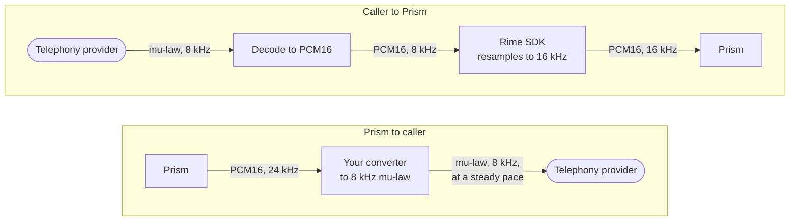
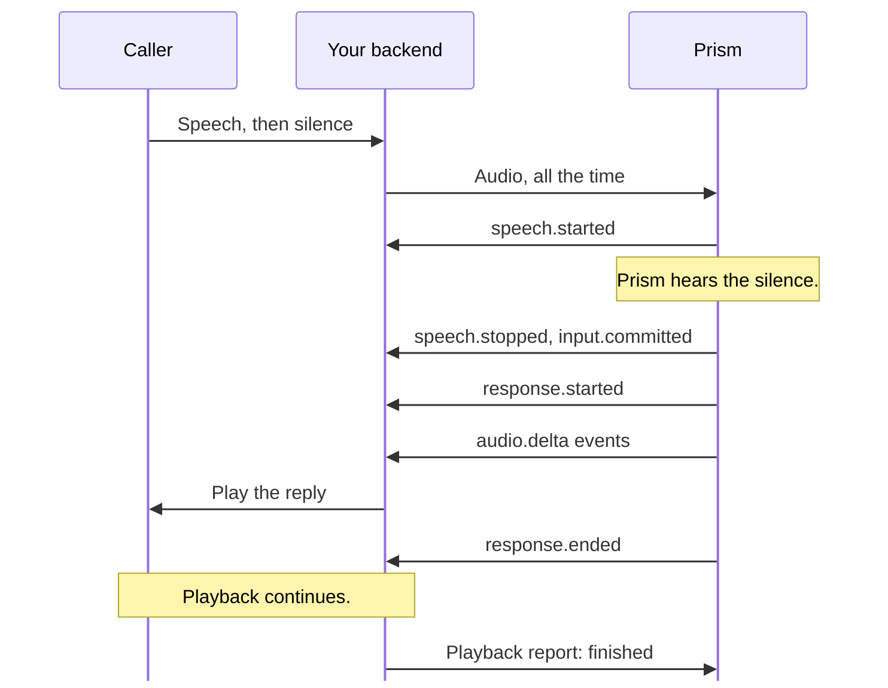
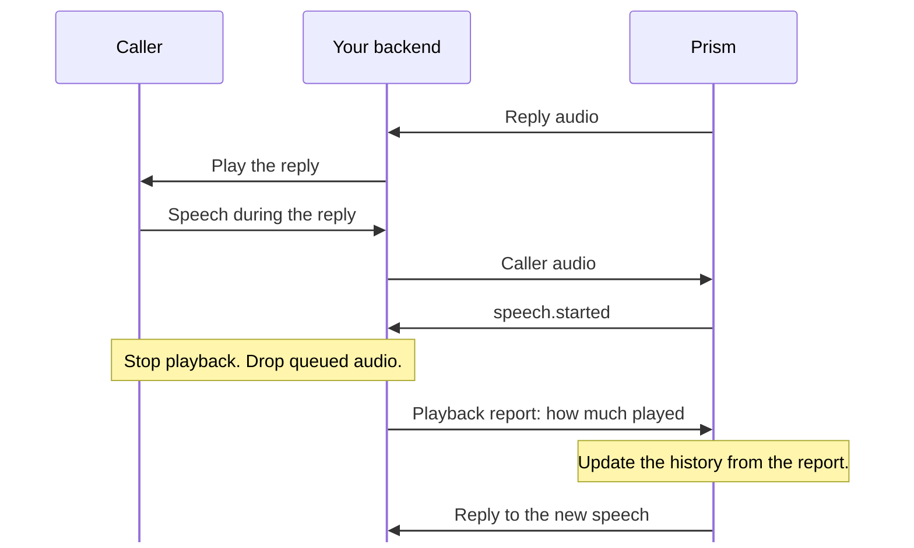

> ## Documentation Index
> Fetch the complete documentation index at: https://docs.rime.ai/llms.txt
> Use this file to discover all available pages before exploring further.

# Hold a live conversation

> Run a live call through Prism with the Python or Node.js SDK, and handle interruptions and playback reports.

Keep one Prism session open from pickup to hang-up. Your backend streams the caller's audio, plays each reply, and stops playback when the caller interrupts. Then it tells Prism how much of the reply the caller heard. Prism uses that report to decide what it remembers saying. Without it, Prism can build on words that the caller never heard.

These examples use the `session` from [Open one session per call](https://docs.rime.ai/docs/prism/sessions.md#open-one-session-per-call), and the Node.js examples also use its `background` helper. Without the SDK, see [Call the API directly](#call-the-api-directly). Complete programs and guides are in the rime-sdk repository:

* Complete examples: [`voice.py`](https://github.com/rimelabs/rime-sdk/blob/python-v0.1.0-alpha.25/python/examples/realtime/voice.py) and [`voice.ts`](https://github.com/rimelabs/rime-sdk/blob/typescript-v0.1.0-alpha.25/typescript/examples/realtime/voice.ts)
* SDK guides: [Python](https://github.com/rimelabs/rime-sdk/blob/python-v0.1.0-alpha.25/python/docs/realtime.md) and [Node.js](https://github.com/rimelabs/rime-sdk/blob/typescript-v0.1.0-alpha.25/typescript/docs/realtime.md)

## Stream audio for the whole call

Send audio continuously, from connect until the caller hangs up. Include silence, because Prism finds the end of a turn from the silence after it. Keep sending while Prism speaks, because Prism hears an interruption only in the audio that it receives.

Three audio problems are easy to miss:

* **Gaps in the audio:** a gap of several seconds makes turn detection worse for the rest of the call, and Prism reports no error. Send silence while the caller is muted, and check that your gateway does not drop it.
* **Idle conversations:** streaming silence does not keep a quiet conversation open, as the [idle timeout](https://docs.rime.ai/docs/prism/sessions.md#end-a-session) explains.
* **Echo:** use echo cancellation, or Prism can hear its own voice in the caller's microphone and interrupt itself.

### Audio formats

The SDK accepts headerless PCM16, little-endian, at 8, 16, 24, or 48 kHz, mono or stereo, and it [converts the input to 16 kHz mono](https://docs.rime.ai/api-reference/sdk/prism.md#send-audio). Remove WAV headers and decode compressed audio before you send it. Replies arrive as headerless 24 kHz mono PCM16, faster than real time. Queue the audio in your player, and track how much of each reply has played.

Use the reply text for captions and logs. It includes [every spoken word](https://docs.rime.ai/api-reference/prism/websocket.md#audio-formats), including acknowledgments and the phrases that Prism speaks while tools run. The caller's transcript keeps the spoken wording, numbers included, such as "five five five" for 555.

### Phone audio

Phone audio often arrives as 8 kHz G.711 mu-law, which neither the SDK nor Prism decodes. Decode each frame to PCM16 and set `sample_rate=8000` (`sampleRate: 8000` in Node.js), as the code below does, and the SDK resamples the audio to 16 kHz. Over the WebSocket API, [resample the audio](https://docs.rime.ai/api-reference/prism/websocket.md#audio-formats) yourself.

> [tab] Python
>
> ```python theme={null}
> from rimelabs_sdk.realtime import AudioChunk, PCMFormat
>
> def mulaw_to_pcm16(data: bytes) -> bytes:
>     # Decode G.711 mu-law bytes into PCM16 samples, little-endian.
>     pcm = bytearray()
>     for byte in data:
>         byte = ~byte & 0xFF
>         magnitude = (((byte & 0x0F) << 3) + 0x84) << ((byte >> 4) & 0x07)
>         sample = 0x84 - magnitude if byte & 0x80 else magnitude - 0x84
>         pcm += sample.to_bytes(2, "little", signed=True)
>     return bytes(pcm)
>
>
> async def stream_phone_audio(session, call_audio):
>     # call_audio yields the call's mu-law frames, such as 160 bytes every 20 ms.
>     async for frame in call_audio:
>         pcm = mulaw_to_pcm16(frame)
>         await session.send_audio(AudioChunk(data=pcm, format=PCMFormat(sample_rate=8000)))
>     await session.close()  # The call ended.
> ```

> [tab] Node.js
>
> ```javascript theme={null}
> function mulawToPcm16(data) {
>   // Decode G.711 mu-law bytes into PCM16 samples, little-endian.
>   const pcm = Buffer.alloc(data.length * 2);
>   data.forEach((value, i) => {
>     const byte = ~value & 0xff;
>     const magnitude = (((byte & 0x0f) << 3) + 0x84) << ((byte >> 4) & 0x07);
>     pcm.writeInt16LE(byte & 0x80 ? 0x84 - magnitude : magnitude - 0x84, i * 2);
>   });
>   return pcm;
> }
>
> async function streamPhoneAudio(session, callAudio) {
>   // callAudio yields the call's mu-law frames, such as 160 bytes every 20 ms.
>   for await (const frame of callAudio) {
>     await session.sendAudio({ data: mulawToPcm16(frame), format: { sampleRate: 8000 } });
>   }
>   await session.close(); // The call ended.
> }
> ```

The SDK does not convert reply audio, so convert and pace it for the call yourself:

* Resample each 24 kHz reply to 8 kHz, and encode it as mu-law for the call.
* Send the reply at a steady pace, or let your telephony provider buffer it, because uneven pacing makes the caller hear crackles.
* When the caller interrupts, also clear the reply audio that your telephony provider still holds.

Here's each conversion, on the way into the call and back out:



## How a turn ends

Prism detects turn boundaries automatically, and your application cannot end or commit a turn. The SDK emits `speech.started`, `speech.stopped`, and `input.committed` for each turn, followed by `response.started` for the reply. [Event types](https://docs.rime.ai/api-reference/sdk/prism.md#event-types) gives the Python class for each name, and [Rime SDK steps as WebSocket events](https://docs.rime.ai/api-reference/prism/websocket.md#rime-sdk-steps-as-websocket-events) gives the WebSocket event.



A turn ends when Prism detects that the caller has finished, or after [55 seconds of continuous speech](https://docs.rime.ai/docs/prism/errors.md#limits). A long pause can also end a turn. Further speech starts a new turn with its own `speech.started` event, and with interruption on, it interrupts the reply to the earlier turn. Interruption is on by default: `session.info.interrupt_on_speech` (`interruptOnSpeech` in Node.js) shows the applied setting, and [When interruption is off](#when-interruption-is-off) describes the other value.

To change how readily a turn ends, set `eagerness` and the end-of-turn timeout in the [session configuration](https://docs.rime.ai/docs/prism/sessions.md#configure-a-session). In `speech.stopped`, `end_reason` (`endReason` in Node.js) tells what ended the turn, such as `semantic` or `timeout`. Over the WebSocket API, the field is [`prism_end_reason`](https://docs.rime.ai/api-reference/prism/websocket#input_audio_buffer-speech_stopped).

## Stop playback when the caller talks over a reply

With interruption on, do these steps when `speech.started` arrives:

1. Stop playback at once.
2. Drop the reply audio that is still in the queue.
3. [Report](#what-prism-remembers-of-an-interrupted-reply) how much of the interrupted reply the caller heard.
4. Keep reading events, and Prism replies to the new speech.



This events loop plays each reply and does those steps. `player`, your audio output, needs three methods:

| Method | What it does |
| - | - |
| `play(output, data)` | Queues the audio of a message. |
| `stop()` | Stops playback at once and drops the queued audio. Returns the message that was playing, and how many milliseconds of it played, as a tuple `(output, played_ms)` in Python or `{ output, playedMs }` in Node.js. Returns `None` (`null` in Node.js) when nothing was playing. |
| `finished(response)` | Waits until the last sample of a reply has played. Returns false if playback stopped first. |

> [tab] Python
>
> ```python theme={null}
> import asyncio
>
> from rimelabs_sdk.realtime import (
>     AudioDelta,
>     PlaybackFinished,
>     PlaybackInterrupted,
>     ResponseEnded,
>     RimeRealtimeError,
>     SpeechStarted,
> )
>
>
> async def report_heard(session, output, played_ms):
>     try:
>         await session.report_playback(PlaybackInterrupted(output=output, audio_end_ms=played_ms))
>     except RimeRealtimeError as error:
>         if error.fault.code != "truncate_not_current":
>             raise  # Otherwise the reply is from an earlier stretch of playback.
>
>
> async def report_finished(session, player, response):
>     if await player.finished(response):  # False if playback stopped first
>         await session.report_playback(PlaybackFinished(response=response))
>
>
> async def play_replies(session, player):
>     async with asyncio.TaskGroup() as reports:
>         async for event in session.events:
>             payload = event.payload
>             if isinstance(payload, AudioDelta):
>                 player.play(payload.output, payload.audio.data)
>             elif isinstance(payload, SpeechStarted):
>                 heard = player.stop()  # Stop at once, and drop queued audio.
>                 if heard is not None:
>                     await report_heard(session, *heard)
>             elif isinstance(payload, ResponseEnded):
>                 reports.create_task(report_finished(session, player, payload.response))
> ```

> [tab] Node.js
>
> ```javascript theme={null}
> import { RimeRealtimeError } from "@rimelabs/sdk";
>
> async function reportHeard(session, output, playedMs) {
>   try {
>     await session.reportPlayback({ kind: "interrupted", output, audioEndMs: playedMs });
>   } catch (error) {
>     // truncate_not_current: the reply is from an earlier stretch of playback.
>     if (!(error instanceof RimeRealtimeError && error.fault.code === "truncate_not_current")) {
>       throw error;
>     }
>   }
> }
>
> async function reportFinished(session, player, response) {
>   if (await player.finished(response)) {
>     // false if playback stopped first
>     await session.reportPlayback({ kind: "finished", response });
>   }
> }
>
> async function playReplies(session, player) {
>   for await (const { payload } of session.events) {
>     switch (payload.kind) {
>       case "audio.delta":
>         player.play(payload.output, payload.audio.data);
>         break;
>       case "speech.started": {
>         const heard = player.stop(); // Stop at once, and drop queued audio.
>         if (heard) await reportHeard(session, heard.output, heard.playedMs);
>         break;
>       }
>       case "response.ended":
>         background(session, reportFinished(session, player, payload.response));
>         break;
>     }
>   }
> }
> ```

Measure `played_ms` (`playedMs`) on your player's clock, from the start of the message's audio, because audio arrives well before it plays. If generation is still running, Prism cancels it and sends `response.ended` with status `cancelled` and reason `turn_detected`. Usually the reply has already finished generating, so only your player can stop it.

`report_heard` ignores one refusal, `truncate_not_current`, which Prism sends for a report about a reply from an earlier stretch of playback. A new stretch starts with the first reply after Prism becomes [idle](https://docs.rime.ai/docs/prism/typed-turns.md#wait-until-prism-is-idle).

## Report when a reply finishes playing

A reply can play for seconds after `response.ended`, which marks the end of generation. Report completion when your player plays the reply's last sample, as `report_finished` does. The SDK then sends the [playback report](https://docs.rime.ai/api-reference/prism/websocket.md#prism-playback-drained), or nothing for a reply with no audio.

Reporting completion lets Prism use your player's timing instead of its own estimate:

* **When speech starts a new turn:** only after playback ends. Before that, speech interrupts the reply, or Prism holds it when interruption is off.
* **When Prism is idle:** only after playback ends. Prism takes typed turns and nudges only while it is idle.

Without a report, Prism assumes that playback ends 1.5 seconds after the reply's audio would have finished. If your application saves audio without playing it, report completion with `PlaybackFinished(response=response, played_ms=0)`, or `{ kind: "finished", response, playedMs: 0 }` in Node.js.

## What Prism remembers of an interrupted reply

Prism decides from your report what stays in the history. The reply text that Prism already sent still holds every word, including the words that the caller never heard.

| The reply | What Prism does with it |
| - | - |
| Was interrupted during generation | Removes it from the history, however much the caller heard. |
| Finished generation, then was interrupted during playback | Keeps characters in proportion to the audio played, rounded back to a word boundary. If no whole word played, keeps no text. |
| Played to the end | Keeps all its words. |
| Made tool calls | Keeps its words, whatever the caller heard. |
| Was queued behind the interrupted reply, in the same turn | Counts it as unheard, with no report of its own. |

For example, if the caller interrupts a fully generated 16-second reply after 4.8 seconds, Prism keeps 30% of its text. Send the report as soon as playback stops, because the next reply waits up to 300 ms for it. When the report shows that the caller missed 300 ms or more of the reply audio, Prism acknowledges the interruption. Its next spoken reply typically opens with "Okay," "Oh," or "Hmm," in the audio and the text. Without a report, Prism estimates from its own clock how much played, for the history only.

## Call the API directly

Without a Rime SDK for your language, follow the [WebSocket quickstart](https://docs.rime.ai/docs/prism/websocket-quickstart.md) and the WebSocket reference's [complete example](https://docs.rime.ai/api-reference/prism/websocket.md#complete-example).

## Handle edge cases

### When interruption is off

With `interrupt_on_speech=False` (`interruptOnSpeech: false`) at connect, what Prism does with speech during a reply depends on when it starts:

| When the speech starts | What Prism does |
| - | - |
| During reply generation | Prism drops the speech. It sends no events. |
| After generation, while audio is still playing | Prism holds the speech. When playback ends, Prism sends `speech.started`. |

If the caller has finished by the time playback ends, Prism sends `speech.started`, `speech.stopped`, and `input.committed`, then replies. Otherwise, Prism waits for the turn to end, and it drops held speech outside the [duration limits](https://docs.rime.ai/docs/prism/errors.md#limits). Keep interruption on unless every reply must play in full. With it off, held speech waits until the [playback report](#report-when-a-reply-finishes-playing) arrives or Prism estimates that playback has ended.

### Lower playback on the early speech hint

An early speech hint, `SpeechHint` in Python and `speech.hint` in Node.js, signals that the caller may have started to speak during a reply. It typically arrives 0.2 to 0.6 seconds before `speech.started`. Prism sends at most one hint for each stretch of speech, and only while interruption is on and a reply may still be playing. Lower the volume on the hint, then stop playback on `SpeechStarted` (`speech.started`), which confirms the interruption. That event may never arrive, so restore the volume on your own timer.

Add a branch for the hint to [`play_replies`](#stop-playback-when-the-caller-talks-over-a-reply), where `player.duck()` stands for a method that lowers your player's volume:

> [tab] Python
>
> ```python theme={null}
> from rimelabs_sdk.realtime import SpeechHint
>
> # In play_replies, add this check right after payload = event.payload:
> if isinstance(payload, SpeechHint):
>     player.duck()  # Lower the volume. Restore it on your own timer.
> ```

> [tab] Node.js
>
> ```javascript theme={null}
> // In playReplies, in the switch on payload.kind:
> case "speech.hint":
>   player.duck(); // Lower the volume. Restore it on your own timer.
>   break;
> ```

Over the WebSocket API, the hint is the [`prism.input_audio_buffer.speech_hint`](https://docs.rime.ai/api-reference/prism/websocket#prism-input_audio_buffer-speech_hint) event.

## Next

> [card] [Manage a session](https://docs.rime.ai/docs/prism/sessions.md)
>
> Open one session per call, change its settings during the call, and carry a conversation over to a new session.


This documentation is built and hosted on [Mintlify](https://mintlify.com), a developer documentation platform.