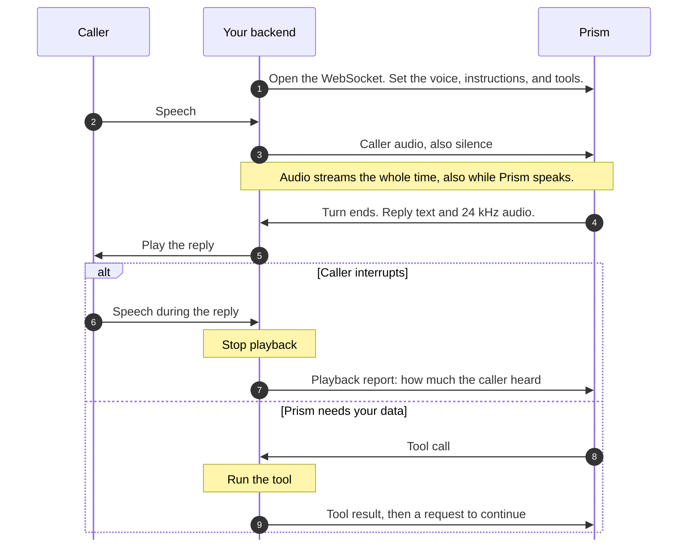
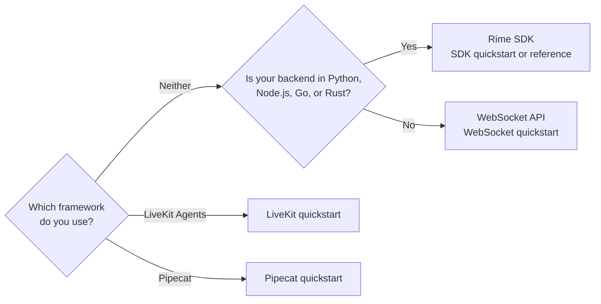

> ## Documentation Index
> Fetch the complete documentation index at: https://docs.rime.ai/llms.txt
> Use this file to discover all available pages before exploring further.

# Prism

> Learn what Prism handles in a call, how a conversation flows, how to connect it, and what you can control.

More and more calls are being automated using voice agents. A long pause, a robotic filler, or an agent that talks over them makes callers hang up or ask for a person. This is why builders are under pressure to make automated calls feel natural, and to get the job done during the call.

Prism is built exactly for that. It's a speech-to-speech model that hears the caller's audio, not just a transcript. It replies at a natural conversation pace. When it needs to look something up, it says something like "Let me check that" while your system works behind the scenes. This way there's no dead air.

Prism speaks in Rime's natural-sounding voices, which are what callers judge first. Additionally, enterprises can fine-tune Prism to their calls, which can significantly increase the rate of call completion. This ultimately maximizes business outcomes at large call volumes.

[Prism demo call: lost debit card](https://www.youtube-nocookie.com/embed/QrsjnYWJ7CM)

A caller reports a lost debit card. Prism finds the card, freezes it, reads the recent charges, and files a dispute.

> [card] [Build a Prism agent with the SDK](https://docs.rime.ai/docs/prism/quickstart.md)
>
> Talk to Prism through your microphone with your own instructions, from Python or Node.js.

## What Prism handles for you

A voice agent has to listen, know when the caller is done, answer, and stay out of the caller's way. Prism does all of this over one connection:

* **It hears the caller.** Prism works from the caller's audio, while a cascade's language model only reads a transcript.
* **It knows when to speak.** Prism decides when the caller has finished, and it doesn't talk over them.
* **It lets the caller cut in.** When the caller talks over a reply, Prism stops and answers what they just said.
* **It replaces three services.** One WebSocket does the work of speech-to-text, a language model, and text-to-speech, with your instructions and tools.
* **It sends text with every reply.** Each spoken reply comes with its text, so you can show captions and keep logs.

## Before you build

Here's what to know first:

| Area | What to know |
| - | - |
| Language | English only |
| Voices | `aurora`, `wawona`, `brando`, and `astra`. Without a voice, Prism uses `astra`. These are Prism's own voices, so Rime's text-to-speech voices do not work with Prism. |
| Audio | Headerless PCM16, mono, at 16 kHz in and 24 kHz out. Phone calls need a bridge, because Prism does not accept or send mu-law or G.711. |
| Response time | Prism starts speaking about 0.57 seconds after the caller finishes their turn, as measured on Artificial Analysis's speech-to-speech benchmark. |
| Connection | The Rime SDK or the WebSocket API, at `wss://prism.api.rime.ai/v1/realtime` in US East (us-east-2). Your backend sends your Rime API key when it connects. |

## What happens during a call

Your backend sits between the caller and Prism. It streams the caller's audio to Prism the whole time, plays Prism's replies, and runs your tools when Prism asks. Here's how one exchange flows:

The caller's audio can reach your backend through your own application or a framework:

* **A browser or mobile app:** the app streams the microphone to your backend. The [SDK quickstart](https://docs.rime.ai/docs/prism/quickstart.md) runs this setup on your computer.
* **A phone call:** your telephony provider streams the call to your backend. Convert the phone audio in both directions, as [Phone audio](https://docs.rime.ai/docs/prism/live-conversations.md#phone-audio) describes.
* **A LiveKit room:** the [LiveKit quickstart](https://docs.rime.ai/docs/prism/livekit.md) adds Prism to a LiveKit agent through the Rime plugin. [LiveKit telephony](https://docs.livekit.io/telephony/) connects phone calls to it.
* **A Pipecat pipeline:** the [Pipecat quickstart](https://docs.rime.ai/docs/prism/pipecat.md) connects a browser to Prism through Pipecat's SmallWebRTC transport.

A few things make the difference between a call that feels natural and one that doesn't:

1. Keep the API key on your backend.
2. Keep the audio flowing while Prism speaks. Prism listens to it to catch interruptions.
3. Send a playback report after an interruption. Prism uses it to decide [how much of the interrupted reply it remembers](https://docs.rime.ai/docs/prism/live-conversations.md#what-prism-remembers-of-an-interrupted-reply).
4. Skip the turn detector. You don't need voice activity detection either, and [How a turn ends](https://docs.rime.ai/docs/prism/live-conversations.md#how-a-turn-ends) explains why.

## Connect Prism to your app

Most teams start with the Rime SDK. If you use LiveKit Agents or Pipecat, follow that framework's quickstart. LiveKit offers a [Rime plugin](https://docs.rime.ai/docs/prism/livekit.md) that uses your Rime API key. For another backend language, use the WebSocket API directly:

| | Rime SDK (recommended) | WebSocket API |
| - | - | - |
| Backend language | Python, Node.js, Go, or Rust | Any language with a WebSocket client and JSON |
| Package | Python: `rimelabs-sdk`. Node.js: `@rimelabs/sdk`. Go: `github.com/rimelabs/rime-sdk/go`. Rust: `rimelabs-sdk`. Follow the [SDK installation instructions](https://docs.rime.ai/api-reference/sdk/overview.md#install) for your language. | None |
| Audio you send | Headerless PCM16 at 8, 16, 24, or 48 kHz, mono or stereo. The SDK converts it to 16 kHz mono. | Headerless PCM16 at 16 kHz, mono, base64-encoded |
| Start here | The [SDK quickstart](https://docs.rime.ai/docs/prism/quickstart.md) for Python and Node.js, or the [Prism SDK reference](https://docs.rime.ai/api-reference/sdk/prism.md) for Go and Rust | [WebSocket quickstart](https://docs.rime.ai/docs/prism/websocket-quickstart.md) |
| Then read | The [Prism SDK reference](https://docs.rime.ai/api-reference/sdk/prism.md) | The [WebSocket API reference](https://docs.rime.ai/api-reference/prism/websocket.md) |

## Make the agent yours

Prism comes with sensible defaults, so a short set of instructions is enough to start. As your agent grows, these are the controls you'll reach for:

| Control | What it does |
| - | - |
| Instructions | The system prompt. It tells Prism who the agent is, what it knows, and how it replies. Start from the [starter prompt](https://docs.rime.ai/docs/prism/prompting.md#write-your-first-prompt). |
| Voice | `aurora`, `wawona`, `brando`, or `astra`. [Choose a voice](https://docs.rime.ai/docs/prism/sessions.md#choose-a-voice) compares them. |
| [Tools](https://docs.rime.ai/docs/prism/tools.md) | Functions that your backend runs when Prism asks. Prism decides when to call them. |
| Turn timing | `eagerness` sets how readily Prism decides that the caller has finished. A timeout sets how much silence ends the turn. Set both when you connect, in the SDK or in [`session.update`](https://docs.rime.ai/api-reference/prism/websocket#session-update). |
| Interruption | On by default. [When interruption is off](https://docs.rime.ai/docs/prism/live-conversations.md#when-interruption-is-off) describes the other value. |
| [Nudges](https://docs.rime.ai/docs/prism/typed-turns.md) | Make Prism speak without new input, such as a greeting before the caller speaks or a check-in when the caller is quiet. |
| [Typed turns](https://docs.rime.ai/docs/prism/typed-turns.md) | Send the caller's words as text, when Prism is idle. |
| [Earlier messages](https://docs.rime.ai/docs/prism/sessions.md#start-from-an-earlier-conversation) | Add history without a new reply, such as a greeting that your application played. |

Prism doesn't offer these settings:

* Text-only replies
* Sampling settings, such as temperature
* A choice of language model
* A way for your application to end the caller's turn

If you need any of these, a pipeline with your own language model may fit better. [Build a voice agent](https://docs.rime.ai/docs/voice-agents.md) compares the two.

## Know the limits

Long calls and busy agents run into a few limits. Knowing them up front saves you a surprise in production:

* **Fixed settings:** the turn timing stays as you set it when the call starts. You can still change the instructions, voice, and tools during the call, with the SDK or the WebSocket API. [Configure a session](https://docs.rime.ai/docs/prism/sessions.md#configure-a-session) lists which settings can change.
* **Connection:** one conversation runs on each connection. A dropped connection does not resume on its own. To carry on, open a new session and add the earlier conversation, as [Start from an earlier conversation](https://docs.rime.ai/docs/prism/sessions.md#start-from-an-earlier-conversation) shows.
* **Turn length:** a caller's turn ends after 55 seconds of continuous speech.
* **Idle time:** the conversation closes after 5 minutes idle. Silence from your backend does not keep it open.
* **Context:** 65,536 tokens in all: instructions, tools, history, and tool results, plus 512 tokens kept for the reply. When a conversation outgrows it, Prism leaves the oldest turns out of each reply's prompt, so the conversation goes on.

The [errors page](https://docs.rime.ai/docs/prism/errors.md#limits) lists every limit.

## Moving from OpenAI Realtime

Prism uses the event names of the OpenAI Realtime beta interface. So an OpenAI Realtime client works with Prism after a few changes, and [Move from OpenAI Realtime](https://docs.rime.ai/docs/prism/migrate-from-openai.md) walks through them, including LiveKit agents.

This documentation is built and hosted on [Mintlify](https://mintlify.com), a developer documentation platform.