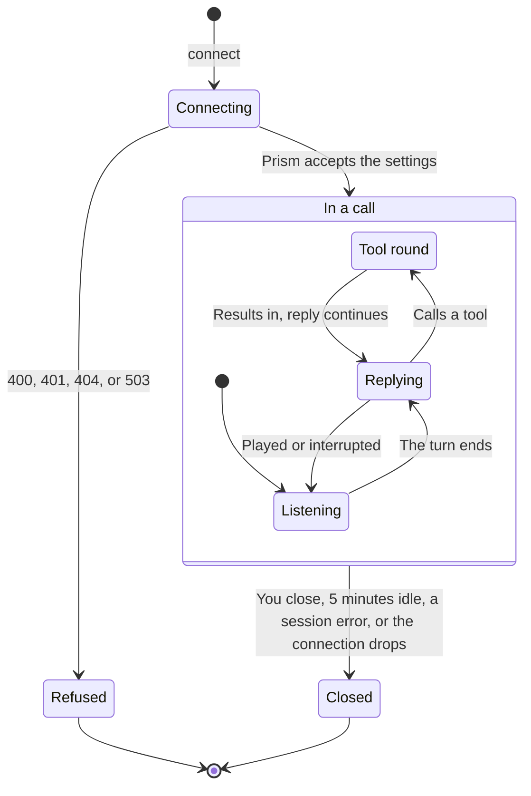

> ## Documentation Index
> Fetch the complete documentation index at: https://docs.rime.ai/llms.txt
> Use this file to discover all available pages before exploring further.

# Manage a session

> Open one Prism session per call, and set or change its settings, instructions, and history with the SDK or the WebSocket API. The guide also covers long calls, reply labels, and the end of a session.

A Prism session holds one conversation, from connect until the connection closes. Its settings, instructions, and history decide how each reply sounds and what each reply knows.

A session moves through these states, from connect to close:



The snippets use the Rime SDK in Python and Node.js, with these names:

* `client` is an open Rime client.
* `microphone` yields the PCM16 frames from your capture.
* `player` is your audio output.

## Open one session per call

Open a session when the call starts, and close it when the caller hangs up. This code holds one call. It sends the caller's audio on a separate task and reads Prism's events in `play_replies`, which [Live conversations](https://docs.rime.ai/docs/prism/live-conversations.md#stop-playback-when-the-caller-talks-over-a-reply) builds. When the caller hangs up, the capture loop closes the session, and the events loop ends.

> [tab] Python
>
> ```python theme={null}
> import asyncio
>
> from rimelabs_sdk.realtime import AudioChunk, PCMFormat
>
>
> async def stream_caller_audio(session, microphone):
>     try:
>         # Every frame from pickup to hang-up, including silence and speech over Prism.
>         async for frame in microphone:
>             # sample_rate is your capture's rate: 8000, 16000, 24000, or 48000.
>             await session.send_audio(AudioChunk(data=frame, format=PCMFormat(sample_rate=48000)))
>     finally:
>         await session.close()  # The caller hung up, or the capture failed.
>
>
> async def handle_call(client, microphone, player):
>     async with client.realtime.connect(
>         endpoint="wss://prism.api.rime.ai/v1/realtime",
>         voice="aurora",
>         instructions=(
>             "You answer the phone for Juniper Cafe, open 8 a.m. to 4 p.m. every day. "
>             "Answer in two or three sentences."
>         ),
>     ) as session:
>         capture = asyncio.create_task(stream_caller_audio(session, microphone))
>         try:
>             await play_replies(session, player)
>         finally:
>             capture.cancel()
> ```

> [tab] Node.js
>
> ```javascript theme={null}
> // Ends the call if work beside the events loop fails.
> function background(session, task) {
>   task.catch((error) => {
>     console.error(error);
>     void session.close();
>   });
> }
>
> async function streamCallerAudio(session, microphone) {
>   // Every frame from pickup to hang-up, including silence and speech over Prism.
>   for await (const frame of microphone) {
>     // sampleRate is your capture's rate: 8000, 16000, 24000, or 48000.
>     await session.sendAudio({ data: frame, format: { sampleRate: 48000 } });
>   }
>   await session.close(); // The caller hung up.
> }
>
> const session = await client.realtime.connect({
>   endpoint: "wss://prism.api.rime.ai/v1/realtime",
>   voice: "aurora",
>   instructions:
>     "You answer the phone for Juniper Cafe, open 8 a.m. to 4 p.m. every day. " +
>     "Answer in two or three sentences.",
> });
> try {
>   background(session, streamCallerAudio(session, microphone));
>   await playReplies(session, player);
> } finally {
>   await session.close();
> }
> ```

In Python, `stream_caller_audio` closes the session when the capture stops for any reason, so a failed microphone ends the call. In Node.js, `background` runs work beside the events loop, and it closes the session if that work fails. The snippets in [Live conversations](https://docs.rime.ai/docs/prism/live-conversations.md) and [Tools](https://docs.rime.ai/docs/prism/tools.md) also use it.

## Configure a session

Set the voice, instructions, tools, and turn settings when the session opens. The SDK sends them when you connect, and over the WebSocket API, the first [`session.update`](https://docs.rime.ai/api-reference/prism/websocket#session-update) sets them. During the call, `update` in the SDK, or a later `session.update`, can change most of them:

| Setting | SDK option | WebSocket field | In a later update |
| - | - | - | - |
| Voice | `voice` | `voice` | Changes |
| Instructions | `instructions` | `instructions` | Changes |
| Tools | `tools` | `tools` | Changes. The new list replaces the whole list. |
| Interruption | `interrupt_on_speech` | `turn_detection.interrupt_response` | Changes |
| Eagerness | `eagerness` in `turn_detection` | `turn_detection.eagerness` | Keeps the first value |
| End-of-turn timeout | `end_of_turn_timeout_ms` in `turn_detection` | `turn_detection.prism_end_of_turn_timeout_ms` | Keeps the first value |
| Long calls | `truncation`, `"auto"` by default | `truncation` | Changes |
| Reply labels | `response_metadata`, and `set_response_metadata` later | `prism_response_metadata` | Changes. The new labels replace all the labels. |

Node.js uses the same names in camelCase: `interruptOnSpeech`, `turnDetection`, `endOfTurnTimeoutMs`, `responseMetadata`, and `setResponseMetadata`. In Go and Rust, `Update` and `update` take the same settings. These SDK calls need Python 0.1.0a22, Node.js 0.1.0-alpha.22, Go v0.1.0-alpha.13, Rust 0.1.0-alpha.11, or later, as the [Prism SDK reference](https://docs.rime.ai/api-reference/sdk/prism.md) lists. The two turn settings work like this:

* **Eagerness:** how readily Prism decides that the caller has finished. `low` cuts in less and replies later, and `high` replies sooner and cuts in more. `medium` and `auto`, the default, use Prism's standard setting.
* **End-of-turn timeout:** the silence that ends the turn, even when Prism is not sure that the caller has finished. It runs from 1 to 10 seconds, and the default is 5 seconds.

Prism refuses a new eagerness or timeout with `session_setting_fixed`, and that update changes nothing, not even its other fields. [Session configuration](https://docs.rime.ai/api-reference/prism/websocket.md#session-configuration) in the WebSocket reference lists every field, its default, and its values.

### Choose a voice

Prism has four voices. Pick the one that suits your callers, and set it when you connect. Without a voice, Prism uses `astra`.

| Voice | How it sounds | A good fit for |
| - | - | - |
| `aurora` | Calm and lower-pitched, with a casual, natural delivery | Appointment scheduling, payment reminders, and fintech |
| `wawona` | Bright and higher-pitched, with a polished, measured delivery | Retail, health and wellness, and education |
| `brando` | Low and steady, with a confident, conversational tone | Sales and outbound calls, fintech, and healthcare |
| `astra` | Clear and youthful, with an energetic delivery | Travel and hospitality, consumer marketing, and entertainment |

## Write instructions for a phone call

Prism speaks every word that it writes, so the caller hears whatever format the reply takes. Start the instructions with rules for speech, and put your agent's role, task, and policy after them. Write them in plain sentences, because replies follow their style. [Write instructions that Prism follows](https://docs.rime.ai/docs/prism/prompting.md) gives a starter prompt with these rules, and shows how to improve it with test calls.

## Update instructions or history during a call

You can update Prism while a call runs. `add_message` (`addMessage` in Node.js) adds a line to the history. With `create_item` (`createItem` in Node.js) or over the WebSocket API, you can also add a `system` message, which is a note for the model, and `delete_item` (`deleteItem`) removes an item. [Read and edit the history](https://docs.rime.ai/api-reference/sdk/prism.md#read-and-edit-the-history) in the SDK reference shows both. `update` in the SDK, or a later `session.update`, can change the instructions, the voice, and the tools. Prism caches the start of the conversation between turns. After you change the instructions, the next reply builds that cache again, so its first audio comes a little later.

A change never interrupts the reply that is playing. That reply keeps the settings that it started with, and the next reply uses the change. To make a change count at once, follow these steps:

1. Make the change.
2. Cancel the reply that is playing, with `cancel` in the SDK or `response.cancel` over the WebSocket API.
3. Report what the caller heard, and report that playback stopped. [Stop playback when the caller talks over a reply](https://docs.rime.ai/docs/prism/live-conversations.md#stop-playback-when-the-caller-talks-over-a-reply) and [Report when a reply finishes playing](https://docs.rime.ai/docs/prism/live-conversations.md#report-when-a-reply-finishes-playing) show how.
4. Ask for a nudge, such as "Tell the caller about the change."

Prism takes a nudge only while it is idle. Until both reports arrive, Prism counts the cancelled reply as still playing.

## Start from an earlier conversation

A new session is a new conversation with no memory of the old one. A session also ends when its connection drops, and the SDK does not reconnect. So to go on with an earlier call, give the new session what the agent must remember. Add that history right after connect, before you stream the caller's audio, so that the first reply already sees it.

With the SDK, add each line with `add_message` (`addMessage` in Node.js), as [Typed turns and nudges](https://docs.rime.ai/docs/prism/typed-turns.md) shows. A `"user"` line is something that the caller said, and an `"assistant"` line is a reply that the caller heard:

> [tab] Python
>
> ```python theme={null}
> # saved_lines holds (role, text) pairs from the earlier call, oldest first.
> for role, text in saved_lines:
>     await session.add_message(role, text)  # role is "user" or "assistant"
> ```

> [tab] Node.js
>
> ```javascript theme={null}
> // savedLines holds [role, text] pairs from the earlier call, oldest first.
> for (const [role, text] of savedLines) {
>   await session.addMessage(role, text); // role is "user" or "assistant"
> }
> ```

To carry over notes and past tool calls too, add each item with `create_item` (`createItem` in Node.js), as [Start from an earlier call](https://docs.rime.ai/api-reference/sdk/prism.md#start-from-an-earlier-call) shows. Over the WebSocket API, send one [`conversation.item.create`](https://docs.rime.ai/api-reference/prism/websocket#conversation-item-create) for each item, after `session.updated`. Both take three kinds of items:

* **Past messages:** `user` and `assistant` messages, as with the SDK.
* **Notes:** a `system` message, such as "The caller called back after the line dropped." The model sees the note at its place in the conversation.
* **Past tool calls:** a `function_call` item, and then a `function_call_output` item with the same `call_id`. A past call never starts a tool round.

To resume after a disconnect, save the conversation while the call runs. `get_history` (`getHistory` in Node.js) in the SDK, or [`prism.conversation.get`](https://docs.rime.ai/api-reference/prism/websocket#prism-conversation-get) over the WebSocket API, lists every item in the order the next reply sees them, including turns that a long call leaves out of the prompt, and a new session accepts the listed items as they are. Keep each message within the [text limit](https://docs.rime.ai/docs/prism/errors.md#limits).

## What each reply sees

Each reply sees your instructions and tools, and the conversation so far, unless a long call [outgrows the context](#handle-long-calls):

* the caller's turns. Prism keeps each earlier turn as its transcript.
* Prism's earlier replies. After an interruption, your playback report keeps only what the caller heard.
* every tool call and its result
* every message that you added

When the conversation outgrows the context, Prism leaves out the oldest turns, as [Handle long calls](#handle-long-calls) explains. `get_history` (`getHistory` in Node.js) in the SDK, or [`prism.conversation.get`](https://docs.rime.ai/api-reference/prism/websocket#prism-conversation-get) over the WebSocket API, lists the conversation.

## Handle long calls

A call has no time limit. When a long call outgrows the [context](https://docs.rime.ai/docs/prism/errors.md#limits), Prism leaves the oldest turns out of each reply's prompt by default, and the call goes on. So put what the agent must always know in the instructions, because a `system` message that you add leaves the prompt with its turn. Over the WebSocket API, [`truncation`](https://docs.rime.ai/api-reference/prism/websocket#when-the-conversation-outgrows-the-context) sets this. `usage` in each `response.done` shows how many tokens the prompt uses, and `prism_truncation` says how many earlier items Prism left out. In Python and Node.js, read `ResponseEnded.usage` when Prism counted the tokens. Go exposes `ResponseEnded.Usage`, and Rust sends `ResponseUsageRecorded` as a separate event.

## Label replies for your logs

You can label every reply with your own values, such as your call ID, to match Prism's events to your records. With the SDK, pass `response_metadata` (`responseMetadata` in Node.js) when you connect, or call `set_response_metadata` (`setResponseMetadata`) during the call. Over the WebSocket API, set the labels in `prism_response_metadata`, and Prism copies them into the `metadata` of each reply's `response.created` and `response.done`:

```json theme={null}
{
  "type": "session.update",
  "event_id": "evt_setup",
  "session": {
    "voice": "aurora",
    "instructions": "You answer the phone for Juniper Cafe, open 8 a.m. to 4 p.m. every day. Answer in one or two short sentences.",
    "prism_response_metadata": { "call_id": "juniper-0001", "agent": "front-desk" }
  }
}
```

A typed turn, proactive reply, or tool continuation can also set labels for
one reply. This requires Python `0.1.0a25` or Node.js `0.1.0-alpha.25` or later.
Pass `metadata={"step": "3"}` to the Python SDK's `send_text`,
`request_reply`, or `continue_reply`. In Node.js, pass
`{ metadata: { step: "3" } }` in the method's options. Prism uses these labels
over session labels with the same key. Replies that Prism starts from caller
speech use session labels. See the [Prism SDK reference](https://docs.rime.ai/api-reference/sdk/prism.md#typed-turns-nudges-and-history)
for the other language APIs.

A label in the `metadata` of a `response.create` replaces the session label with the same name, for that reply only. This `metadata` came from the reply to a typed turn that set `agent` to `after-hours`. Prism adds its own fields, whose names start with `prism_`. `prism_drain_token` is the token for the reply's [playback receipt](https://docs.rime.ai/api-reference/prism/websocket.md#prism-playback-drained):

```json theme={null}
{
  "prism_cause": "user_text",
  "prism_input_item_id": "item_a081d2331bc296aa",
  "prism_drain_token": "drn_7ac2a9445f1a17e5",
  "agent": "after-hours",
  "call_id": "juniper-0001"
}
```

A later `session.update` with `prism_response_metadata` replaces all the labels, and `{}` clears them. Leave the field out to keep the current labels. Labels have [limits](https://docs.rime.ai/docs/prism/errors.md#limits) on their number and length.

## End a session

Close the session when the caller hangs up. With the SDK, leave the `async with` block, or call `await session.close()`. Over the WebSocket API, close the connection. A closed connection ends the conversation, and a new connection starts a new conversation.

Prism also closes a quiet conversation after 5 minutes, even while you send audio. It sends `session.idle_timeout` first, and then it closes the connection with code `1000` and reason `idle`. The time starts again with any other client event, with speech that Prism detects, or with a reply. So a nudge that checks on a quiet caller keeps the conversation open.

Most errors do not end the session. [Errors and limits](https://docs.rime.ai/docs/prism/errors.md) explains each error code and close code, and what to do about it.

## Next

> [card] [Typed turns and nudges](https://docs.rime.ai/docs/prism/typed-turns.md)
>
> Make Prism speak first, answer typed text, and add history without a reply.


This documentation is built and hosted on [Mintlify](https://mintlify.com), a developer documentation platform.