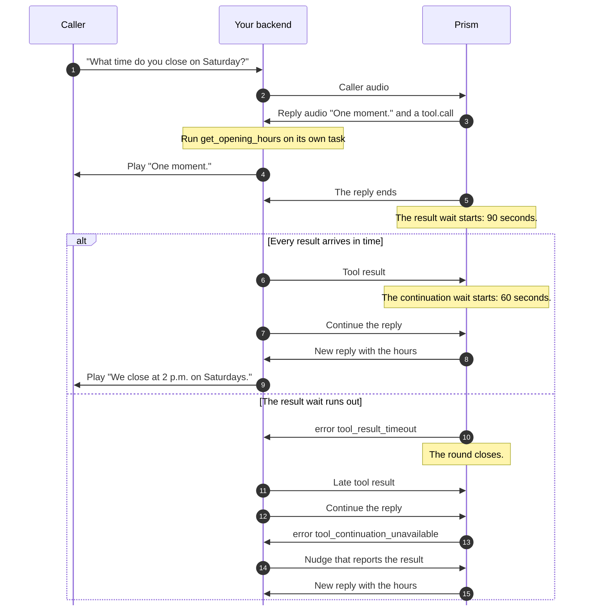

> ## Documentation Index
> Fetch the complete documentation index at: https://docs.rime.ai/llms.txt
> Use this file to discover all available pages before exploring further.

# Let Prism call your tools

> Learn how Prism tool calling works in Python or Node.js, including what the caller hears and failed calls. The guide also covers tools in LiveKit Agents, Pipecat, and direct WebSocket calls.

Tools let Prism reach into your systems during a call, to look something up, such as Saturday's opening hours, or to do something, such as booking a table. Prism decides when to call a tool, but it never runs your code, and it never picks the conversation back up by itself.

Your backend runs the tool, submits the result, and then asks Prism to continue. The calls from one reply, their results, and that continuation make one **tool round**. Forget the continuation, and the caller is left in silence.



The snippets build on [Manage a session](https://docs.rime.ai/docs/prism/sessions.md#open-one-session-per-call), which defines `stream_caller_audio` and, in Node.js, `background`. `get_opening_hours` (`getOpeningHours` in Node.js) stands for your own lookup. The rime-sdk repository has complete programs:

| Program | Python | Node.js |
| - | - | - |
| Reply to a typed question with a tool | [`tools.py`](https://github.com/rimelabs/rime-sdk/blob/python-v0.1.0-alpha.25/python/examples/realtime/tools.py) | [`tools.mjs`](https://github.com/rimelabs/rime-sdk/blob/typescript-v0.1.0-alpha.25/typescript/examples/realtime/tools.mjs) |
| Add a tool to a live conversation | [`voice_tools.py`](https://github.com/rimelabs/rime-sdk/blob/python-v0.1.0-alpha.25/python/examples/realtime/voice_tools.py) | [`voice-tools.ts`](https://github.com/rimelabs/rime-sdk/blob/typescript-v0.1.0-alpha.25/typescript/examples/realtime/voice-tools.ts) |

## Define tools when the session starts

List your tools when you connect. To change them during a call, send an update, as [Configure a session](https://docs.rime.ai/docs/prism/sessions.md#configure-a-session) shows. Each tool has a `name`, a `description` that tells Prism what the tool does, and `parameters`, a JSON Schema object for its arguments. A tool can also [set its phrase](#set-the-phrase-for-a-tool).

> [tab] Python
>
> ```python theme={null}
> import asyncio
>
> from rimelabs_sdk.realtime import ToolDefinition
>
> GET_OPENING_HOURS = ToolDefinition(
>     name="get_opening_hours",
>     description="Look up Juniper Cafe's opening hours for one day of the week.",
>     parameters={
>         "type": "object",
>         "properties": {"day": {"type": "string", "description": "A day of the week"}},
>         "required": ["day"],
>     },
> )
>
> async def handle_call(client, microphone):
>     async with client.realtime.connect(
>         endpoint="wss://prism.api.rime.ai/v1/realtime",
>         voice="aurora",
>         instructions=(
>             "You answer the phone for Juniper Cafe. "
>             "Call get_opening_hours before you answer a question about opening hours."
>         ),
>         tools=[GET_OPENING_HOURS],
>     ) as session:
>         capture = asyncio.create_task(stream_caller_audio(session, microphone))
>         try:
>             await run_tools(session)
>         finally:
>             capture.cancel()
> ```

> [tab] Node.js
>
> ```javascript theme={null}
> const getOpeningHoursTool = {
>   name: "get_opening_hours",
>   description: "Look up Juniper Cafe's opening hours for one day of the week.",
>   parameters: {
>     type: "object",
>     properties: { day: { type: "string", description: "A day of the week" } },
>     required: ["day"],
>   },
> };
>
> const session = await client.realtime.connect({
>   endpoint: "wss://prism.api.rime.ai/v1/realtime",
>   voice: "aurora",
>   instructions:
>     "You answer the phone for Juniper Cafe. " +
>     "Call get_opening_hours before you answer a question about opening hours.",
>   tools: [getOpeningHoursTool],
> });
> try {
>   background(session, streamCallerAudio(session, microphone));
>   await runTools(session);
> } finally {
>   await session.close();
> }
> ```

Prism decides when to call a tool. Your application cannot force a call, but it can stop calls to a tool by removing it with an [update](https://docs.rime.ai/docs/prism/sessions.md#configure-a-session). If the instructions only name a tool, Prism can answer from its own knowledge. So give the instructions a direct rule for each tool, such as "Call get\_opening\_hours before you answer a question about opening hours." [Write your first prompt](https://docs.rime.ai/docs/prism/prompting.md#write-your-first-prompt) in the prompting guide has more.

## Run each call and continue the reply

When Prism needs a tool, the reply sends a `tool.call` event for each call, and then the reply ends. The SDK parses the arguments from JSON. In the round in the diagram, Prism calls `get_opening_hours` with `{"day": "Saturday"}`, and the lookup returns 9 a.m. to 2 p.m. Your backend then follows these steps:

1. Run each call.
2. Submit the result of each call.
3. Wait until the reply that made the calls ends and every result is in.
4. Continue that reply.

Prism then uses the results in a new reply, whose `response.started` event has `cause` `"tools"`.

> [tab] Python
>
> ```python theme={null}
> import asyncio
> import json
>
> from rimelabs_sdk import RimeInputError
> from rimelabs_sdk.realtime import ResponseEnded, RimeRealtimeError, ToolCall
>
>
> async def run_tool(session, call):
>     day = call.arguments.get("day")
>     try:
>         if call.name == "get_opening_hours" and isinstance(day, str):
>             result = await get_opening_hours(day)  # Your own lookup
>         else:
>             result = {"error": f"Can't run {call.name} with these arguments"}
>     except Exception:  # A call whose lookup fails still gets a result.
>         result = {"error": f"{call.name} failed"}
>     await session.submit_tool_result(call.call, json.dumps(result))
>
>
> async def finish_round(session, response, runs):
>     await asyncio.gather(*runs)  # Every call has its result.
>     try:
>         await session.continue_reply(response)
>     except RimeInputError:
>         pass  # The caller spoke first, and Prism is answering them instead.
>     except RimeRealtimeError as error:
>         if error.fault.code not in ("tool_continuation_unavailable", "response_superseded"):
>             raise  # Otherwise the caller spoke first, or Prism had closed the round.
>
>
> async def run_tools(session):
>     rounds = {}  # The tool runs of each reply that made calls
>     async with asyncio.TaskGroup() as tasks:
>         async for event in session.events:
>             payload = event.payload
>             if isinstance(payload, ToolCall):
>                 run = tasks.create_task(run_tool(session, payload))
>                 rounds.setdefault(payload.call.response_id, []).append(run)
>             elif isinstance(payload, ResponseEnded):
>                 runs = rounds.pop(payload.response.response_id, None)
>                 if runs and payload.status == "completed":
>                     tasks.create_task(finish_round(session, payload.response, runs))
> ```

> [tab] Node.js
>
> ```javascript theme={null}
> import { RimeInputError, RimeRealtimeError } from "@rimelabs/sdk";
>
> async function runTool(session, call) {
>   const day = call.arguments.day;
>   let result;
>   try {
>     result =
>       call.name === "get_opening_hours" && typeof day === "string"
>         ? await getOpeningHours(day) // Your own lookup
>         : { error: `Can't run ${call.name} with these arguments` };
>   } catch {
>     // A call whose lookup fails still gets a result.
>     result = { error: `${call.name} failed` };
>   }
>   await session.submitToolResult(call.call, JSON.stringify(result));
> }
>
> async function finishRound(session, response, runs) {
>   await Promise.all(runs); // Every call has its result.
>   try {
>     await session.continueReply(response);
>   } catch (error) {
>     // The caller spoke first, or Prism had closed the round, as after tool_result_timeout.
>     const over =
>       error instanceof RimeRealtimeError &&
>       ["tool_continuation_unavailable", "response_superseded"].includes(error.fault.code);
>     if (!(error instanceof RimeInputError) && !over) throw error;
>   }
> }
>
> async function runTools(session) {
>   const rounds = new Map(); // The tool runs of each reply that made calls
>   for await (const { payload } of session.events) {
>     if (payload.kind === "tool.call") {
>       const run = runTool(session, payload);
>       background(session, run);
>       rounds.set(payload.call.responseId, [...(rounds.get(payload.call.responseId) ?? []), run]);
>     } else if (payload.kind === "response.ended") {
>       const runs = rounds.get(payload.response.responseId);
>       rounds.delete(payload.response.responseId);
>       if (runs && payload.status === "completed") {
>         background(session, finishRound(session, payload.response, runs));
>       }
>     }
>   }
> }
> ```

`run_tools` (`runTools` in Node.js) handles only tool events. In a live call, add its two branches to `play_replies`, the events loop in [Live conversations](https://docs.rime.ai/docs/prism/live-conversations.md#stop-playback-when-the-caller-talks-over-a-reply) that plays replies. Run each tool on its own task, and do not await a tool inside the events loop. While the loop waits, it reads no events, and the SDK ends the session when 256 events wait unread.

When the round cannot continue, for example because the caller spoke first or a wait ran out, `continue_reply` (`continueReply`) raises an error. `finish_round` drops the round, and the session stays open. [Tool calls](https://docs.rime.ai/api-reference/sdk/prism.md#tool-calls) in the SDK reference lists each error.

Handle three more things in your tool code:

* **Results:** `submit_tool_result` (`submitToolResult`) records a result, but it does not start a reply. The result is a string, so encode a structured result as JSON. Each result stays in the conversation and takes up room in the [context](https://docs.rime.ai/docs/prism/errors.md#limits) of later replies, so return only what Prism needs.
* **Arguments:** check the arguments before you use them. The model writes the arguments, and the schema does not guarantee them.
* **Unhandled exceptions:** an exception that escapes `run_tool` or `finish_round` ends the call. In Python, it stops `run_tools`, and the session closes. In Node.js, `background` closes the session.

## What the caller hears while a tool runs

What the caller hears depends on the kind of turn:

| Turn | What the caller hears while the tool runs |
| - | - |
| A spoken turn, a typed turn, or a nudge, when the reply has no words of its own before the call | A short phrase, such as "One moment." or "Just a second." The wording changes from call to call, unless the tool [sets its own phrase](#set-the-phrase-for-a-tool). |
| A reply to tool results: a continuation, or a nudge that reports a tool result | No phrase. A reply that only makes tool calls has no audio, so there is nothing to play or report. The caller next hears the reply after it. |

The reply text holds the phrase and any other words next to the calls, such as "Let me try that again." So captions from `text.delta` events and logs from `text.done` show the phrase too. A reply to tool results that only makes tool calls has empty text. When the lookup is slow, the caller hears silence after the phrase until you continue, unless you [speak while it runs](https://docs.rime.ai/docs/prism/long-running-tasks.md#speak-while-a-slow-tool-runs).

[Prism demo call: a tool lookup](https://www.youtube-nocookie.com/embed/QrsjnYWJ7CM?start=11\&end=35)

From 0:11 to 0:35 of the Prism demo call. Prism says "One moment." while it looks up the card, and then reads the card that the lookup found. Then it asks before it freezes the card.

### Set the phrase for a tool

A tool's `prism_filler` setting decides the phrase that the caller hears while the tool runs, on every turn except a reply to tool results. The setting needs `rimelabs-sdk` `0.1.0a20` or `@rimelabs/sdk` `0.1.0-alpha.20`.

| `prism_filler` | What the caller hears |
| - | - |
| Not set, or `auto` | A short phrase that Prism writes from the tool's description, such as "One moment." Add `instructions` to say what it should cover, such as "Say you're checking today's hours." |
| `text`, with your line | Your line, word for word, up to 500 characters. |
| `none` | No phrase. Use it when speech would get in the way, such as when the tool presses keys on a phone menu. |

When a reply calls several tools, the first call's tool decides the phrase.

> [tab] Python
>
> ```python theme={null}
> from rimelabs_sdk.realtime import PrismFiller, ToolDefinition
>
> GET_OPENING_HOURS = ToolDefinition(
>     name="get_opening_hours",
>     description="Look up Juniper Cafe's opening hours for one day of the week.",
>     parameters={
>         "type": "object",
>         "properties": {"day": {"type": "string", "description": "A day of the week"}},
>         "required": ["day"],
>     },
>     prism_filler=PrismFiller(type="text", text="One moment while I check our hours."),
> )
> ```

> [tab] Node.js
>
> ```javascript theme={null}
> const getOpeningHoursTool = {
>   name: "get_opening_hours",
>   description: "Look up Juniper Cafe's opening hours for one day of the week.",
>   parameters: {
>     type: "object",
>     properties: { day: { type: "string", description: "A day of the week" } },
>     required: ["day"],
>   },
>   prismFiller: { type: "text", text: "One moment while I check our hours." },
> };
> ```

For no phrase, set `PrismFiller(type="none")` in Python or `{ type: "none" }` in Node.js. The SDK refuses a blank line or a line over 500 characters with `RimeInputError`.

## When a tool fails

Return the failure as the tool result, and continue the reply as usual. Prism then tells the caller. For example, when `get_opening_hours` raises an exception, `run_tool` returns `{"error": "get_opening_hours failed"}`. Prism says that it cannot get Saturday's opening hours, and suggests that the caller try again later or contact the cafe.

Always submit a result, even for a failed call. Without a result, the caller hears nothing after the phrase until the [result wait](https://docs.rime.ai/docs/prism/long-running-tasks.md#timeouts-and-late-results) runs out. Also make each tool safe to run once, because Prism does not deduplicate requests. A call with an unknown outcome, such as a timed-out lookup, may still complete, so never run it again automatically. [Tool calls](https://docs.rime.ai/docs/prism/errors.md#tool-calls) in Errors and limits lists the error codes of a tool round and what to do about each one.

## Tools in LiveKit Agents

In a [LiveKit voice agent with Prism](https://docs.rime.ai/docs/prism/livekit.md), each `@function_tool` method on your `Agent` becomes a Prism tool. LiveKit runs the round for you.

## Tools in Pipecat

Pass your functions in the Rime service's `Settings.tools`. Pipecat executes requested calls, and `await params.result_callback(result)` returns each result to Prism. The [Pipecat quickstart](https://docs.rime.ai/docs/prism/pipecat.md) defines a complete tool and connects it to a browser.

## Call the API directly

For the WebSocket API, [Tools](https://docs.rime.ai/api-reference/prism/websocket.md#tools) in the WebSocket reference maps each step of a tool round to its event. Its [complete example](https://docs.rime.ai/api-reference/prism/websocket.md#complete-example) runs one round.

## Next

> [card] [Long-running tasks](https://docs.rime.ai/docs/prism/long-running-tasks.md)
>
> Speak while a slow tool runs, and hand long tasks to your own agent.

> [card] [Typed turns and nudges](https://docs.rime.ai/docs/prism/typed-turns.md)
>
> Make Prism speak first, or report a late tool result with a nudge.


This documentation is built and hosted on [Mintlify](https://mintlify.com), a developer documentation platform.