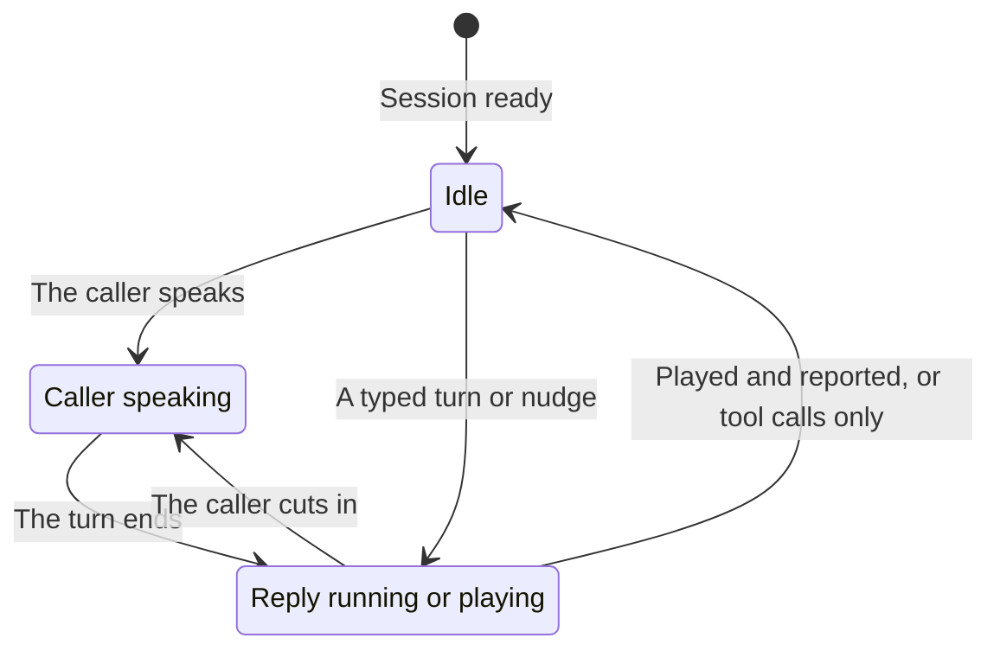

> ## Documentation Index
> Fetch the complete documentation index at: https://docs.rime.ai/llms.txt
> Use this file to discover all available pages before exploring further.

# Typed turns and nudges

> Send typed text to Prism, make Prism speak first with a nudge, and add conversation history, from Python or Node.js.

Besides the caller's voice, your application can put words into a Prism conversation in three ways:

* A **typed turn** stands in for speech. Prism treats the text as if the caller had said it and replies, so a caller can type a question instead of speaking it.
* A **nudge** makes Prism speak when nobody has said anything, such as a greeting at pickup, a check-in after a long silence, or an update when a slow tool finally returns. You give it a one-off instruction for that reply.
* **History** adds a line to the conversation without a reply, such as a greeting that your application already played. Prism builds its later replies on it.

The snippets build on [Live conversations](https://docs.rime.ai/docs/prism/live-conversations.md). They use the `session` that [Open one session per call](https://docs.rime.ai/docs/prism/sessions.md#open-one-session-per-call) opens, and the events loop from Live conversations. That loop matters here: its [playback reports](https://docs.rime.ai/docs/prism/live-conversations.md#report-when-a-reply-finishes-playing) tell Prism when a reply has finished playing, and typed turns and nudges wait for them. Over the WebSocket API, send typed turns and nudges as [`response.create`](https://docs.rime.ai/api-reference/prism/websocket#response-create) after [`prism.typed_input.ready`](https://docs.rime.ai/api-reference/prism/websocket#prism-typed_input-ready), and history as [`conversation.item.create`](https://docs.rime.ai/api-reference/prism/websocket#conversation-item-create).

## Send text, nudges, and history

The SDK has one method for each kind of request:

| Python | Node.js | What Prism does |
| - | - | - |
| `send_text(text)` | `sendText(text)` | Replies to the text as the caller's turn |
| `request_reply(instruction=...)` | `requestReply({ instruction })` | Speaks without new input. The instruction shapes this reply only, and the session's instructions do not change. |
| `add_message(role, text)` | `addMessage(role, text)` | Adds a `"user"` or `"assistant"` line to the history, without a reply |

This sequence greets the caller, records a line that your application played, answers a typed question, and checks in. Run it on its own task beside the events loop, because the methods wait for playback that the loop reports:

> [tab] Python
>
> ```python theme={null}
> # Speak first, before the caller says anything.
> await session.request_reply(instruction="Greet the caller and ask how you can help.")
>
> # Add a line your application played itself, without asking for a reply.
> await session.add_message("assistant", "Today's special is a cardamom bun.")
>
> # Answer words the caller typed, as their turn.
> await session.send_text("What's today's special?")
>
> # Later, when your own silence timer fires, check in.
> await session.request_reply(instruction="Ask whether the caller is still there.")
> ```

> [tab] Node.js
>
> ```javascript theme={null}
> // Speak first, before the caller says anything.
> await session.requestReply({ instruction: "Greet the caller and ask how you can help." });
>
> // Add a line your application played itself, without asking for a reply.
> await session.addMessage("assistant", "Today's special is a cardamom bun.");
>
> // Answer words the caller typed, as their turn.
> await session.sendText("What's today's special?");
>
> // Later, when your own silence timer fires, check in.
> await session.requestReply({ instruction: "Ask whether the caller is still there." });
> ```

## Wait until Prism is idle

Prism does not start a typed turn or a nudge while anything else is happening. It is idle only when all three of these are true:

* The caller is not speaking.
* No reply is running or waiting.
* The last reply has finished playing, or it made tool calls.

Here's how Prism moves in and out of the idle state:



So `send_text` and `request_reply` do not fire at once. They wait until Prism is idle, and each returns when its reply starts. Two things can cut that short:

* **The wait runs out:** each method waits for at most `ready_s` (`readyS` in Node.js), which is 30 seconds by default, and then raises `RealtimeAdmissionTimeout`. The session stays open.
* **The caller speaks first:** live speech wins. Prism refuses the request, and the method raises `RimeRealtimeError` with one of the codes in [Requested replies](https://docs.rime.ai/docs/prism/errors.md#requested-replies).

The text for `send_text`, `request_reply`, and `add_message` must not be blank, and it is at most 4,000 code points, as [the limits](https://docs.rime.ai/docs/prism/errors.md#limits) list. Other text raises `RimeInputError` before the SDK sends anything.

In the sequence above, the greeting starts right away, and `add_message` returns at once, because it asks for no reply. `send_text` then waits until the greeting has played and its playback report has gone out, and Prism answers "Today's special is a cardamom bun." from the line that you added. The check-in waits until that answer has played.

## Next

> [card] [Tools](https://docs.rime.ai/docs/prism/tools.md)
>
> Let Prism get data or take actions through functions that your backend runs. Then continue the reply with the result.


This documentation is built and hosted on [Mintlify](https://mintlify.com), a developer documentation platform.